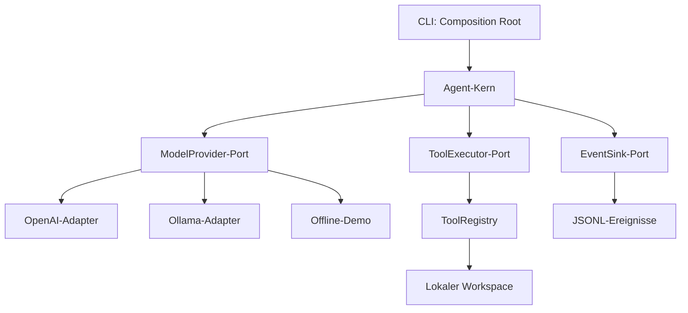

# Generischer KI-Coding-Agent

Ein Python-Grundgerüst mit einem anbieterunabhängigen Agent-Kern. Modelle und
Werkzeuge werden über Schnittstellen eingebunden. Keine ChatGPT-Mitgliedschaft
nötig. Python 3.11 oder neuer ist erforderlich.

## Schnellstart ohne API oder Modell

```bash
python -m venv .venv
source .venv/bin/activate
pip install -e .
coding-agent "Projekt untersuchen" --provider demo --workspace . --verbose
```

Die Demo führt deterministisch einen Verzeichnisaufruf aus. Sie ist kein KI-Modell.
Unter Windows die Umgebung mit `.venv\Scripts\Activate.ps1` aktivieren.

## Lokales Modell mit Ollama

Ollama separat installieren, den Server starten und ein Modell mit Unterstützung
für Tool Calling herunterladen. Den tatsächlichen installierten Modellnamen angeben:

```bash
coding-agent "Erkläre den Projektaufbau" --provider ollama --model MODELLNAME --workspace .
```

Mit `--base-url http://localhost:11434` lässt sich die Serveradresse ändern.
Modellqualität und Werkzeugunterstützung hängen vom ausgewählten Modell ab.

## OpenAI (optional)

```bash
pip install -e '.[openai]'
read -rsp 'OpenAI API key: ' OPENAI_API_KEY
export OPENAI_API_KEY
coding-agent "Erkläre den Projektaufbau" --provider openai --model gpt-4.1
```

API-Nutzung wird separat abgerechnet. Der Kern benötigt weder das OpenAI-SDK noch
Zugangsdaten. Standardanbieter ist für bestehende Aufrufe weiterhin `openai`.
`AGENT_PROVIDER` und `AGENT_MODEL` setzen Defaults; `OPENAI_MODEL` bleibt als
Fallback für den OpenAI-Adapter unterstützt.

## Architektur: Ports and Adapters

Die [ausführliche Architekturdokumentation](docs/architecture.md) erläutert die
Komponenten, Design Patterns, Datenflüsse und Erweiterungspunkte mit Diagrammen.



- `agent/core/types.py`: eigene Nachrichten, Aufrufe, Ergebnisse und Werkzeugschemas.
- `agent/core/ports.py`: Python-Protokolle für Modelle, Werkzeuge und Ereignisse.
- `agent/core/engine.py`: Beobachten → Modellentscheidung → Werkzeug → Ergebnis.
- `agent/adapters/models.py`: Übersetzung zwischen internen Typen und Anbieterformaten.
- `agent/adapters/tools.py`: Werkzeugregistrierung, String-Argumentvalidierung und Fehlerergebnisse.
- `agent/files.py`: lokaler Workspace mit bestehenden Pfadbeschränkungen.
- `agent/adapters/events.py`: JSONL-Metadaten ohne Prompts und Dateiinhalte.
- `agent/cli.py`: wählt Adapter aus und verbindet sie mit dem Kern.

Abhängigkeiten zeigen zum Kern. Der Kern kennt weder SDKs noch CLI, HTTP oder
Dateisystem. Für einen neuen Anbieter `ModelProvider.generate(messages, tools)`
implementieren und in der CLI auswählen lassen. Ein Provider muss interne
Assistant-Nachrichten liefern und seine anbieterspezifischen Tool-Formate selbst
übersetzen. Zusätzliche Werkzeuge werden mit `ToolSpec` und Handler registriert;
bei anderen Argumenttypen als Strings muss die Validierung erweitert werden.

## Grenzen des Grundgerüsts

Standardmäßig sind nur `list_files` und `read_file` verfügbar. `--allow-write`
schaltet `write_file` hinzu; dabei können Dateien vollständig ersetzt werden.
Patch-Anwendung, Testprozesse, Git-Werkzeuge, Container-Isolation, Anthropic-Adapter
und automatische Kontextauswahl sind noch nicht implementiert.

`--max-steps 15` begrenzt Modellaufrufe. `--max-context-chars 200000` begrenzt den
ungefähren Zeichenumfang vor dem nächsten Aufruf, keine Tokens oder Kosten.
Bei Überschreitung wird abgebrochen; Historie wird nicht stillschweigend gekürzt.
Bereits geschriebene Änderungen bleiben bei Abbruch oder API-Fehler bestehen.
Jeder neue Lauf beginnt mit eigenem Kontext. `--verbose` schreibt Ereignisse
auf stderr; diese können mit `2>events.jsonl` gespeichert werden.

Aufgelöste Pfade müssen im Workspace liegen. `.git`, `.ssh`, `.aws` und Namen
beginnend mit `.env` sind gesperrt. Das ist keine Betriebssystem-Sandbox und schützt
nicht gegen gleichzeitig manipulierte Symlinks. Eine isolierte Arbeitskopie ohne
Geheimnisse verwenden. Gelesene Inhalte werden an den gewählten Modellserver
übermittelt. Änderungen mit `git diff` prüfen. Der Agent kann keine Tests ausführen
und darf deshalb keine erfolgreiche Testausführung behaupten.

## Entwicklung und Prüfungen

```bash
python -m unittest discover -s tests -v
```

Tests benötigen weder SDKs noch API-Schlüssel. Sie prüfen Pfadgrenzen,
Werkzeugvalidierung, den Agent-Zyklus, Limits, Fehlerweitergabe und Übersetzungen
beider Modelladapter mit simulierten Antworten. Live-Tests gegen Modellserver
müssen separat erfolgen.
