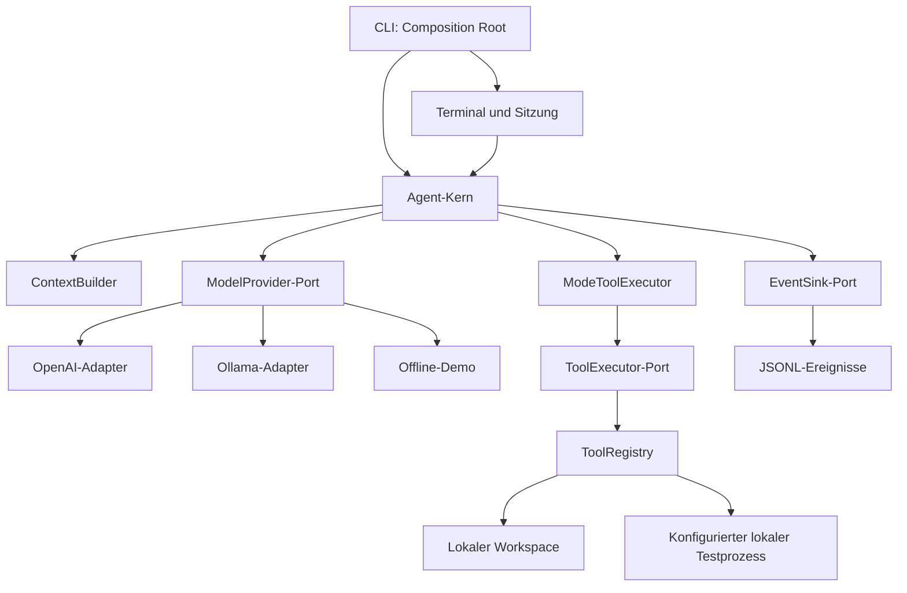

# Generischer KI-Coding-Agent

Ein Python-Grundgerüst mit einem anbieterunabhängigen Agent-Kern. Modelle und
Werkzeuge werden über Schnittstellen eingebunden. Keine ChatGPT-Mitgliedschaft
nötig. Python 3.11 oder neuer ist erforderlich.

## VS Code-Erweiterung

Die [VS Code-Erweiterung](vscode/README.md) ergänzt eine eigene Seitenleiste,
Planung, einzeln bestätigte Änderungen mit Undo, konfigurierte Prüfungen,
optionale Inline-Vorschläge und vorhandene Editor-Diagnosen. Sie verwendet einen
explizit eingerichteten Python-Backend-Prozess auf dem Workspace-Host und läuft
auch in der Architektur von SSH, WSL und Dev Containers. Die tatsächlichen Remote-
Umgebungen benötigen eigene Smoke-Tests. Installation über das erzeugte VSIX;
keine Marketplace-Veröffentlichung. Architektur: [Editor-Integration](docs/vscode-extension.md).

## Schnellstart ohne API oder Modell

```bash
python -m venv .venv
source .venv/bin/activate
pip install -e .
coding-agent "Projekt untersuchen" --provider demo --workspace . --verbose
```

Die Demo führt deterministisch einen Verzeichnisaufruf aus. Sie ist kein KI-Modell.
Unter Windows die Umgebung mit `.venv\Scripts\Activate.ps1` aktivieren.

## Interaktives Terminal und Planungsmodus

```bash
pip install -e '.[terminal]'
coding-agent --provider demo --allow-write
```

Ohne Aufgabe startet eine gemeinsame Sitzung im Modus `plan`. Tab ergänzt
Slash-Befehle: `/plan`, `/implement`, `/instructions`, `/help`, `/new`, `/exit`.
Zusätzlich stehen `/status`, `/attach "Pfad" [Start:Ende]`, `/attachments` und
`/detach <ID|all>` bereit. Enter sendet; Alt+Enter ergänzt eine neue Zeile.
Dateianhänge werden beim Senden frisch gelesen und nach erfolgreicher Arbeit
aus der Warteschlange entfernt. Fortschritt und Zusammenfassungen zeigen
Prüfergebnisse, Änderungen und tatsächlich gemeldete Tokenwerte getrennt.
`--no-progress` blendet Fortschrittszeilen aus; `--verbose` bleibt JSONL auf stderr.
`/plan <Aufgabe>` plant lesend. `/implement` akzeptiert den letzten erfolgreichen
Plan, wechselt den Modus und wartet auf die nächste Aufgabe. Schreibzugriff gibt
es nur in `implement` mit `--allow-write`; `plan` bleibt immer lesend.
Die Demo ist kein echtes Planungsmodell; für reale Aufgaben Ollama oder OpenAI wählen.
Optional verlangt `--allow-write --review-edits` für jede Dateiänderung eine
Bestätigung des vollständigen Diffs im Terminal. Ohne `--review-edits` bleiben
direkte Änderungen aktiviert, sofern Schreibrechte bestehen. Review benötigt
ein echtes Terminal und lässt sich nicht mit `--lint-fix-command` kombinieren.

Die Root-Datei `AGENTS.md` wird automatisch geladen und im Kontext behalten.
`/instructions` zeigt den geladenen Stand, `/new` leert die Sitzung und lädt neu.
Geschichte und Pläne bleiben ausschließlich im Arbeitsspeicher. Einzellauf-Aufrufe
mit Aufgabe bleiben erhalten und verwenden standardmäßig `implement`;
`--mode plan|implement` überschreibt den Standard.

Die [Terminal-Dokumentation](docs/interactive.md) beschreibt Befehle, Berechtigungen,
Planübergabe, Fehlerbehandlung und Architektur mit Diagrammen.

## Provider verbinden und Tokenstatistik

```bash
pip install -e '.[terminal,connections,openai]'
coding-agent --connect
coding-agent --profile work
coding-agent --stats today
coding-agent --stats custom --from 2026-10-01 --to 2026-10-21
```

Im Terminal stehen `/connect`, `/connect NAME`, `/providers` und `/stats` mit
Tab-Vervollständigung bereit. Profile enthalten Referenzen auf den OS-Schlüsselbund;
API-Schlüssel werden dort gespeichert. Ollama benötigt keinen Schlüsselbund.
Ein erfolgreicher Profilwechsel beginnt eine neue Unterhaltung im Planungsmodus.
`/stats` zeigt die aktuelle Unterhaltung; `today`, `week`, `month`, `7d`, `30d`,
`all` und eigene Datumsbereiche zeigen historische Werte mit Filtern für Anbieter,
Profil, Modell, Oberfläche und Kategorie. Fehlende Tokenwerte bleiben unbekannt.

CLI und VS-Code-Worker erfassen Metadaten in einer lokalen SQLite-Datei pro
Ausführungshost. In VS Code: **Coding Agent: Show Token Usage** oder **Refresh usage**
in der Seitenleiste. Prompts, Quellcode und Schlüssel werden nicht in der Statistik
abgelegt. Einrichtung, Speicherorte, Diagramme und Grenzen stehen im
[Provider- und Statistikleitfaden](docs/providers-and-usage.md).

## Lokales Modell mit Ollama

Ollama separat installieren, den Server starten und ein Modell mit Unterstützung
für Tool Calling herunterladen. Den tatsächlichen installierten Modellnamen angeben:

```bash
coding-agent "Erkläre den Projektaufbau" --provider ollama --model MODELLNAME --workspace .
```

Mit `--base-url http://localhost:11434` lässt sich die Serveradresse ändern.
Modellqualität und Werkzeugunterstützung hängen vom ausgewählten Modell ab.

## OpenAI (optional)

```bash
pip install -e '.[openai]'
read -rsp 'OpenAI API key: ' OPENAI_API_KEY
export OPENAI_API_KEY
coding-agent "Erkläre den Projektaufbau" --provider openai --model gpt-4.1
```

API-Nutzung wird separat abgerechnet. Der Kern benötigt weder das OpenAI-SDK noch
Zugangsdaten. Standardanbieter ist für bestehende Aufrufe weiterhin `openai`.
`AGENT_PROVIDER` und `AGENT_MODEL` setzen Defaults; `OPENAI_MODEL` bleibt als
Fallback für den OpenAI-Adapter unterstützt.

## Suchen, gezielt ändern und Tests ausführen

Der Agent kann mit `search_text` nach Literaltext suchen, per `read_file_range`
relevante Zeilen samt vollständigem Datei-Hash lesen und bei Bedarf mit
`file_snapshot` die ganze Datei abrufen. Änderungen lassen sich mit `preview_edit`/`apply_edit`
gezielt vorbereiten und anwenden. Veraltete oder mehrdeutige Änderungen werden abgewiesen.
Bereichsabrufe sind auf 200 Zeilen und 12.000 Inhaltszeichen begrenzt. Die
[Dokumentation zur Tokeneffizienz](docs/token-efficiency.md) erklärt Grenzen,
gepaarte Evaluation und gemessene Zeichenreduktionen samt Mehrkosten bei kleinen Dateien.

```bash
coding-agent --provider ollama --model MODELLNAME --allow-write \
  --allow-exec --test-command 'python -m unittest discover -s tests -v'
```

`run_tests` führt ausschließlich den ausdrücklich konfigurierten Befehl aus.
Planungsmodus bleibt ohne Ausführung. Das ist lokale Ausführung mit Host-Rechten,
keine Sandbox; Testcode kann auch unabhängig von `--allow-write` Dateien ändern.
Standardlimits sind 60 Sekunden und 64 KiB aufgezeichnete Ausgabe.

OpenAI-kompatible Server werden separat über Chat Completions unterstützt:

```bash
# OPENAI_COMPATIBLE_API_KEY vorher in der Umgebung setzen.
coding-agent --provider openai-compatible --model MODELLNAME \
  --base-url http://localhost:1234/v1 --allow-write
```

Dafür ist das optionale OpenAI-SDK nötig; der Server muss Tool Calling unterstützen.
Native OpenAI verwendet weiterhin Responses. Es gibt keinen automatischen API-Fallback.

Die [Workflow-Dokumentation](docs/coding-workflow.md) erklärt Tools, Prozesslimits,
Providerkonfiguration und die opt-in Live-Evaluation für OpenAI, Ollama und kompatible
Endpoints. Ohne `--live` macht die Evaluation keine Modellaufrufe:

```bash
python -m agent.evaluate --toolset both --output evaluation-report.json
```

## Tests und Linting getrennt konfigurieren

```bash
pip install -e '.[dev,terminal]'
coding-agent --provider ollama --model MODELLNAME --allow-write --allow-exec \
  --test-command 'python -m unittest discover -s tests -v' \
  --lint-command 'python -m ruff check .'
```

`run_tests` und `run_lint` liefern getrennte Resultate. Optional aktiviert
`--lint-fix-command 'python -m ruff check --fix .'` einen eigenen Fixer;
dieser benötigt `--allow-write` und prüft danach Lint erneut. Tests müssen nach
Fixes ebenfalls erneut laufen. Im Planungsmodus sind alle drei Werkzeuge gesperrt.

Ruff ist im Entwicklungs-Extra enthalten. Die Repository-CI führt Lint und Tests
separat aus. Details: [Tests, Linting und optionale Fixes](docs/testing-and-linting.md).

## Architektur: Ports and Adapters

Die [ausführliche Architekturdokumentation](docs/architecture.md) erläutert die
Komponenten, Design Patterns, Datenflüsse und Erweiterungspunkte mit Diagrammen.

Die neue englische [Komponentenreferenz](docs/components.md) erklärt Verträge,
Algorithmen, Fehlerfälle, formale Modelle und wissenschaftliche Aussagegrenzen.
Die [Architecture Decision Records](docs/adr/README.md) dokumentieren Gründe,
Alternativen, Konsequenzen und Kriterien für spätere Änderungen.
Der [Dokumentationsindex](docs/README.md) bietet passende Lesepfade.

Ein separater [Architekturvorschlag für Kontextverwaltung und SQLite](docs/context-and-persistence.md)
beschreibt Datenmodell, Cache-Invalidierung und weitere Ausbaustufen. Regelbasierte
Kontextauswahl und Messung sind implementiert; SQLite, Cache und Zusammenfassungen noch nicht.



- `agent/core/types.py`: eigene Nachrichten, Aufrufe, Ergebnisse und Werkzeugschemas.
- `agent/core/ports.py`: Python-Protokolle für Modelle, Werkzeuge und Ereignisse.
- `agent/core/engine.py`: Beobachten → Kontextauswahl → Modellentscheidung → Werkzeug → Ergebnis.
- `agent/core/context.py`: vollständige Runden und Turns auswählen, Pflichtkontext behalten.
- `agent/core/policy.py`: lesende Werkzeuge im Planungsmodus erzwingen.
- `agent/terminal.py`: interaktive Eingabe, Slash-Befehle und gemeinsame Sitzung.
- `agent/adapters/instructions.py`: Root-`AGENTS.md` als geprüften Snapshot laden.
- `agent/adapters/editing.py`: begrenzte Suche und hashgeprüfte atomare Textersetzung.
- `agent/adapters/execution.py`: konfigurierter lokaler Prozess mit Zeit-/Ausgabelimit.
- `agent/evaluate.py`: opt-in Fixture-Evaluation mit unabhängiger Prüfung.
- `agent/adapters/models.py`: Übersetzung zwischen internen Typen und Anbieterformaten.
- `agent/adapters/tools.py`: Werkzeugregistrierung, String-Argumentvalidierung und Fehlerergebnisse.
- `agent/files.py`: lokaler Workspace mit bestehenden Pfadbeschränkungen.
- `agent/adapters/events.py`: JSONL-Metadaten ohne Prompts und Dateiinhalte.
- `agent/cli.py`: wählt Adapter aus und verbindet sie mit dem Kern.

Abhängigkeiten zeigen zum Kern. Der Kern kennt weder SDKs noch CLI, HTTP oder
Dateisystem. Für einen neuen Anbieter `ModelProvider.generate(messages, tools)`
implementieren und in der CLI auswählen lassen. Rückgabe ist `ModelResponse`
mit einer `Message` und optionalen tatsächlichen `ModelUsage`-Tokenwerten. Ein Provider muss interne
Assistant-Nachrichten liefern und seine anbieterspezifischen Tool-Formate selbst
übersetzen. Zusätzliche Werkzeuge werden mit `ToolSpec` und Handler registriert;
bei anderen Argumenttypen als Strings muss die Validierung erweitert werden.

## Grenzen des Grundgerüsts

Standardmäßig sind `list_files`, `read_file`, `search_text`, `file_snapshot` und
`preview_edit` verfügbar. `--allow-write` schaltet in `implement` zusätzlich
`write_file` und `apply_edit` frei; `write_file` ersetzt den vollständigen Inhalt.
Gezielte Textersetzung und konfigurierte Testprozesse sind vorhanden. Allgemeine
Patch-Anwendung, Git-Werkzeuge, Container-Isolation, Anthropic-Adapter und automatische
relevanzbasierte Auswahl von Dateiabschnitten sind noch nicht implementiert.

`--max-steps 15` begrenzt Modellaufrufe. `--max-context-chars 200000` begrenzt den
ungefähren Zeichenumfang vor dem nächsten Aufruf, keine Tokens oder Kosten.
Standard ist `--context-mode recent`: Systemanweisungen und Nutzeraufgabe bleiben
immer erhalten, danach werden die neuesten vollständigen Assistant-/Werkzeugrunden
bis zum Budget ausgewählt. Bei Folgeaufträgen bleiben zusätzlich die neueste
Nutzeranfrage, Root-Projektregeln und ein akzeptierter Plan erhalten. Ältere
abgeschlossene Turns werden nur vollständig ausgewählt. Ältere Inhalte können entfallen.
Die vollständige Historie bleibt unverändert erhalten. Informationen aus älteren
Runden können dem Modell deshalb fehlen; es gibt keine automatische Zusammenfassung.
Passt bereits der Pflichtkontext oder die neueste Runde nicht hinein, wird abgebrochen.
`--context-mode full` überträgt wie bisher die gesamte Historie oder bricht am Limit ab.
Einzelne Nachrichten werden nie abgeschnitten.
Bereits geschriebene Änderungen bleiben bei Abbruch oder API-Fehler bestehen.
Einzellauf-Aufrufe beginnen mit eigenem Kontext; das Terminal teilt abgeschlossene
Turns innerhalb einer Sitzung. `--verbose` schreibt Ereignisse
auf stderr; diese können mit `2>events.jsonl` gespeichert werden.
`context_selected` zeigt ursprünglichen/ausgewählten Zeichenumfang, Nachrichtenzahl
und entfernte Runden. `model_completed.usage` enthält verfügbare tatsächliche
Tokenwerte; fehlende Werte sind `null`, keine Schätzung und keine Nullmessung.
Zeichenwerte sind keine Tokens und schließen nicht die gesamte Anbieterformatierung ein.

```bash
coding-agent "Projekt untersuchen" --provider demo --context-mode recent --verbose
coding-agent "Projekt untersuchen" --provider demo --context-mode full --verbose
```

Bei direkter Python-Nutzung enthält `RunResult.requests` die Auswahlstatistiken
und optionalen Nutzungswerte pro Modellaufruf. `RunResult.messages` bleibt vollständig.

Aufgelöste Pfade müssen im Workspace liegen. `.git`, `.ssh`, `.aws` und Namen
beginnend mit `.env` sind gesperrt. Das ist keine Betriebssystem-Sandbox und schützt
nicht gegen gleichzeitig manipulierte Symlinks. Eine isolierte Arbeitskopie ohne
Geheimnisse verwenden. Gelesene Inhalte werden an den gewählten Modellserver
übermittelt. Änderungen mit `git diff` prüfen. Der Agent darf Tests nur bei explizit
aktiviertem `run_tests` ausführen und Ergebnisse nur auf tatsächliche Ausführung stützen.

## Entwicklung und Prüfungen

```bash
python -m unittest discover -s tests -v
```

Tests benötigen weder SDKs noch API-Schlüssel. Sie prüfen Pfadgrenzen,
Werkzeugvalidierung, den Agent-Zyklus, Limits, Fehlerweitergabe und Übersetzungen
der Modelladapter mit simulierten Antworten. Live-Tests gegen Modellserver
müssen separat erfolgen.

## Sicherheitsprüfungen

Das Extra `.[security]` installiert Bandit und pip-audit. Mit `--allow-exec`,
`--security-command 'python -m bandit -r agent'` und
`--dependency-audit-command 'python -m pip_audit --skip-editable'` lassen sich
beide Prüfarten unabhängig aktivieren. Im Planungsmodus sind sie gesperrt.
CI führt statische Analyse und Abhängigkeitsprüfung in eigenen Jobs aus.

Die [Security-Dokumentation](docs/security-checks.md) erklärt Einrichtung,
Datenfluss, Grenzen, OWASP-Bezug und die begründeten Bandit-Ausnahmen.
Saubere Scans garantieren keine Sicherheit; automatische Sicherheitsfixes oder
Abhängigkeits-Upgrades durch den Agenten sind nicht vorgesehen. Ollama-Endpunkte
müssen HTTP(S) verwenden; Weiterleitungen werden abgelehnt.
