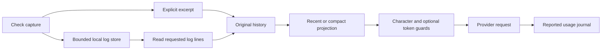

# ADR-0024: Retrievable excerpts, optional context compaction and token guards

- Status: Accepted
- Recorded: 2026-10-21
- Scope: request context, check presentation and editor suggestions
- Partially supersedes: [ADR-0006](0006-atomic-context-projection.md)

## Context

Each selected file read, check log and edit preview is replayed on later model
calls. Character limits alone do not capture Unicode/tokenizer differences.
Reducing context indiscriminately can remove dependencies or misrepresent
verification. SQLite persistence does not reduce transmitted input.

## Decision

Use bounded unified replacement diffs and explicitly labeled check excerpts
with bounded local line retrieval. Keep scanner output and execution metadata
intact. Preserve full bounded command captures outside model-facing summaries.

Retain `recent` as the default. Add opt-in deterministic `compact` projections
of older large successful file reads; retain the latest two rounds, original
history, call/result links, instructions, decisions and verification. References
are explicitly historical and require fresh reads when their details are needed.

Add optional per-request context and per-task cumulative token guards with an
output reserve. Estimate through an injectable adapter: optional model-aware
tokenization for recognized OpenAI models, conservative bytes otherwise. Label
estimates independently; never insert them into provider usage accounting.
Deduplicate exact inline requests with shared cancellation and a ten-second,
single-entry memory cache, retaining all existing staleness checks.

## Alternatives and consequences

LLM-generated summaries add cost and can invent facts. Global response caching
needs broader freshness and privacy policies. Automatically enabling aggressive
compaction lacks live accuracy evidence. A hard token cap cannot be promised
from a provider-independent estimate; provider-side billing limits remain separate.

Retrieval can require extra model calls. Short-lived logs can expire, and
compaction does not reduce stored source history. Local worker cancellation
cannot guarantee remote billing cancellation. Optional tokenizer data may need
downloading; unknown or unavailable tokenizers retain the fallback.

## Verification

Regression tests cover protocol preservation, immutable history, mandatory
context, preflight stops, missing/reported usage, log retrieval/expiry, scanner
preservation, newline-aware previews and shared completion cancellation. Paired
scripted repairs use independent file checks. Live accuracy and token savings
remain evaluation gates, documented in [token efficiency](../token-efficiency.md).
