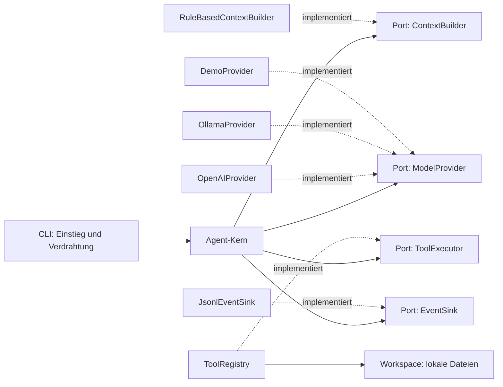
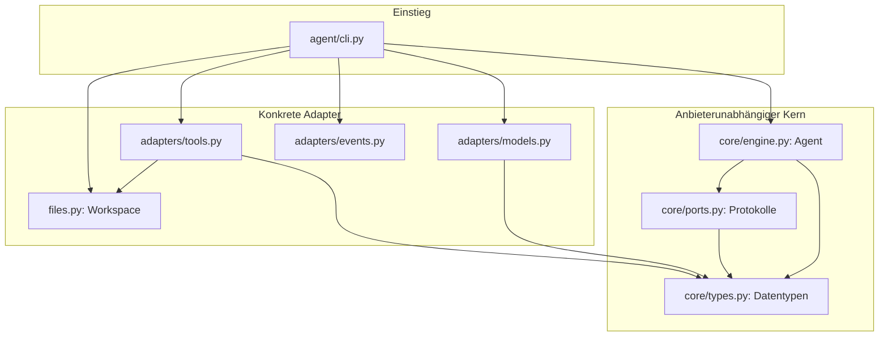
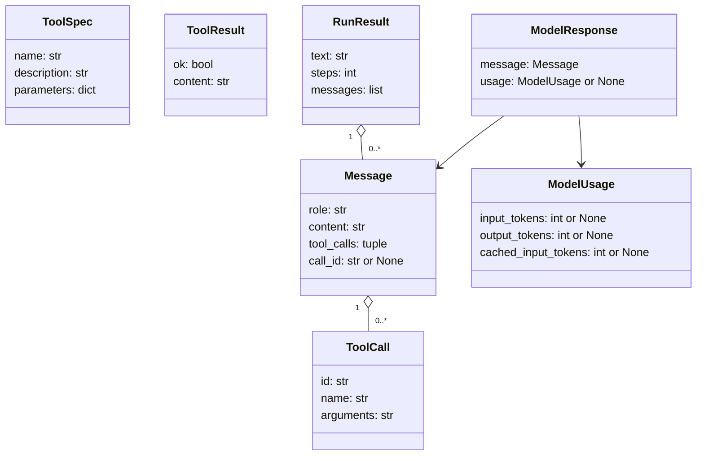
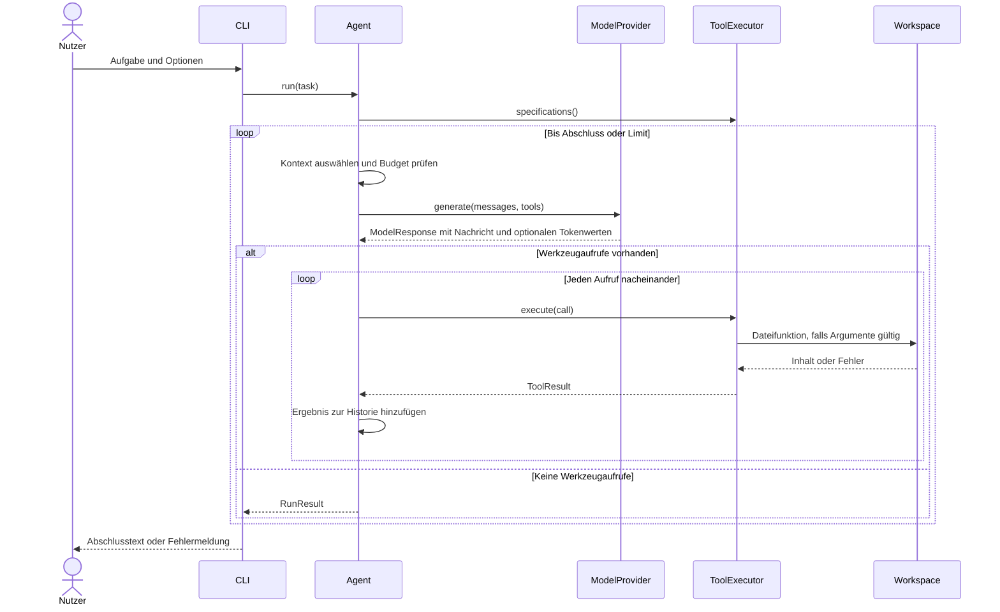
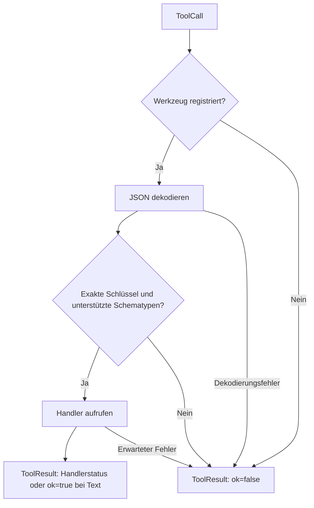
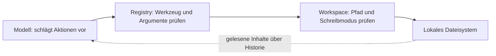
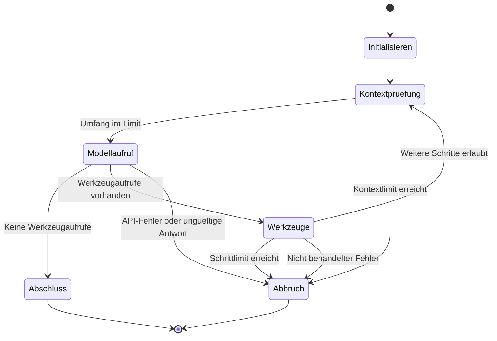
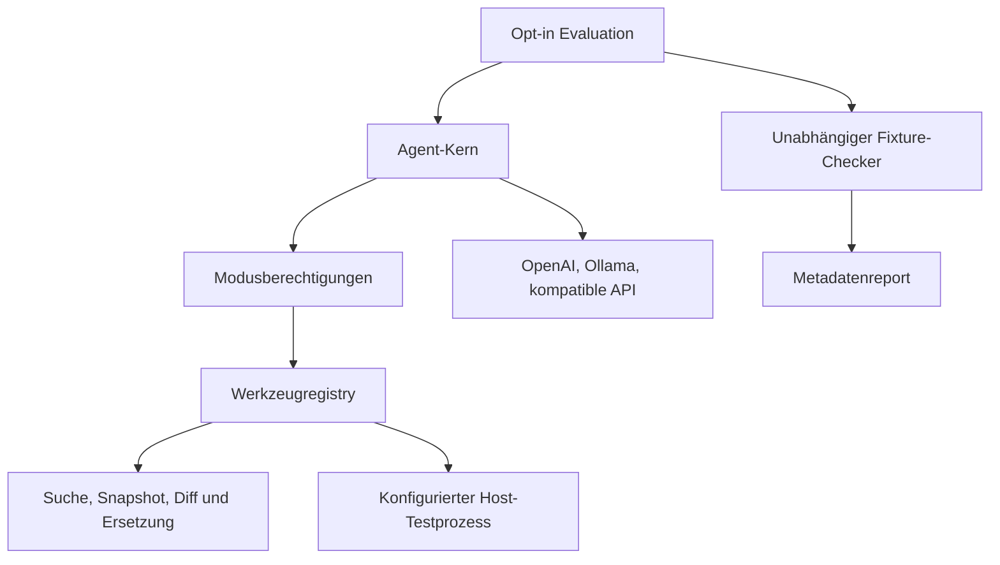

# Architektur des generischen Coding-Agenten

Diese Dokumentation beschreibt die implementierte Architektur der Version 0.8.
Sie richtet sich an Entwicklerinnen und Entwickler, die den Agenten verstehen,
einen Modellanbieter ergänzen oder neue Werkzeuge anbinden möchten.

Die englische [Komponentenreferenz](components.md) ergänzt diese Darstellung um
formale Verträge, wissenschaftliche Einordnung und eine Evidenzmatrix.
Die [ADRs](adr/README.md) dokumentieren Entscheidungen, Alternativen und Folgen.

## Inhaltsverzeichnis

1. [Ziele und Umfang](#ziele-und-umfang)
2. [Design Pattern: Ports and Adapters](#design-pattern-ports-and-adapters)
3. [Komponenten und Abhängigkeiten](#komponenten-und-abhängigkeiten)
4. [Datenmodell und Verträge](#datenmodell-und-verträge)
5. [Agent-Kern und Arbeitszyklus](#agent-kern-und-arbeitszyklus)
6. [Modelladapter](#modelladapter)
7. [Werkzeugverwaltung und Workspace](#werkzeugverwaltung-und-workspace)
8. [Kontext, Limits und Fehler](#kontext-limits-und-fehler)
9. [Ereignisse und Protokollierung](#ereignisse-und-protokollierung)
10. [CLI und Konfiguration](#cli-und-konfiguration)
11. [Erweiterungen implementieren](#erweiterungen-implementieren)
12. [Tests und Qualitätsgrenzen](#tests-und-qualitätsgrenzen)
13. [Architekturentscheidungen und nächste Schritte](#architekturentscheidungen-und-nächste-schritte)

## Ziele und Umfang

Der Agent soll Coding-Aufgaben bearbeiten können, ohne seinen Arbeitszyklus an
ChatGPT, ein bestimmtes Modell oder ein SDK zu binden. Ein Nutzer übergibt eine
Aufgabe und einen Workspace. Das Modell entscheidet, welche angebotenen Werkzeuge
es benötigt. Der Agent führt die Aufrufe aus und gibt deren Ergebnisse an das
Modell zurück, bis eine Abschlussantwort oder ein Limit erreicht ist.

Aktuell gibt es Datei-, Such-, Snapshot-, Vorschau- und Editierwerkzeuge,
optionale lokale Testausführung sowie Adapter für OpenAI Responses, Ollama Chat
und OpenAI-kompatible Chat Completions. Eine Offline-Demo ergänzt die Adapter. Der Kern arbeitet
synchron und führt Werkzeugaufrufe nacheinander aus. Es gibt einen Agenten pro
Lauf, keine verteilten Dienste und keine Datenbank. Eine interaktive Sitzung teilt
abgeschlossene Turns und akzeptierte Pläne im Arbeitsspeicher.

Die Bezeichnung „generisch“ bezieht sich auf austauschbare Modellanbieter und
bearbeitbare Projekte. Sie bedeutet nicht, dass jedes Modell dieselben Fähigkeiten
hat: Für die Modelladapter ist Unterstützung für strukturierte Werkzeugaufrufe
nötig. Explizit konfigurierte Tests sind möglich; beliebige Modell-Shellbefehle und
Git-Automation sind nicht implementiert.

## Design Pattern: Ports and Adapters

Das zentrale Muster ist **Ports and Adapters**, auch hexagonale Architektur.
Der Kern beschreibt die Arbeit und die benötigten Fähigkeiten. Interaktives Terminal,
Moduswechsel und Root-Projektregeln sind zusätzlich in der
[Terminal-Dokumentation](interactive.md) erläutert. Ports definieren
Verträge für diese Fähigkeiten. Adapter erfüllen die Verträge mit konkreten
Bibliotheken, APIs oder Dateisystemzugriffen.

Beispiel: Der Kern ruft `ModelProvider.generate(messages, tools)` auf. Er kennt
dabei eigene `Message`- und `ToolSpec`-Objekte. Der OpenAI-Adapter übersetzt diese
in die Responses API; der Ollama-Adapter übersetzt sie in die Chat API. Der Kern
bleibt bei einem Anbieterwechsel unverändert.



Die durchgezogenen Pfeile zeigen Nutzung, die gestrichelten Implementierung.
Python-`Protocol` ermöglicht strukturelle Typisierung: Ein Adapter muss nicht von
einer gemeinsamen Basisklasse erben. Passende Methodensignaturen genügen für den
Vertrag; zur Laufzeit werden diese Signaturen nicht automatisch geprüft.

Drei ergänzende Muster helfen bei der Umsetzung:

- **Dependency Injection:** `Agent` erhält Modell, Werkzeuge und optionalen
  Ereignisempfänger im Konstruktor. Er erzeugt sie nicht selbst.
- **Strategy:** Der Modellanbieter ist eine austauschbare Strategie für die
  nächste Entscheidung. Die Auswahl findet vor dem Lauf statt.
- **Registry:** Werkzeugspezifikationen und Handler werden unter einem eindeutigen
  Namen registriert. Neue Werkzeuge benötigen keine Fallunterscheidung im Kern.

## Komponenten und Abhängigkeiten



Dieses Diagramm zeigt Codeabhängigkeiten. Der Kern importiert keine Adapter,
kein SDK, kein HTTP-Modul und keine CLI. Die CLI ist die **Composition Root**:
Hier werden konkrete Objekte ausgewählt, erzeugt und miteinander verbunden.

| Datei | Verantwortung | Bewusst außerhalb ihrer Verantwortung |
| --- | --- | --- |
| `agent/core/engine.py` | Arbeitszyklus, Historie, Limits und Abschluss | HTTP, Modellformate, Dateizugriffe |
| `agent/core/context.py` | Protokollvalidierung, Rundenauswahl und Zeichenbudget | Dateisuche und Zusammenfassung |
| `agent/core/policy.py` | Planungsmodus auf explizit lesende Werkzeuge begrenzen | Terminaleingabe |
| `agent/terminal.py` | Befehle, Completion, Modus und Sitzung | Modellformate und Dateizugriffe |
| `agent/adapters/instructions.py` | Root-Projektregeln über Workspace laden | Modusberechtigungen |
| `agent/core/ports.py` | Verträge für Modell, Werkzeuge und Ereignisse | Konkrete Implementierungen |
| `agent/core/types.py` | Gemeinsame anbieterunabhängige Datentypen | SDK-Typen und Persistenz |
| `agent/adapters/models.py` | Übersetzung und Modellkommunikation | Werkzeugausführung |
| `agent/adapters/tools.py` | Registrierung, Argumentvalidierung, Fehlerergebnisse | Entscheidung über nächste Aktion |
| `agent/files.py` | Lokale Dateizugriffe und Pfadbeschränkungen | Modellkommunikation |
| `agent/adapters/events.py` | Ereignisse als JSONL schreiben | Speicherung vollständiger Gespräche |
| `agent/cli.py` | Konfiguration, Adapterauswahl, Ausgabe und Exit-Fehler | Fachlicher Agent-Zyklus |

Der Workspace ist konzeptionell ein Infrastrukturadapter. Er bleibt für die
Kompatibilität mit dem ersten Projektstand unter `agent/files.py`. Einen eigenen
Workspace-Port gibt es derzeit nicht: Der Kern ist über `ToolExecutor` bereits
von der konkreten Dateisystemimplementierung getrennt.

## Datenmodell und Verträge



### Nachrichten und Aufrufe

`Message` repräsentiert die Rollen `system`, `user`, `assistant` oder `tool`.
Die Rollen sind aktuell Strings statt eines Enums. Der Kern prüft beim
Modellergebnis ausdrücklich, dass die Rolle `assistant` ist.

Eine Assistant-Nachricht kann Text und mehrere `ToolCall`-Objekte enthalten.
`ToolCall.id` verbindet einen Aufruf mit seiner Ergebnisnachricht;
`Message.call_id` ist in einer Tool-Nachricht die Referenz darauf. `arguments`
ist ein JSON-String. Dadurch bleibt auch ungültiges JSON bis zur zentralen
Werkzeugvalidierung darstellbar und kann als verständlicher Fehler zurückgehen.
Der Kern verwirft doppelte Aufruf-IDs innerhalb einer einzelnen Modellantwort.

`ToolSpec` enthält Name, Beschreibung und ein JSON-Schema für die Argumente.
Diese Informationen beschreiben das Werkzeug für das Modell. Sie ersetzen nicht
die Validierung vor der tatsächlichen Ausführung.

### Ergebnisse

`ToolResult` transportiert entweder Erfolg oder einen erwarteten Werkzeugfehler.
Der Kern serialisiert das Ergebnis als JSON in eine Tool-Nachricht:

```json
{"ok": false, "content": "Werkzeug nicht verfügbar: unknown"}
```

Das Modell kann diesen Fehler sehen und eine andere Aktion wählen. `RunResult`
entsteht dagegen nur bei regulärem Abschluss und enthält den Abschlusstext,
die Zahl der Modellaufrufe und die gesamte interne Nachrichtenhistorie.
Die Historie wird nicht automatisch auf die Festplatte geschrieben.
`RunResult.requests` enthält zusätzlich `RequestMetrics` mit Schrittzahl,
`ContextStats` und optionalen Nutzungswerten pro Modellaufruf.

`ModelResponse` ist die neue Anbieter-Rückgabehülle. Sie enthält die Assistant-
Nachricht und optional `ModelUsage`. Unbekannte Tokenwerte sind `None` statt
Schätzwerten. OpenAI liefert verfügbare Input-, Output- und gecachte Inputtokens;
Ollama liefert `prompt_eval_count` und `eval_count`, jedoch keine Cachezählung.
Gecachte Inputtokens sind eine Teilmenge der Inputtokens und werden nicht addiert.
Die Offline-Demo hat keine tatsächlichen Nutzungswerte.

**Migration von Version 0.2:** Eigene Modelladapter müssen ihre bisherige
`Message`-Rückgabe in `ModelResponse(message)` einhüllen. Direkte Aufrufer lesen
nun `response.message.content` statt `response.content`. Nutzungswerte sind optional;
für die Kontextauswahl ist kein SDK oder Tokenizer erforderlich. Der bisherige
Import von `ContextLimitError` aus `agent.core.engine` bleibt möglich, die Definition
liegt jetzt in `agent.core.context`.

`Message`, `ToolCall`, `ToolSpec` und `ToolResult` sind eingefrorene Dataclasses.
Das verhindert das Neuzuweisen ihrer Felder; verschachtelte Dictionaries wie
`ToolSpec.parameters` werden dadurch nicht tief unveränderlich.

### Ports

| Port | Methoden | Erwartung |
| --- | --- | --- |
| `ModelProvider` | `generate(messages, tools) -> ModelResponse` | Anbieterformate intern halten, Nachricht und optionale Nutzungswerte liefern |
| `ContextBuilder` | `build(messages, tools, max_chars) -> ContextSelection` | Vollständige Quelle auf einen budgetierten Modellkontext projizieren |
| `ToolExecutor` | `specifications()` und `execute(call)` | Angebotene Werkzeuge beschreiben und strukturierte Ergebnisse liefern |
| `EventSink` | `emit(kind, data)` | Ereignisse empfangen; optional für den gesamten Lauf |

## Agent-Kern und Arbeitszyklus

`Agent.run(task)` startet ohne expliziten Zustand weiterhin mit einer frischen
Historie. `Agent.run(task, state)` ergänzt dagegen die abgeschlossene Konversation
in `ConversationState` um einen neuen lokalen Turn. Systemanweisungen werden für
aktuellen Modus, geladene Projektregeln und akzeptierten Plan neu aufgebaut. Die verfügbaren Werkzeuge werden
zu Beginn als Tuple übernommen. Ein dynamischer Werkzeugwechsel während eines
Laufs ist derzeit nicht vorgesehen.



Die Schleife entspricht dem praktischen **ReAct-Ablauf**: beobachten, nächste
Aktion entscheiden, handeln und das Ergebnis wieder beobachten. Es wird kein
separates internes Gedankentranskript gespeichert. Die sichtbare Steuerung
besteht aus Nachrichten und expliziten Werkzeugaufrufen.

Eine Antwort ohne Werkzeugaufrufe gilt als Abschluss, auch wenn ihr Text leer
ist. Das ist eine Steuerungsentscheidung, kein Nachweis, dass die Nutzeraufgabe
inhaltlich erfüllt wurde. Die Implementierung hat noch keinen unabhängigen
Ergebnisprüfer und keine automatische Erfolgsmessung. Der separate opt-in
Evaluator prüft Fixture-Ergebnisse unabhängig; dies ist kein allgemeiner Prüfer
für beliebige Aufgaben im normalen Agent-Zyklus.

Die CLI lädt die Root-`AGENTS.md` automatisch über einen Workspace-Adapter.
Direkte Kern-Aufrufer liefern `project_instructions` explizit. Regeln und ein
akzeptierter Plan werden als separate Systemnachrichten im Pflichtkontext gehalten.
Der Planungsmodus registriert und erlaubt nur Werkzeuge mit `read_only=True`;
der Implementierungsmodus erhält Schreibwerkzeuge nur bei freigegebenem Workspace.

Es gibt weiterhin keinen separaten Planer und keine automatische Auswahl relevanter
Dateien. Der Modus verändert Instruktionen und Berechtigungen desselben Agenten.


## Modelladapter

### OpenAIProvider

Der Adapter übersetzt interne Nachrichten in Eingabeelemente der Responses API.
Textnachrichten erhalten Rolle und Inhalt, Aufrufe werden `function_call` und
Ergebnisse werden `function_call_output`. Die Aufruf-ID bleibt erhalten.
`ToolSpec` wird zu einer Funktionsdefinition mit `strict=True`.

Der Request enthält die vom ContextBuilder ausgewählten Nachrichten und `store=False`. Die
Implementierung setzt keinen serverseitigen Gesprächsfortsetzungsbezeichner ein.
Die Antwort wird auf Ausgabetext und Funktionsaufrufe abgebildet.

Das OpenAI-SDK wird erst beim Erstellen eines Adapters ohne übergebenen Client
importiert. Deshalb laufen Kern, Demo und Ollama ohne SDK-Installation. Tests
können einen simulierten Client übergeben.

Die Abbildung umfasst aktuell Text und Werkzeugaufrufe. Bilder, Streaming,
anbieterspezifische Reasoning-Elemente und andere spezialisierte Ausgabearten
werden nicht als eigene interne Datentypen erhalten. Tatsächlich gemeldete
Nutzungsstatistiken werden dagegen in `ModelUsage` erhalten. Unterstützung
für beliebige Modellfamilien ist damit nicht durch die Architektur allein garantiert.

### OllamaProvider

Dieser Adapter sendet einen synchronen JSON-POST an `/api/chat` der konfigurierten
Basisadresse. Er verwendet nur die Python-Standardbibliothek. `stream=False`
fordert eine vollständige Antwort statt eines Streams an; der Netzwerk-Timeout
beträgt standardmäßig 120 Sekunden und ist im Adapter-Konstruktor änderbar.

Interne Funktionsargumente werden in JSON-Objekte übersetzt. Für Tool-Ergebnisse
ordnet der Adapter die interne Aufruf-ID wieder dem Werkzeugnamen zu und trägt
`tool_name` in die Ollama-Nachricht ein. IDs für zurückgelieferte Aufrufe werden
lokal aus einer UUID pro Antwort und dem Aufrufindex erzeugt. Eine gleichbleibende
Länge des verkürzten Kontexts führt damit nicht zu wiederverwendeten IDs.

Ein laufender Server und ein installiertes Modell mit Werkzeugunterstützung sind
Voraussetzungen. Der Adapter installiert oder startet Ollama nicht. Eine explizite
Authentifizierung für einen entfernten Ollama-Server ist noch nicht implementiert.

### DemoProvider

Die Demo ist kein KI-Modell. Bei der ersten Nutzeraufgabe fordert sie fest
`list_files` mit `{"path":"."}` an. Danach schließt sie mit dem empfangenen
Werkzeugergebnis ab. Damit lässt sich der komplette Zyklus ohne Netzwerk,
API-Schlüssel und Modellinstallation ausprobieren.

## Werkzeugverwaltung und Workspace

### ToolRegistry

Die Registry verbindet `ToolSpec.name` mit einem Handler. Ein Name darf nur
einmal registriert werden. `specifications()` liefert die Beschreibungen für das
Modell. `execute()` nimmt einen konkreten Aufruf entgegen.



Die Validierung verlangt exakt die im Schema genannten Schlüssel. Bisherige
Werkzeuge verlangen weiterhin Strings; `read_file_range` ergänzt begrenzte
Integer-Zeilennummern und lehnt Floats, Booleans und numerische Strings ab.
`run_tests` verwendet ein leeres Argumentobjekt.
Die Registry ist kein vollständiger JSON-Schema-Validator. Optionale Felder,
weitere Zahlentypen, Arrays oder verschachtelte Objekte erfordern eine Erweiterung.

`OSError`, `ValueError`, `KeyError` und `TypeError` werden in Fehlerergebnisse
umgewandelt. Andere Exceptions werden weitergereicht und beenden den Lauf, wenn
sie nicht außerhalb der Registry behandelt werden. Handler können einen Text
oder ein explizites `ToolResult` liefern; Testfehler bleiben damit `ok=False`.

### workspace_tools und Fähigkeiten

`workspace_tools(workspace)` registriert `list_files` und `read_file`.
Nur bei `workspace.allow_write=True` kommen `write_file` und `apply_edit` hinzu.
Standardmäßig ergänzen Suche, Snapshot, Bereichsabruf und Vorschau die ursprünglichen Tools.
Die [Bereichsabruf-Dokumentation](token-efficiency.md) beschreibt den aktuellen
Vertrag und die gemessenen Zeichenkosten; vollständige Dateiabrufe bleiben verfügbar.
Ein explizit übergebener `LocalTestRunner` registriert `run_tests`; der Planungsmodus
entfernt alle nicht lesenden Werkzeuge und blockiert erfundene Aufrufe ebenfalls. Im Lesemodus sieht
das Modell dieses Werkzeug also nicht. Ein trotzdem erzeugter Schreibaufruf wird
von der Registry abgelehnt. Zusätzlich prüft der Workspace Schreibberechtigung
noch einmal selbst.

| Werkzeug | Argumente | Verhalten |
| --- | --- | --- |
| `list_files` | `path` | Listet direkte Verzeichniseinträge; keine rekursive Suche |
| `read_file` | `path` | Liest UTF-8-Text bis maximal 100.000 Zeichen |
| `write_file` | `path`, `content` | Erstellt Elternverzeichnisse und ersetzt vollständigen Dateiinhalt; maximal 100.000 Zeichen |

Die Verzeichnisliste betrachtet die ersten 500 sortierten Einträge und filtert
dann geschützte Namen. Sie ist daher nicht zwingend vollständig und kann weniger
als 500 sichtbare Einträge enthalten. Symlink-Namen können in einer Liste
auftauchen; beim tatsächlichen Zugriff wird der aufgelöste Zielpfad geprüft.

### Workspace und Vertrauensgrenzen



Der Workspace muss existieren und ein Verzeichnis sein. Pfade werden aufgelöst;
das Ziel muss innerhalb des aufgelösten Workspace liegen. Dadurch werden auch
Symlinks nach außerhalb abgewiesen. `.git`, `.ssh`, `.aws` und Pfadbestandteile,
die mit `.env` beginnen, sind gesperrt. Absolute Pfade werden nicht grundsätzlich
verboten, solange ihr aufgelöstes Ziel innerhalb des Workspace liegt.

Diese Prüfungen sind keine Betriebssystem-Sandbox. Gleichzeitig veränderte
Symlinks sind nicht abgesichert. Andere vertrauliche Dateien innerhalb des
Workspace können gelesen und an den Modellserver übermittelt werden. Auch ein
lokaler Server ist nur dann lokal, wenn seine konfigurierte Adresse es ist.
Eine dedizierte Arbeitskopie ohne Geheimnisse ist deshalb das vorgesehene
Arbeitsverzeichnis.

Schreiboperationen sind weder transaktional noch mit automatischem Rollback
versehen. Nach einem späteren Fehler bleiben Änderungen bestehen; ein Fehler
während des Schreibens kann ebenfalls eine teilweise geänderte Datei hinterlassen.
Dateien sind nach dem Lauf über Git-Diffs und passende Tests zu prüfen.
Die gezielte Textersetzung im neuen Adapter verwendet Hash-Vergleiche und atomaren
Dateiersatz. Details und die lokale Testausführung stehen im
[Workflow-Leitfaden](coding-workflow.md).

## Kontext, Limits und Fehler

Ein laufender Turn lebt lokal in `Agent.run()`. Optional wird er nach erfolgreichem
Abschluss an `ConversationState.messages` angehängt. Fehler und Unterbrechungen
verwerfen diesen Turn aus dem Gespräch, rollen Dateischreibvorgänge aber nicht zurück.
`latest_plan` und `accepted_plan` sind getrennte Felder der Sitzung. Der Terminalbefehl
`/implement` akzeptiert den letzten erfolgreichen Plan ohne automatischen Modellaufruf.

Der `ContextBuilder` erhält führende Systemnachrichten und mehrere Nutzer-Turns.
Jeder abgeschlossene ältere Turn muss mit einer finalen Assistant-Antwort enden.
Ein aktiver Turn darf mit einer vollständigen Werkzeugrunde enden. Ungültige,
fehlende oder doppelte Ergebnisse werden auch in später entfernten Runden abgewiesen.

`recent` behält Systemanweisungen, Modus, Root-Regeln, akzeptierten Plan, ursprüngliche
Aufgabe und neuesten Nutzerauftrag. Neueste aktive Runden haben Vorrang; passt die
jüngste nicht vollständig, wird abgebrochen. Danach passen gegebenenfalls weitere
aktive Runden und schließlich ältere abgeschlossene Turns als ganze Einheiten hinein.
Quellreihenfolge und Werkzeugzuordnung bleiben erhalten. Nachrichten werden weder
abgeschnitten noch zusammengefasst. `full` behält die vollständige Quelle oder bricht ab.

`ContextSelection` enthält Nachrichten und `ContextStats`: `full_chars`,
`selected_chars`, `full_messages`, `selected_messages`, `dropped_rounds`.
Die Quelle bleibt unverändert. In einer Sitzung bedeutet das nicht, dass das Modell
immer alle früheren Details sieht; nur der feste Kontext ist garantiert erhalten.
Es gibt keine Datenbank, persistente Sitzung oder Wiederaufnahme nach Prozessende.



`max_steps` begrenzt die Zahl der Modellaufrufe, nicht die Anzahl der einzelnen
Werkzeugaufrufe. Eine Modellantwort kann mehrere Werkzeuge anfordern. Auch im
letzten zulässigen Schritt werden diese noch ausgeführt; anschließend wird bei
fehlendem Abschluss `StepLimitError` ausgelöst.

`max_context_chars` prüft vor jedem Modellaufruf einen ungefähren Zeichenumfang:
Nachrichtentexte, Aufrufnamen und -argumente sowie Werkzeugbeschreibungen und
serialisierte Parameterschemas. Rollen, IDs und Anbieterformatierung werden
nicht vollständig mitgerechnet. Die Grenze ist weder ein Tokenbudget noch eine
Kostenobergrenze und begrenzt nicht die Größe der nächsten Modellantwort.

| Situation | Reaktion |
| --- | --- |
| Erwarteter Datei- oder Argumentfehler | `ToolResult(ok=False)` geht an das Modell |
| Pflichtkontext oder neueste Runde zu groß; im Modus `full` gesamte Historie zu groß | `ContextLimitError` |
| Ungültige oder unvollständige Werkzeugrunden bei der Kontextauswahl | `ValueError` |
| Kein Abschluss innerhalb der erlaubten Modellaufrufe | `StepLimitError` |
| Andere Rolle als `assistant` oder doppelte IDs innerhalb einer Antwort | `ValueError` |
| API-, Netzwerk- oder nicht behandelter Adapterfehler | Exception erreicht die CLI |
| CLI fängt eine Exception im Ausführungsblock | Fehlermeldung auf stderr, Exit-Code 1 |

Es gibt keine einheitliche Retry-Strategie im Kern. Einzelne SDKs können eigene
Wiederholungen und Timeouts besitzen. Der Agent setzt auch keine globale
Laufzeitgrenze. Ein allgemeines Abbruchereignis für jede denkbare Exception ist
noch nicht implementiert.

## Ereignisse und Protokollierung

`EventSink` ist optional. Ohne Sink läuft der Agent ohne Ereignisausgabe.
`JsonlEventSink` schreibt pro Ereignis ein JSON-Objekt in eine Zeile und leert
den Stream-Puffer sofort. Die CLI aktiviert ihn mit `--verbose` auf stderr.

| Ereignis | Daten |
| --- | --- |
| `run_started` | `max_steps`, `mode` |
| `context_selected` | `step`, `full_chars`, `selected_chars`, `full_messages`, `selected_messages`, `dropped_rounds` |
| `model_completed` | `step`, `tool_calls`, `usage` (optional verfügbare Tokenwerte) |
| `tool_completed` | `name`, `ok` |
| `run_completed` | `steps` |
| `run_stopped` | `reason`: `context_limit` oder `step_limit` |

```bash
python -m agent.cli "Projekt untersuchen" --provider demo --verbose 2>events.jsonl
```

Die aktuellen Ereignisse enthalten keine Aufgaben, Dateiinhalte oder
Werkzeugargumente. Sie enthalten auch keine Zeitstempel, Lauf-IDs oder
Kostenwerte. Tokenwerte erscheinen nur, sofern der Anbieter sie tatsächlich meldet.
Ein Ereignisprotokoll ist somit eine Ausführungsübersicht,
kein vollständiges Audit oder wiederabspielbares Gespräch. Fehler beim Schreiben
des Sinks werden nicht abgefangen und können den Lauf beenden.

## CLI und Konfiguration

Die CLI parst Argumente, wählt Adapter und erzeugt den Workspace. Danach verbindet
sie `Agent(model, tools, events, ...)`, ruft `run()` auf und gibt den Abschlusstext
aus. Damit bleiben Konfigurationsdetails außerhalb des Kerns.

| Option | Standard und Bedeutung |
| --- | --- |
| `task` | Optional; ohne Aufgabe startet das interaktive Terminal |
| `--mode` | `plan` oder `implement`; Standard interaktiv `plan`, im Einzellauf `implement` |
| `--workspace` | Aktuelles Arbeitsverzeichnis |
| `--provider` | `AGENT_PROVIDER`, sonst `openai`; Auswahl `openai`, `ollama`, `openai-compatible`, `demo` |
| `--model` | `AGENT_MODEL`; bei OpenAI danach `OPENAI_MODEL`, sonst `gpt-4.1` |
| `--base-url` | Ollama: Standard `http://localhost:11434`; für kompatible APIs explizit erforderlich |
| `--api-key-env` | `OPENAI_COMPATIBLE_API_KEY` für den kompatiblen Provider |
| `--allow-exec`, `--test-command` | Gemeinsam erforderlich für lokale Tests |
| `--test-timeout`, `--test-output-bytes` | 60 Sekunden und 65.536 aufgezeichnete Bytes |
| `--max-steps` | 15 Modellaufrufe, muss positiv sein |
| `--max-context-chars` | 200.000 ungefähre Zeichen, muss positiv sein |
| `--context-mode` | `recent` als Standard, `full` für vollständige Historie und Vergleich |
| `--allow-write` | Standardmäßig aus |
| `--verbose` | Standardmäßig aus; JSONL-Metadaten auf stderr |

Ollama benötigt einen explizit oder über `AGENT_MODEL` gewählten Modellnamen.
OpenAI benötigt `OPENAI_API_KEY` und die optionale Installation
`pip install -e '.[openai]'`. `pip install -e .` installiert nur das Grundgerüst.
Die Demo benötigt keine Schlüssel und ignoriert die fachliche Aufgabe.
Das Terminal benötigt zusätzlich `pip install -e '.[terminal]'`. Eine einzelne Aufgabe
benötigt diese Abhängigkeit nicht. Details: [Terminal und Sitzungen](interactive.md).

## Erweiterungen implementieren

### Einen Modellanbieter ergänzen

1. Einen Adapter außerhalb von `agent/core` erstellen.
2. `generate(messages, tools)` implementieren und interne Typen in das
   Anbieterformat übersetzen.
3. Textantworten und Werkzeugaufrufe einschließlich ihrer Zuordnung wieder als
   `ModelResponse(Message(role="assistant", ...), usage=...)` zurückgeben.
   Fehlende Nutzungsdaten nicht erfinden; das SDK bleibt im Adapter.
4. Den Adapter in der CLI beziehungsweise einem späteren Konfigurationsmodul
   auswählbar machen und Bibliotheken bei Bedarf optional deklarieren.
5. Die Übersetzung und mehrere aufeinanderfolgende Werkzeugrunden testen.

Minimaler Testadapter ohne externe API:

```python
from agent.core.types import Message, ModelResponse

class StaticProvider:
    def generate(self, messages, tools):
        return ModelResponse(Message("assistant", "Keine Änderungen erforderlich."))
```

Ein zukünftiger Anthropic-Adapter folgt demselben Vertrag; er ist derzeit noch
nicht implementiert. Bei erweiterten Formaten wie multimodalen Inhalten muss
gegebenenfalls zuerst das gemeinsame Datenmodell erweitert werden.

### Ein Werkzeug ergänzen

Ein Werkzeug benötigt eine Spezifikation und eine aufrufbare Funktion.
Dieses Beispiel verwendet String-Argumente:

```python
from agent.adapters.tools import ToolRegistry, spec
from agent.core.types import ToolCall

registry = ToolRegistry()
registry.register(
    spec("echo", "Gibt den Text zurück.", {"text": {"type": "string"}}),
    lambda text: text,
)
result = registry.execute(ToolCall("example-1", "echo", '{"text":"Hallo"}'))
assert result.ok and result.content == "Hallo"
```

Für ein Dateiewerkzeug weiterhin `Workspace.path()` und den Schreibmodus prüfen.
Für neue Typen oder optionale Felder zuerst die Registry-Validierung erweitern.
Ein JSON-Schema allein macht einen Handler nicht sicher oder korrekt.

### Andere Ein- und Ausgaben anbinden

Ein späteres Web-API oder eine IDE-Integration kann dieselben Ports und denselben
Kern verwenden. Es muss Modell, Werkzeuge und Ereignissink selbst zusammenstellen.
Ein neuer `EventSink` kann die Metadaten beispielsweise in eine Datenbank schreiben.
Diese Anpassungen benötigen keine Änderung des normalen Agent-Zyklus.

## Tests und Qualitätsgrenzen

```bash
python -m unittest discover -s tests -v
```

`tests/test_files.py` prüft Schreib-/Lesezugriffe, den Lesemodus, Pfadausbrüche,
Symlinks nach außerhalb, geschützte Pfade und Dateigrößen.

`tests/test_architecture.py` prüft den vollständigen Offline-Zyklus,
Werkzeugvalidierung, Fehlerrückgabe an das Modell, Schritt- und Kontextlimits,
getrennte Historien, Registry-Routing sowie die OpenAI- und Ollama-Übersetzungen
mit simulierten Antworten. Die Tests benötigen kein SDK und keinen API-Schlüssel.

`tests/test_context.py` prüft Auswahlreihenfolge, feste Inhalte, Budgetgrenzen,
mehrere Werkzeuge pro Runde, ungültige Protokolle und einen längeren Vergleichslauf.
`tests/test_usage.py` prüft echte, fehlende und teilweise Nutzungswerte sowie
Ollama-Aufruf-IDs bei gleichbleibender Kontextlänge.

Die Terminal- und Sitzungstests prüfen Modusberechtigungen, lokale Befehle,
Root-Instruktionen, mehrteilige Kontexte und Wiederverwendbarkeit nach Fehlern.
Ein echter Prompt-Test prüft Tab-Completion mit `prompt-toolkit`.

Die zusätzlichen Tests prüfen kompatible Chat-Übersetzungen, Suche, gezielte Änderungen,
Prozessgrenzen und den deterministischen vollständigen Reparaturzyklus. Die Evaluation
prüft unabhängig vom Abschlusstext des Modells.

Der dokumentierte Implementierungsstand besteht aus 104 erfolgreichen lokalen
Tests und einem ausgeführten Offline-CLI-Durchlauf. Das belegt die getesteten
Verträge und Pfade, keine erfolgreiche Kommunikation mit echten Modellservern.
Live-Tests, Kompatibilitätsprüfungen mehrerer Modelle und eine Überprüfung der
inhaltlichen Coding-Ergebnisse bleiben separate Aufgaben.

## Architekturentscheidungen und nächste Schritte

| Entscheidung | Begründung | Konsequenz |
| --- | --- | --- |
| Ein synchroner Agent | Einfacher, nachvollziehbarer Start | Keine parallelen Modell- oder Werkzeugaufrufe |
| Sitzung nur im Arbeitsspeicher | Einfache Folgeaufträge und Planübergabe | Keine Fortsetzung nach Prozessende |
| Modusprüfung im Kern | Planungsmodus kann keine Schreibwerkzeuge aufrufen | Eigene lesende Werkzeuge müssen `read_only=True` deklarieren |
| Eigene Datentypen | Anbieterwechsel ohne SDK-Typen im Kern | Adapter müssen Formate und Besonderheiten abbilden |
| Protocol statt Pflicht-Basisklasse | Leichte Testdoubles und geringe Kopplung | Keine automatische Laufzeitprüfung der Verträge |
| OpenAI als optionale Abhängigkeit | Lokaler Betrieb ohne Cloud-SDK | OpenAI muss separat installiert werden |
| Regelbasierte Kontextauswahl | Weniger wiederholte Inhalte bei unveränderter Historie | Ältere Informationen können dem Modell fehlen |
| Expliziter Abbruch bei zu großem Pflichtkontext | Keine unvollständigen Werkzeugrunden | Große Einzelrunden benötigen weiterhin kleinere Aufgaben |
| Hashgeprüfte Textersetzung neben vollständigem Schreiben | Kleine Änderungen und veraltete Snapshots erkennen | `write_file` bleibt für neue Dateien/Kompatibilität; keine allgemeine Patch-Engine |
| Metadaten statt vollständiger Gesprächslogs | Kleine, einfache Ereignisausgabe | Keine automatische Wiederaufnahme oder vollständige Rekonstruktion |

Gezielte Textersetzung und begrenzte lokale Testprozesse sind in Version 0.5
umgesetzt. Sinnvolle nächste Ausbaustufen sind isolierte Ausführung, belastbare
Live-Evaluation, Persistenz und relevanzbasierte Dateiauswahl. Der
[Workflow-Leitfaden](coding-workflow.md) beschreibt die aktuellen Grenzen.

Git-Funktionen, Container-Workspaces und ein Anthropic-Adapter können danach an
den vorhandenen Grenzen ergänzt werden. Multi-Agent-Orchestrierung ist kein
Bestandteil des Grundgerüsts und sollte erst bei konkretem Bedarf hinzukommen.

## Weiterführender Architekturvorschlag

Der [Vorschlag für Kontextverwaltung und SQLite-Persistenz](context-and-persistence.md)
beschreibt den weiteren Ausbau mit Speicher-Ports, Datenmodell und Cache-Invalidierung.
Regelbasierte Kontextauswahl und Nutzungsmessung sind bereits implementiert;
SQLite, Zusammenfassungen und Artefaktauswahl bleiben Vorschläge.

## OpenAI-kompatible Endpoints und Evaluation

`OpenAICompatibleProvider` implementiert denselben Modell-Port über Chat Completions.
Es gibt keinen automatischen API- oder Provider-Fallback. Der Konfigurationsvertrag
besteht aus Modell, Basis-URL und dem Namen einer Schlüssel-Umgebungsvariablen.
`agent.evaluate` vergleicht ursprüngliche und erweiterte Werkzeuge an denselben
Fixtures. Reports enthalten Metriken und kontrollierte Statuscodes, keine Rohdialoge.



## Getrennte Test- und Lint-Profile

Version 0.6 generalisiert den lokalen Prozessadapter zu `LocalCommandRunner`;
`LocalTestRunner` bleibt als kompatibler Alias erhalten. `run_tests`, `run_lint`
und das explizit konfigurierte `run_lint_fix` haben getrennte Ergebnisse und
werden durch denselben Modusfilter geschützt. Der Fixer prüft anschließend Lint
und kennzeichnet Tests als erneut erforderlich. Ablauf, Limits und CI-Konfiguration
stehen im [Leitfaden für Tests und Linting](testing-and-linting.md).


## Security-Erweiterung (Version 0.7)

`LocalCommandRunner` unterstützt zusätzlich die Profile `security` und
`dependency_audit`. Die CLI konfiguriert sie unabhängig; die Registry bietet
`run_security` und `run_dependency_audit` ohne Argumente an. `ModeToolExecutor`
sperrt beide im Planungsmodus. Limits und Ergebnisfelder entsprechen dem
Test-/Lint-Adapter. Terminal und Modell unterscheiden diese Prüfarten;
ein erfolgreicher Scan ist keine Sicherheitsgarantie.

Die [Security-Dokumentation](security-checks.md) enthält das Komponentendiagramm,
CLI-Verträge, CI-Aufteilung, Audit-Abdeckung und die einzeln begründeten
Bandit-Ausnahmen. Der Ollama-Adapter erlaubt nur HTTP(S)-Endpunkte ohne eingebettete
Zugangsdaten, Query oder Fragment und lehnt Weiterleitungen ab. Bandit und
pip-audit sind optionale Werkzeuge, keine Abhängigkeiten des Agent-Kerns.


### Korrekturen nach dem Bug-Review

`write_file` validiert UTF-8 vor dem Anlegen von Verzeichnissen oder dem Öffnen
der Zieldatei. Ungültige Unicode-Surrogate können daher keine vorhandene Datei
mehr leeren. Der Prozessadapter erfasst Fehler des Ausgabe-Threads in
`capture_error`; erfolgreiche Prüfungen erfordern neben Exitcode null auch eine
fehlerfreie Ausgabeerfassung. Laufende Prozesse werden bei Leserfehlern beendet.
Bei abgelehnten Ollama-Weiterleitungen schließt der Adapter die HTTP-Antwort,
bevor er den Fehler zurückgibt.


## VS Code-Adapter (Version 0.8)

Die [Editor-Architektur](vscode-extension.md) beschreibt das TypeScript-Frontend,
JSON-RPC über stdio, verwaltetes Python-Backend, Pufferbesitz, einzeln bestätigte
Änderungen, Abbruch und getrennte Completion-Worker. Die CLI bleibt verfügbar.
Der Agent und der lokale Prozessadapter akzeptieren optional einen CancellationToken;
Provider können für Inline-Vorschläge Zeit-/Ausgabelimits erhalten.
