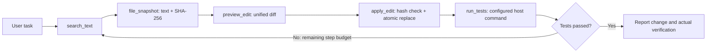
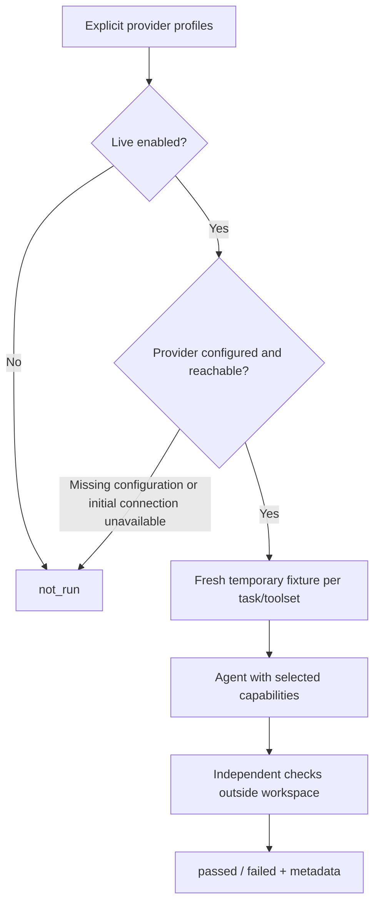

# Search, precise edits, local verification, and evaluation

Version 0.5 adds an OpenAI-compatible Chat Completions provider, bounded code
search, targeted editing, and explicit local test execution. Existing providers,
terminal commands, and single-task invocations remain available.

## Working with a model

Native OpenAI still uses Responses. Ollama still uses `/api/chat`. The new
`openai-compatible` provider uses Chat Completions with tool calling:

```bash
pip install -e '.[openai,terminal]'
# Set OPENAI_COMPATIBLE_API_KEY in your environment, not in repository files.
coding-agent --provider openai-compatible --model YOUR_MODEL \
  --base-url http://localhost:1234/v1 --allow-write
```

Pass the server's actual API base URL, including `/v1` if required by that server.
`--api-key-env MY_PROVIDER_KEY` selects a different environment variable. Even a
local server that ignores authentication needs an explicitly configured key value
for this adapter. The URL must not contain userinfo, query credentials, or fragments.

The endpoint must support Chat Completions tool schemas, assistant tool calls,
and tool results. Compatibility is not guaranteed merely by offering a text-chat
endpoint. The adapter does not send OpenAI strict-schema extensions, switch APIs,
or fall back to another endpoint. Its SDK retries are disabled and request timeout
is 120 seconds. Native provider behavior is separate.

`ModelResponse` and `ModelUsage` stay provider independent. Compatible usage maps
`prompt_tokens`, `completion_tokens`, and optional cached prompt tokens. Missing
values remain unknown. Cached input is a subset of input, not an additional total.

## Capabilities and permissions

| Capability | Tool | Available when |
| --- | --- | --- |
| Literal search | `search_text(path, query)` | Both modes |
| Exact text snapshot | `file_snapshot(path)` | Both modes |
| Diff preview | `preview_edit(path, expected_sha256, old_text, new_text)` | Both modes |
| Targeted replacement | `apply_edit` with the same arguments | Implementation plus `--allow-write` |
| Configured local tests | `run_tests()` | Implementation plus both execution flags |

Existing `list_files`, `read_file`, and `write_file` remain compatible. The model
is instructed to prefer search, snapshots, and targeted edits. A preview is not a
separate user approval gate, and the apply tool does not require a prior preview
call; it independently rechecks all arguments and the file version.



### Search

Search is literal and line based, not regex or semantic retrieval. It returns
workspace-relative paths, one-based line numbers, and bounded snippets. It skips
symlink entries, protected paths, binary/non-UTF-8 files, oversized text, virtual
environments, `node_modules`, build output, and bytecode caches.

Limits per call are 10,000 visited directory entries, 1,000 scanned files,
100 matching lines, and approximately 20,000 serialized match characters.
The response includes `files_scanned` and `truncated`. Queries must be nonempty,
single-line strings of at most 512 characters. Results are not ranked and filesystem
iteration order is not guaranteed. `.gitignore` patterns are not interpreted.

### Snapshots and edits

Snapshots preserve exact UTF-8 text, including CRLF, and hash the original bytes
with SHA-256. Files must stay within the existing 100,000-character text limit;
NUL-containing files are rejected by the new tools.

An edit requires a current hash and exactly one occurrence of `old_text`, including
overlapping occurrences. Empty or ambiguous originals and stale snapshots are
errors. The replacement must stay within the text limit. Preview and apply return
new hashes, unified diffs, and a `diff_truncated` flag for previews over 20,000
characters. Diff truncation affects display, not replacement contents.

Apply writes a temporary file in the target directory, flushes it, preserves file
permission bits, rechecks the source, and uses atomic replacement. Failures clean
up temporary files. This avoids partial replacement of the target but is not a
filesystem transaction or a lock against concurrent edits. A change in the small
interval between final checking and replacement remains possible. Extended
attributes, hard-link relationships, and original ownership are not preserved by
this implementation. Existing workspace and protected-path checks still apply.

## Explicit local test execution

```bash
coding-agent --provider ollama --model YOUR_MODEL --allow-write \
  --allow-exec --test-command 'python -m unittest discover -s tests -v'
```

Both `--allow-exec` and `--test-command` are required together. Arguments are split
using shell-like quoting, then passed to a subprocess with `shell=False`. Shell
operators, substitutions, and pipelines are not evaluated. Quote executable paths
that contain spaces. The command is selected by the user at startup, never by the
model or automatically from repository configuration/`AGENTS.md`.

`run_tests` accepts no arguments, so the model cannot replace the executable or
append arbitrary flags. The working directory is the workspace root. stdin is
closed and stdout/stderr share one capture stream. Defaults:

- `--test-timeout 60`: seconds until process cleanup starts.
- `--test-output-bytes 65536`: maximum retained raw output bytes; remaining output
  is drained to avoid blocking the child.

The result includes `passed`, `exit_code`, `output`, `elapsed_seconds`, `timed_out`,
`output_truncated`, and `capture_complete`. A nonzero exit or timeout is also an
unsuccessful `ToolResult`; the model receives the structured result for repair.
The tool registry supports either string results or an explicit `ToolResult`.

Timeout/Ctrl+C cleanup kills the process group on POSIX and uses Windows `taskkill
/T /F` with direct-process fallback. Cleanup is best effort for descendants that
escape the group/tree. This is local execution, not a sandbox or a network boundary.
Project code inherits the agent process's host permissions and environment. It can
write files even when file-edit tools are disabled. Use only trusted projects.
The terminal displays test capability separately from file-write capability.

Planning mode cannot invoke `run_tests`, even with execution enabled. In
implementation, successful verification requires a real successful tool result;
changes made afterward require rechecking. No automatic retry happens outside the
bounded agent loop. Interruption can leave filesystem changes even though the
incomplete conversation turn is discarded.

## Opt-in evaluation

```bash
# No network requests or fixture execution; statuses are not_run.
python -m agent.evaluate --toolset both --output evaluation-report.json
```

The equivalent installed command is `coding-agent-eval`. To choose actual models,
provide a JSON list of profiles, containing names of key variables, never keys:

```json
[
  {"name":"native", "provider":"openai", "model":"YOUR_OPENAI_MODEL"},
  {"name":"local", "provider":"ollama", "model":"YOUR_OLLAMA_MODEL"},
  {"name":"compatible", "provider":"openai-compatible", "model":"YOUR_COMPATIBLE_MODEL",
   "base_url":"http://localhost:1234/v1", "api_key_env":"OPENAI_COMPATIBLE_API_KEY"}
]
```

```bash
python -m agent.evaluate --profiles profiles.json --live --allow-exec \
  --toolset both --output evaluation-report.json
```

`--live` enables model requests and may incur API costs. `--allow-exec` additionally
enables local fixture and independent verification code. Without execution
permission, edit/repair tasks are `not_run`; the read-only explanation can still
run. Each profile and toolset runs three fresh temporary projects. The default
`workflow` toolset includes the new capabilities. `baseline` supplies only the
original three file tools; `both` compares them using identical task fixtures.
The model may be nondeterministic, so use repeated runs for reliable conclusions.

| Task | Independent success check |
| --- | --- |
| Explain structure | Answer names `calc.py`, `add`, and `tests`; fixture files remain unchanged |
| Change a function | External assertions check addition and multiplication; tests and rules remain unchanged |
| Repair failing test | Same independent checks, starting from a deliberately broken multiplication implementation |

The checker is outside the model's workspace and is not the exposed test command.
Fixture test runs use Python `-B` to avoid creating timestamp-based bytecode caches
that could make very rapid same-sized edits appear stale. Projects are temporary
directories, not isolated containers; model-generated Python still runs on the host.



Reports contain provider/name/model labels, toolset/task, status, controlled reason
codes, elapsed time, attempted model calls, completed responses, selected/full
character counts, tool-call count, and known token sums with coverage counts.
Unknown tokens are null; partial token totals must not be treated as complete costs.
Raw prompts, answers, tool output, endpoint URLs, API keys, and raw exception
messages are not saved. Profile labels are user-provided, so do not put secrets in
them. Character reductions are not equivalent to token or quality improvements.

Missing configuration/SDK and initial connection failures produce `not_run`.
Authentication/API errors, mid-task failures, and failed independent checks produce
`failed`. Any failed row makes the command exit 1; configuration/report errors exit
2 and interruption exits 130. All-not-run reports exit 0 but are **not evidence of
successful evaluation**. There is no provider fallback or automatic matrix retry.

## Validation evidence and limits

The automated suite uses simulated model responses, real filesystem operations,
and real subprocesses to test adapter translation, stale/ambiguous edits,
read-only enforcement, timeout cleanup, output draining, and end-to-end repair.
The deterministic repair fixture follows failing tests → search → snapshot →
preview → apply → passing tests and then an independent check.

Those tests are not live model evaluations. Real endpoint behavior, quality,
latency, and token savings must be measured with configured live profiles.
SQLite persistence, cached retrieval, semantic search, additional providers,
container isolation, and Git automation remain future work.
