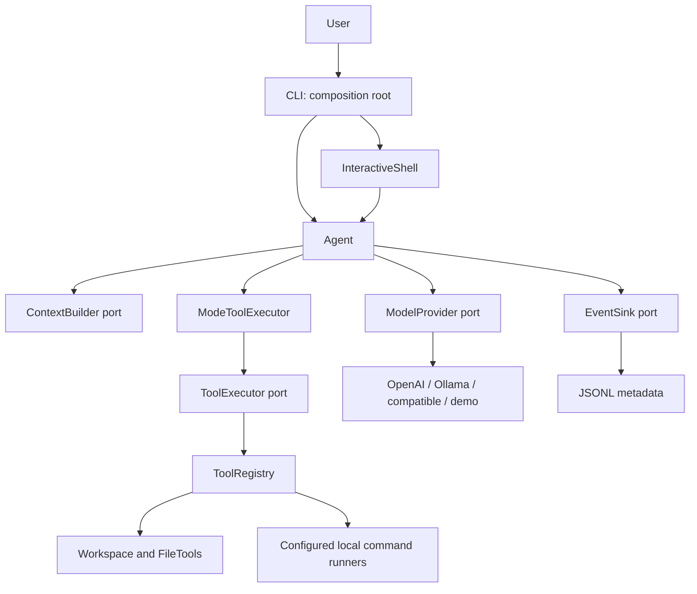
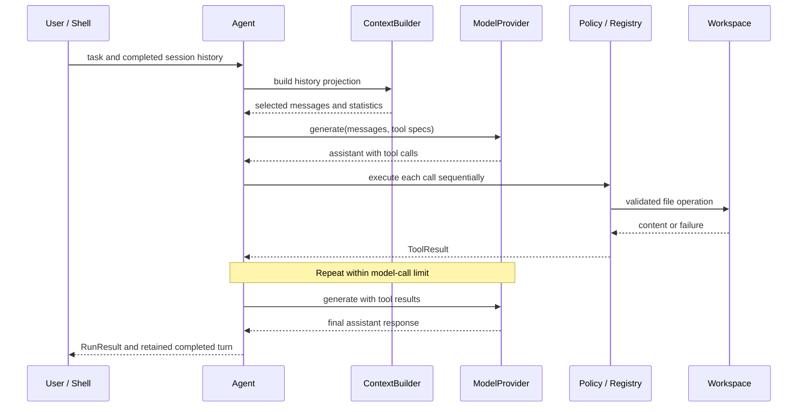
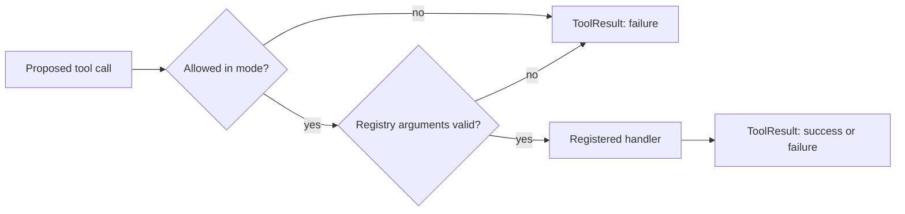
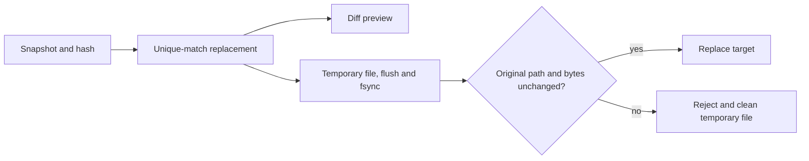
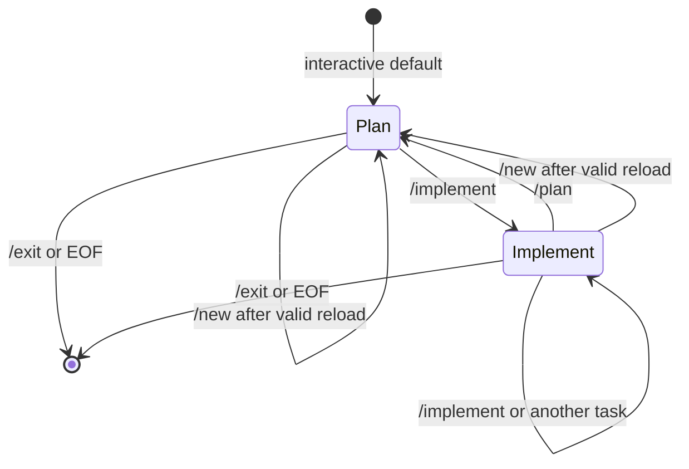

# Component reference and scientific rationale

**Core baseline:** version 0.7.0 and the bug fixes documented in PR #1. This is an
explanation of implemented behavior, not a specification of future features.
Source inspection baseline: [commit 0f7ded1](https://github.com/mtirtasana/ai-coding-agent/commit/0f7ded187c27b70cc439bace4fe311d9e3935992),
recorded 2026-10-20. Source links below track the checked-out branch; use the
baseline commit for reproducible comparisons.

The [documentation index](README.md) gives shorter operational reading paths;
the [ADRs](adr/README.md) explain why these choices were made.

Version 0.8 adds optional core cancellation and the editor adapter described in
[VS Code extension architecture](vscode-extension.md), with separate completion
workers and reviewed buffer operations. The following baseline still explains the
CLI/core; its earlier validation snapshot is historical.

Version 0.9 adds [focused file reads and paired context-cost evaluation](token-efficiency.md).
The range tool retains full-file edit hashes; integer argument validation and
editor-buffer behavior are documented with that additive contract.

Version 0.10 adds [interactive CLI composition, attachments and opt-in review](interactive.md),
with presentation adapters and an additive `tool_started` event. Direct CLI
writes remain the default; editor approvals remain a separate adapter contract.

Version 0.11 adds [provider profiles and a host-local usage ledger](providers-and-usage.md).
`ConnectionController` composes existing providers; `OSVault` owns keychain access;
`ProfileStore` owns nonsecret metadata; `MeteredProvider` records model-port calls;
`UsageJournal` owns SQLite and read-only report aggregation. Neither the core nor
context selection acquires a persistence dependency. The linked guide specifies
schemas, unknown-value coverage, concurrency, session identity and failure behavior.

Version 0.12 adds [supervised defaults, typed verification evidence, opt-in recovery,
file policy and locked runtime updates](production-readiness.md). These adapters
extend the baseline without making the core depend on filesystem or persistence
implementations. `ModelResponse.truncated` prevents incomplete tool execution;
`RunResult.verification` carries host-owned check evidence.

## 1. Problem, terminology and evidence

The agent translates a natural-language coding request into observations,
proposed edits and configured verification commands. A language model proposes
which action to take. Ordinary Python code decides which actions are available,
validates their arguments and executes them. This separates probabilistic
proposal generation from deterministic checks on individual operations. It does
not make the resulting program correct by construction.

A **port** is a small interface expressing a capability the core needs. An
**adapter** translates that interface into a particular API, filesystem or
output format. A **tool** is an operation exposed to the model. A **round** is one
assistant response together with all results for its tool calls. A **turn** begins
with a user request and, when successful, ends with an assistant response without
tool calls. A **run** attempts to complete one turn; a **session** retains completed
turns and plans across runs in the same process.

Ports and adapters follow Cockburn's separation of application behavior from
external devices [R1]. The iterative model/tool interaction is related to
reasoning-and-acting systems such as ReAct [R2]. This implementation does not
reproduce the paper's prompting experiments, require an explicit reasoning trace,
or expose a model's private reasoning. These references explain concepts, not
measured performance of this code.

Throughout this reference:

- **Implemented** means the behavior is visible in the linked source.
- **Tested** means the linked automated tests exercise selected cases. It is not
  proof over all inputs or supported operating systems.
- **Hypothesis** means a plausible effect that needs controlled measurement.
- **Deferred** means there is no operational implementation in this repository.

## 2. System decomposition

The implementation uses ports and adapters, dependency injection, a policy
wrapper, and a bounded sequential control loop. These patterns have different
roles: ports isolate technology, injection assembles an application, policy
restricts capabilities, and the loop defines execution order.



Arrows above show runtime calls. Source dependencies are more restrictive: the
core imports its own types, ports and policies, but no CLI, SDK or filesystem
adapter. Adapters may import core types. The CLI imports both sides to construct
the application. This is the **composition root**, the place where concrete
choices are made. See [ADR-0001](adr/0001-ports-and-adapters.md).

| Component | Implementation | Primary responsibility |
| --- | --- | --- |
| Domain data and ports | [types.py](../agent/core/types.py), [ports.py](../agent/core/ports.py) | Provider-independent contracts |
| Agent engine | [engine.py](../agent/core/engine.py) | Model/tool sequencing and successful-turn commit |
| Mode policy | [policy.py](../agent/core/policy.py) | Capability filtering and execution denial |
| Context builder | [context.py](../agent/core/context.py) | Validate and select complete history units |
| Model adapters | [models.py](../agent/adapters/models.py) | Translate provider requests, responses and usage |
| Tool registry | [tools.py](../agent/adapters/tools.py) | Validate calls and dispatch handlers |
| Workspace | [files.py](../agent/files.py) | Path checks and basic file operations |
| Editing tools | [editing.py](../agent/adapters/editing.py) | Bounded search, snapshots and exact edits |
| Command execution | [execution.py](../agent/adapters/execution.py) | Explicit processes and bounded output capture |
| Project instructions | [instructions.py](../agent/adapters/instructions.py) | Load the workspace-root instruction snapshot |
| Interactive shell | [terminal.py](../agent/terminal.py) | Commands, session state and effective permission display |
| Event adapter | [events.py](../agent/adapters/events.py) | Emit structured metadata |
| Evaluation harness | [evaluate.py](../agent/evaluate.py) | Run opt-in fixtures with independent checks |
| CLI and packaging | [cli.py](../agent/cli.py), [pyproject.toml](../pyproject.toml) | Validate configuration and choose adapters |

## 3. Formal model of a run

Let H_t be the complete in-memory message history before model call t, F_t the
external workspace state, A the available tool specifications, B the context
character budget, and K the maximum number of model calls. The context builder
computes a projection P_B(H_t, A). The model then returns either a final response
or an ordered list of proposed tool calls.

```text
Q_t = P_B(H_t, A)
Y_t = Model(Q_t, A)

If Y_t contains tool calls a_1, ..., a_m:
    for each a_j in order:
        r_j = PolicyAndRegistryExecute(a_j, current workspace)
    H_(t+1) = H_t followed by Y_t and r_1, ..., r_m

If Y_t has no tool calls:
    commit the completed turn to ConversationState and return

If no final response occurs in K calls:
    raise StepLimitError
```

This model describes application control flow. Model behavior and external
processes are not assumed deterministic. A run with fewer transmitted characters
can still require more calls, produce worse edits, or cost more overall.

A successful **conversation commit** only replaces the session's message list
after a final response. File operations occur earlier and are not part of that
commit. Thus a failed turn leaves the previous conversation intact but may leave
edited files or process side effects. This is a failure-containment convention,
not a transaction over the conversation and filesystem together.



The engine validates the assistant role and duplicate tool-call IDs within one
response. It does not validate a response against an exhaustive runtime type
schema. The core makes no automatic recovery retry after a failed run; provider
libraries can have their own network retry behavior. Event-sink exceptions also
propagate. See [ADR-0002](adr/0002-bounded-sequential-loop.md) and
[ADR-0005](adr/0005-session-state-and-project-instructions.md).

## 4. Data contracts and ports

`Message` stores a role, text, optional tool calls, and an optional result
`call_id`. `ToolCall` stores an ID, tool name and JSON argument string. The result
ID associates one observation with its original action; preserving it is a
protocol requirement, not merely a logging convenience.

`ToolSpec` defines a name, description, parameter schema and `read_only` flag.
`ToolResult` separates success (`ok`) from textual content. Structured file or
process reports are JSON inside that content string. The engine wraps the result
again as `{"ok": ..., "content": ...}` in a tool message. Consumers therefore
need to distinguish the outer success envelope from any JSON report inside it.

`ModelResponse` combines an assistant message with optional `ModelUsage`.
Unavailable usage stays `None`, serialized as `null` when appropriate. A reported
zero remains zero. `RunResult` retains full messages and per-request metrics;
`ConversationState` retains completed turns, `latest_plan` and `accepted_plan`.

The four ports are deliberately small:

| Port | Input and output | Adapter obligation |
| --- | --- | --- |
| `ModelProvider.generate` | Messages and tool specs → `ModelResponse` | Translate formats and preserve call/result identity |
| `ContextBuilder.build` | History, specs, character budget → `ContextSelection` | Produce valid history units and honest selection statistics |
| `ToolExecutor` | Specifications; call → `ToolResult` | Expose capabilities and preserve failures |
| `EventSink.emit` | Event kind and metadata dictionary | Record or forward the supplied event |

Python `Protocol` supports structural typing: adapters need the required methods,
not a shared base class [R3]. Type annotations do not enforce these contracts at
runtime. Frozen dataclasses prevent rebinding their fields but do not deeply
freeze nested dictionaries or lists. No repository-wide static type-checking gate
is currently configured. See [ADR-0003](adr/0003-provider-neutral-contracts.md).

## 5. Agent engine and mode policy

The engine supplies runtime instructions, mode instructions, the loaded project
rules, an accepted plan if present, previous completed turns and the current user
request. It selects context before every model call, executes returned tools
serially, and records observations before asking the model again. The engine
stops on a final response, a step/context limit, an exception or interruption.

`ModeToolExecutor` wraps the concrete executor. In `plan`, it advertises only
specifications marked `read_only=True`. It also checks every call against that
filtered set, so an invented write or process call is denied even if the model
ignores the advertised schema. In `implement`, it exposes the configured set.

For the current built-in tools, permissions can be described as:

```text
available(file edit) = implement AND allow_write
available(process check) = implement AND allow_exec AND configured command
available(lint fix) = implement AND allow_exec AND configured fixer
                      AND configured lint recheck AND allow_write
```

These equations summarize CLI assembly plus the policy wrapper; they are not
independent checks implemented in every adapter. Direct Python integrations are
responsible for constructing an appropriate registry. Custom tools must declare
`read_only` accurately. The wrapper cannot infer whether a handler writes files.



An accepted plan is text supplied to the model, not executable code and not a
permission grant. Prompt instructions such as “run tests after editing” remain
behavioral requests; a separate verification ledger does not enforce them.
See [ADR-0004](adr/0004-capability-based-planning.md).

## 6. Context selection

`RuleBasedContextBuilder` validates the complete source history using
`split_turns`, then selects whole message groups. Tool responses must match
unique call IDs in their round. Older turns must finish before a later user turn
begins. Incomplete or misassociated groups fail validation before a model call.

The implemented size function is approximately:

```text
c(message) = len(content) + sum(len(tool name) + len(arguments))
c(tools)   = sum(len(description) + len(JSON(parameter schema)))
c(context) = sum(c(message)) + c(tools)
```

It omits roles, call IDs, provider-specific framing and parts of wire-format
serialization. It counts Python string characters, not UTF-8 bytes or tokens.
A budget of 200,000 characters is consequently neither a guaranteed model context
limit nor a monetary spending limit.

In `full` mode, all history must fit. In default `recent` mode, the algorithm:

1. Pins leading system messages, the original user request and the latest request.
2. Adds the latest active-turn round, which must fit in full when one exists.
3. Adds preceding active-turn rounds from newest to oldest until one does not fit.
4. Only if all active rounds fit, tries older completed turns from newest to oldest
   as atomic units. It stops at the first older turn that does not fit.
5. Returns selected messages in their original order without changing the source.

This is a recency heuristic, not knapsack optimization or semantic retrieval.
The original user message may remain without the rest of its old turn because
it is independently pinned. The algorithm never slices a tool/result round or
shortens a message. If mandatory context cannot fit, it raises
`ContextLimitError`; it does not silently summarize or truncate.

The complete history remains in memory and is inspected again on later calls.
Selection reduces transmitted context, not retained session memory. Ignoring
serialization details, history traversal is linear in its content; sorting
selected indices adds up to O(n log n) work for n messages. No retrieval index
or persistent cache accelerates it.

**Hypothesis:** removing irrelevant history can reduce input tokens. It may also
remove information needed for a correct edit. Research on positional effects in
long contexts motivates evaluation, but does not validate this particular
recency policy [R4]. See [ADR-0006](adr/0006-atomic-context-projection.md).

## 7. Provider adapters

All providers implement the same port but offer only a common subset: text,
function calls and optional usage. Provider-independent interfaces do not imply
identical model quality, protocol support or network behavior.

| Adapter | Translation and configuration | Important limits |
| --- | --- | --- |
| `OpenAIProvider` | Responses input items, function-call outputs, strict tool schemas, `store=False`; optional SDK | No streaming or provider-specific reasoning-item preservation; SDK defaults govern timeout/retries unless an injected client changes them |
| `OllamaProvider` | JSON POST to `/api/chat`; tool arguments become objects and results include `tool_name`; response-local UUID call IDs | HTTP(S) URL validation, no embedded credentials/query/fragment, redirects rejected and response stream closed; default 120-second timeout; no authentication option |
| `OpenAICompatibleProvider` | Chat Completions message/tool-call format; explicit model, endpoint and environment-selected key | Default client timeout 120 seconds and `max_retries=0`; no Responses fallback; compatibility depends on the endpoint |
| `DemoProvider` | Deterministic `list_files` request followed by a final response | Offline wiring check, not a language model or measure of coding ability |

Ollama's generated IDs avoid collisions caused by deriving IDs from a projected
history's length. The adapter derives tool names for observations from retained
calls, so preserving complete rounds is necessary for translation.

Provider-reported usage is normalized to nonnegative integers. Missing or malformed
fields remain unknown. Cached input counts, when provided, describe provider-side
accounting; they do not imply this agent implements a local model-response cache.
The configured endpoint is trusted: HTTP(S) validation is not a defense against
an untrusted user selecting an internal server. Files supplied in context are
sent to the chosen model endpoint.

## 8. Tool registry and workspace

`ToolRegistry` connects names to specifications and handlers. It parses argument
JSON, requires an object with exactly the declared keys, and currently accepts
string-valued arguments plus bounded integers for range reads (added in v0.9).
Booleans and floats do not satisfy integer fields. Zero-argument process tools
accept exactly `{}`. Supporting further schema types requires extending validation; the registry is not
a general JSON Schema validator. Expected operational exceptions become
`ToolResult(False, error text)` so the model can inspect the failure.

`workspace_tools` assembles basic files, enhanced search/edit tools and optional
verification tools. Basic writes and targeted edits require write permission.
Process tools are added independently when their runners exist.

`Workspace.path` resolves the requested path and requires the result to remain
under the resolved workspace root. It rejects `.git`, `.ssh`, `.aws` and path
parts beginning with `.env` in both the supplied and resolved paths. Ordinary
outside-root symlinks are rejected. These checks are application-level guards;
concurrent symlink changes and arbitrary subprocess access require stronger
isolation than this code provides.

`read_file` reads UTF-8 with a 100,000-character limit. `write_file` validates
length and UTF-8 encodability before creating directories or opening the target,
so malformed Unicode cannot truncate an existing file. It still replaces a whole
file directly and is not crash-atomic. `list_files` sorts directory entries,
considers the first 500 and filters protected names. That limits displayed
entries, not the work required to enumerate/sort the directory.

See [ADR-0007](adr/0007-workspace-guards-without-sandbox.md).

## 9. Search, snapshots and targeted editing

`FileTools` adds literal search, byte-preserving snapshots and optimistic edit
validation. Search traverses directories with a queue, skips encountered symlink
entries and configured cache/build directories, and reads eligible UTF-8 text.
It is bounded by 10,000 visited directory entries, 1,000 scanned files, 100
matches and approximately 20,000 characters of match data. Queries must be
single-line literals of at most 512 characters. A negative truncated search is
not evidence that no match exists in the entire repository.

A snapshot contains the exact decoded text and SHA-256 of the raw bytes. The
400,000-byte/100,000-character limit and NUL rejection prevent treating arbitrary
binary or large files as editable text. Retaining raw bytes preserves CRLF and
makes hash checks sensitive to line-ending changes.

An edit requires an expected hash and one nonempty old-text fragment that occurs
exactly once, including overlapping matches. Let b be the bytes read, h the
supplied hash, and s the old-text fragment. The preparation preconditions are:

```text
SHA256(b) = h
number of occurrences of s = 1
updated text is valid UTF-8, contains no NUL, and meets the size limit
```

`preview_edit` computes a unified diff without writing. It caps returned diff
text at 20,000 characters and marks truncation. `apply_edit` recomputes the
preconditions, writes a temporary file in the target directory, flushes and
fsyncs it, preserves permission bits, rechecks original bytes and path, then
replaces the target with `os.replace`.



The hash acts as an optimistic version token, not authentication. Revalidation
reduces stale edits but is not a lock or an atomic compare-and-swap: another
writer can intervene between the final check and replacement. Multiple file
edits are not a transaction. Directory fsync, ownership/ACL preservation and
multi-writer coordination are not guaranteed. A preview is advisory and is not
a mandatory approval checkpoint. See [ADR-0008](adr/0008-hash-checked-targeted-edits.md).

## 10. Local verification and security checks

`LocalCommandRunner` executes only the argument list configured by the host.
The model cannot pass a replacement command to `run_tests`, `run_lint`,
`run_security` or `run_dependency_audit`. CLI command strings are parsed with
`shlex.split`, using POSIX quoting rules even on Windows; Windows paths require
appropriate escaping/quoting. No explicit shell evaluation is requested; OS handling of Windows batch files
is platform-dependent [R5].

The process runs in the resolved workspace, inherits the host environment and
permissions, receives no interactive stdin, and merges stdout/stderr. A reader
thread drains the pipe while retaining a bounded byte prefix. The default output
limit is 65,536 bytes; extra bytes are discarded without blocking the writer.
Default process deadlines are 60 seconds for tests/lint/security and 120 seconds
for dependency auditing. Cleanup and process startup can extend observed time
beyond the configured deadline. POSIX process groups are killed on timeout or
interruption; Windows uses the OS `taskkill` utility and a kill fallback.
Descendants that escape those mechanisms are outside the guarantee.

For a completed runner report, define E as exit code zero, D as timeout, and C
as successful capture completion. The implemented success predicate is:

```text
passed = E AND NOT D AND C
capture_complete = reader finished AND capture_error is null
```

A reader error produces `capture_error`, prevents success even after exit zero,
and stops a still-running command. The report retains partial output, exit code,
elapsed time, timeout and truncation flags. Startup errors instead become a
registry-level failure without a completed process report. Output truncation
alone does not make a successful command fail: it limits observability, not the
process's exit status. Nonzero scanner exits need interpretation of the output;
they can indicate findings, bad configuration or unavailable infrastructure.

`LintFixRunner` composes a configured fixer and lint recheck. It rechecks after a
normal fixer result, including nonzero exit, but skips rechecking after a fixer
timeout. Both results must pass. It returns `requires_test_rerun=True`; it does
not itself run tests. Exceptions such as a missing executable propagate to the
registry failure path. No automatic security fixer or dependency upgrader is
exposed.

Tests, linting, static security analysis and dependency auditing answer different
questions. A green Bandit scan cannot establish correct authorization, and a
green pip-audit result only means no matching known advisory was reported for the
audited installed environment. Separate CI jobs report these outcomes. Current
CI audits installed optional dependencies and tooling, skips the editable local
package, and updates pip/setuptools first. The three narrow subprocess Bandit
exceptions and OWASP limits are explained in [Security checks](security-checks.md).
See [ADR-0009](adr/0009-explicit-bounded-process-execution.md) and
[ADR-0010](adr/0010-separate-verification-evidence.md).

## 11. Terminal, instructions and session lifecycle

`InteractiveShell` owns the mutable `ConversationState`; it creates an agent for
each task with the current mode and instruction snapshot. Without an initial
CLI task, mode defaults to `plan`; a single supplied task defaults to
`implement`. `/implement` accepts the latest successful plan and changes mode,
then waits for a new user task. It does not start an implementation implicitly.



The instruction loader reads only workspace-root `AGENTS.md` through existing
path and size checks. Missing instructions are allowed. Invalid encoding,
oversize content or a protected/escaping path fails loading. Nested instruction
files are not automatically discovered. `/instructions` displays the loaded
snapshot; `/new` loads a replacement before clearing history, so a failed reload
preserves the previous session.

Terminal history is in memory, with no configured disk history. Runtime/project
instructions and an accepted plan are pinned as system-prefix context. This
helps preserve guidance but is not a semantic defense against prompt injection.
Mode and workspace guards remain independent executable checks. Ordinary task
failure leaves previous conversation state intact; external file/process
changes can remain. Restarting the process loses conversation and plans.

## 12. Observability, usage and empirical evaluation

The engine emits `run_started`, `context_selected`, `model_completed`,
`tool_completed`, `run_completed` and limit-related `run_stopped` events.
`JsonlEventSink` writes and flushes one JSON object per event. The standard engine
payloads contain counts, mode, tool names and usage rather than prompts, file
content or raw model responses. The sink does not redact arbitrary custom
payloads. It is an observer, not an event-sourced persistence system: these
records cannot reconstruct the conversation or restore a run.

For N completed responses, let O be the subset with a known input-token count.
The observed token sum and coverage are:

```text
observed_input_tokens = sum(input_tokens_i for i in O)
usage_coverage = len(O) / N                 (N > 0)
character_reduction = 1 - selected_chars / full_chars  (full_chars > 0)
```

The harness reports the sum and contributing count, not the coverage fraction
itself. An incomplete observed sum is not the unknown total. Character reduction
is a context-volume statistic, not token savings, model quality or a causal
latency estimate. Cached-input accounting must not be added to input counts as
if it were an independent third category of tokens.

`agent.evaluate` offers fresh temporary fixtures for project explanation,
correcting addition and repairing multiplication. `--live` authorizes endpoint
calls; code-changing fixture evaluation also requires `--allow-exec` for host
checks. In workflow mode the model can access configured fixture tests; baseline
mode omits enhanced tools and that test tool. Both changed-code conditions use
an independent checker outside the workspace after the run. This compares tool
bundles, not only the edit algorithm or context selector in isolation.

The explanation check looks for expected terms and unchanged fixture files; it
is a limited proxy for explanatory accuracy. The changed-code checker executes
candidate code with host permissions and checks arithmetic cases and protected
fixture hashes. Its outside-workspace location reduces accidental modification
through file tools; it is not tamper-proof isolation against arbitrary host code.
Rows are `passed`, `failed` or `not_run`. Missing setup and endpoint failure before
any completed response can yield `not_run`; failures after interaction are not
silently counted as unavailable. Reports omit raw conversations and errors, but
profile labels and model identifiers remain user-supplied metadata.

See [ADR-0011](adr/0011-metrics-and-independent-evaluation.md) and the executable
fixture tests in [test_evaluation.py](../tests/test_evaluation.py).

## 13. Worked example: one small repair

Suppose the user requests “fix addition and verify the result.” A safe workflow
is possible when write and process capabilities have been configured:

1. Search for the addition function, then obtain a current snapshot of its file.
2. Preview a replacement from `return a - b` to `return a + b` using that hash.
3. Apply it. If another editor changed the file, obtain a new snapshot and reason
   about the change instead of repeatedly reusing the stale hash.
4. Run configured tests and relevant lint/security checks, inspecting each result.
5. Report the actual edit, actual results and checks that were not available.

This sequence is guidance, not a hard-coded plan. The model can choose a
different permitted sequence, omit a check, or give a poor explanation. If tests
fail, their actual output becomes an observation for a later model decision.
If the context or step budget is exhausted, the run stops without rolling back
the already applied edit. Human review remains necessary.

## 14. Validation, hypotheses and limits of inference

The following table connects claims to executable evidence. Tests are
counterexample searches over selected cases, not mathematical proofs.

| Property | Evidence | What it does not establish |
| --- | --- | --- |
| Core sequencing and provider translation | [test_architecture.py](../tests/test_architecture.py), [test_compatible.py](../tests/test_compatible.py) | Correct behavior of every remote model or endpoint |
| Complete context groups, pinned requests and budgets | [test_context.py](../tests/test_context.py) | Optimal information retention or exact token limits |
| Successful-turn commit and instruction lifecycle | [test_session.py](../tests/test_session.py), [test_terminal.py](../tests/test_terminal.py) | Filesystem rollback or durable sessions |
| Path checks and Unicode write prevalidation | [test_files.py](../tests/test_files.py) | Protection against concurrent symlink races or host processes |
| Stale/ambiguous edits and byte preservation | [test_editing.py](../tests/test_editing.py) | Multi-writer serializability or semantic patch correctness |
| Process limits, capture failures and permissions | [test_execution.py](../tests/test_execution.py), [test_linting.py](../tests/test_linting.py), [test_security.py](../tests/test_security.py) | An OS sandbox or exhaustive platform coverage |
| Unknown usage handling and independent fixture checks | [test_usage.py](../tests/test_usage.py), [test_evaluation.py](../tests/test_evaluation.py) | Representative coding accuracy or monetary savings |

The preceding review verified 104 tests and passing lint/security/audit CI. That
is a recorded validation snapshot, not a promise that every future environment
or newly published advisory will produce the same result. No live-model study
is reported here.

For a defensible evaluation of a change, predeclare the task set, success
criterion, model/endpoint version, tool bundle, budgets and repeated-trial count.
Use fresh workspace fixtures, identical independent checks and paired tasks
across conditions. Report failures and unavailable runs separately, usage
coverage, the distribution of latency and tokens, and uncertainty intervals.
Ablate context policy and edit tools separately; otherwise their effects are
confounded. API nondeterminism, small arithmetic fixtures, keyword-based
explanation grading and a changing advisory database limit reproducibility.
These are recommendations for an experiment, not additional implemented harness
features.

Artifact caching, relevance ranking, summaries, persistent verification ledgers,
container isolation and multi-agent scheduling are deferred. Persisting H_t in
a database alone would not change P_B(H_t, A) or transmitted context. Introducing
them needs its own contracts, invalidation rules and evidence. See
[ADR-0012](adr/0012-defer-persistence-and-caching.md).

## 15. References

These are background and API references. Repository source and tests determine
what this implementation actually does. No quoted benchmark result is reused as
a result for this agent.

- **[R1]** Alistair Cockburn (2005), [Hexagonal Architecture](https://alistair.cockburn.us/hexagonal-architecture).
  Original description of separating application behavior from external devices.
- **[R2]** Shunyu Yao et al. (2023), [ReAct: Synergizing Reasoning and Acting in Language Models](https://arxiv.org/abs/2210.03629).
  Research on interleaving language-model reasoning and external actions.
- **[R3]** Python documentation, [Protocols and structural subtyping](https://docs.python.org/3.11/library/typing.html#typing.Protocol).
  Language-level basis for the port definitions.
- **[R4]** Nelson F. Liu et al. (2023), [Lost in the Middle: How Language Models Use Long Contexts](https://arxiv.org/abs/2307.03172).
  Evidence about context-position effects in the studied models/tasks, not this agent.
- **[R5]** Python documentation, [subprocess security considerations](https://docs.python.org/3.11/library/subprocess.html#security-considerations).
  Process execution semantics and the limits of avoiding a shell.
- **[R6]** Michael Nygard (2011), [Documenting Architecture Decisions](https://cognitect.com/blog/2011/11/15/documenting-architecture-decisions).
  Rationale for maintaining small records of decisions and their consequences.
