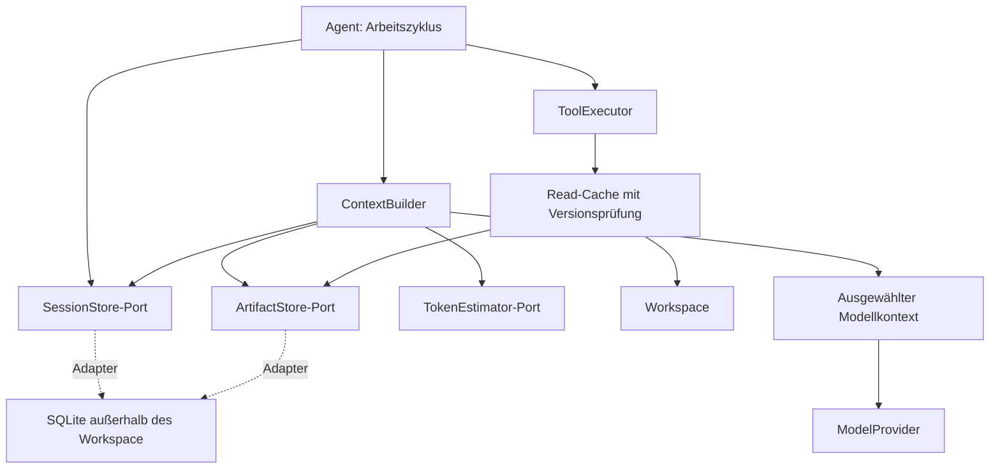
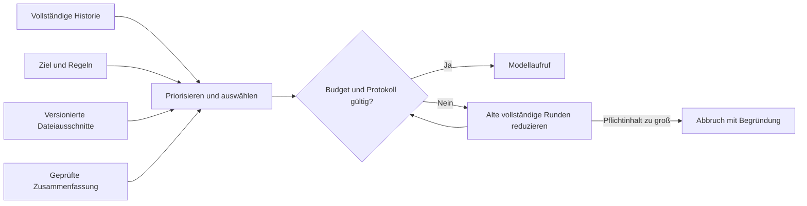
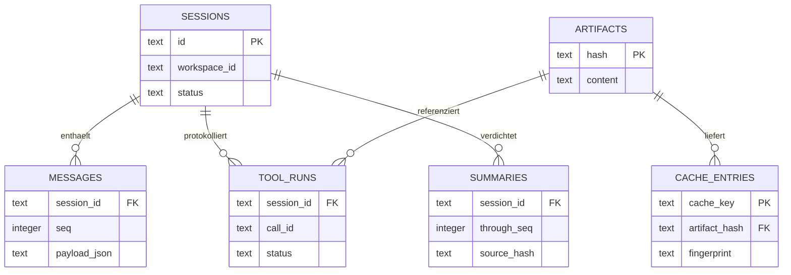

# Vorschlag: Kontextverwaltung und SQLite-Persistenz

**Status: teilweise umgesetzt, Stand Version 0.3.** Die regelbasierte Kontextauswahl
(`recent`/`full`), Auswahlstatistiken und optionale Anbieter-Tokenwerte sind implementiert.
SQLite, Speicher-Ports, Cache, Zusammenfassungen, TokenEstimator und relevante
Dateiausschnitte sind weiterhin Vorschläge. Die folgende Gesamtarchitektur trennt
bewusst die aktuelle Basis vom geplanten Ausbau; das SQL ist keine Migration.
Details zum aktuellen Verhalten stehen in der [Architekturdokumentation](architecture.md).

## Entscheidung

SQLite ist für diesen Agenten als lokaler Sitzungs- und Artefaktspeicher sinnvoll.
Tokenverbrauch reduziert jedoch erst eine gezielte Kontextauswahl. Der nächste
Schritt nach dem vorhandenen regelbasierten ContextBuilder sollte deshalb
die Messergebnisse auswerten und SQLite hinter austauschbaren Speicher-Ports anbinden.

Empfohlene Reihenfolge:

1. Tokenverbrauch beziehungsweise Schätzwerte und Aufgabenqualität messen.
2. Relevante Ausschnitte auswählen und wiederholte Inhalte im Modellkontext reduzieren.
3. Sitzungen und Werkzeugartefakte persistent speichern.
4. Nur nachweislich gültige Ergebnisse rein lesender Werkzeuge wiederverwenden.
5. Zusammenfassungen erst nach einer belastbaren Basislinie ergänzen.

Für einen einzelnen lokalen Prozess ist SQLite ausreichend. Mehrere schreibende
Prozesse, verteilte Worker und gemeinsame Netzlaufwerke sind zunächst nicht das
Ziel. Ein separater Datenbankserver oder eine Vektordatenbank ist für den
aktuellen Umfang nicht erforderlich.

## Ausgangslage im Repository

`Agent.run()` führt die gesamte Nachrichtenhistorie im Arbeitsspeicher. Jeder
Modellaufruf erhält in Version 0.3 eine budgetierte Auswahl der neuesten vollständigen
Runden oder im Modus `full` alle Nachrichten. Werkzeugausgaben werden vollständig
als JSON-Text in der Originalhistorie behalten. `max_context_chars` ist weiterhin
ein ungefähres Zeichenbudget. Auswahl findet statt, Komprimierung noch nicht.

`JsonlEventSink` protokolliert nur Metadaten. Er ist weder Gesprächsspeicher noch
Checkpoint. `RunResult.messages` existiert nur bei erfolgreichem Abschluss.
`Workspace` liest und ersetzt Dateien, besitzt aber keine Versionsverwaltung
für einzelne Dateistände. Diese Eigenschaften erklären, weshalb bloßes Speichern
der bisherigen Historie in SQLite noch keine Tokenersparnis erzeugt.

## Drei verschiedene Aufgaben

| Aufgabe | Inhalt | Nutzen | Einfluss auf Tokens |
| --- | --- | --- | --- |
| Sitzungszustand | Aufgabe, Nachrichten, Werkzeugaufrufe, Status | Nachvollziehbarkeit und kontrollierte Wiederaufnahme | Kein direkter Vorteil |
| Werkzeugcache | Ergebnisse rein lesender, versionierter Operationen | Weniger lokale Arbeit und wiederholte Abfragen | Nur wenn Kontextduplikate vermieden werden |
| Kontextauswahl | Relevante Nachrichten und Dateiabschnitte | Weniger unnötige Eingabe beim Modell | Direkter Einfluss auf Eingabetokens |

Ein Modellantwortcache ist zunächst nicht vorgesehen: Sein Schlüssel müsste
unter anderem vollständigen Kontext, Modellversion, Parameter, Werkzeuge und
Instruktionen erfassen. Wiederverwendete Antworten können außerdem bereits
überholte Handlungen enthalten. Anbieter-Prompt-Caching ist eine weitere,
separate Optimierung; es reduziert gegebenenfalls Kosten oder Latenz und muss
anbieterspezifisch gemessen werden.

## Zielarchitektur und Ports



Das Diagramm zeigt den vollständigen Zielausbau. `ContextBuilder` ist als Port mit
regelbasierter Implementierung vorhanden; Speicher-Ports und TokenEstimator fehlen noch.
`ModelProvider.generate()` erhält bereits einen ausgewählten Kontext und liefert
seit Version 0.3 `ModelResponse` mit Nachricht und optionalen Anbieter-Tokenwerten. Die vollständige
Historie bleibt im SessionStore erhalten. Kontextprojektion und Quelle werden
also getrennt.

| Komponente | Verantwortung und vorgeschlagener Vertrag |
| --- | --- |
| `SessionStore` | Lauf starten, Nachrichten geordnet anhängen, Status und Checkpoints atomar speichern, Sitzung laden |
| `ArtifactStore` | Inhalte nach Hash ablegen, Metadaten und Dateiversionen verwalten, Inhalte oder Ausschnitte laden |
| `ContextBuilder` | Aus Aufgabe, Historie und relevanten Artefakten einen konsistenten Modellkontext bauen |
| `TokenEstimator` | Tokenumfang für Anbieter/Modell schätzen; verfügbare Nutzungswerte separat erfassen |
| Read-Cache | Leseschlüssel bilden, Gültigkeit prüfen und Workspace-Ergebnisse wiederverwenden |
| SQLite-Adapter | Transaktionen, Migrationen, Retention und Abfragen; keine Modellentscheidung |

In-Memory-Adapter bleiben für Tests und kurze Läufe verfügbar. Der Agent-Kern
importiert weiterhin kein `sqlite3`. Die CLI verdrahtet die neuen Komponenten.
Ein EventSink darf ergänzend Speicherereignisse erhalten, ist jedoch kein Ersatz
für einen atomaren SessionStore-Vertrag.

## Kontextstrategie

### Budget festlegen

Das nutzbare Eingabebudget wird pro gewähltem Modell bestimmt:

`Eingabebudget = Kontextfenster − reservierte Ausgabe − Sicherheitsreserve`

Werkzeugschemas und Systemanweisungen zählen zum Eingabebudget. Ein zusätzliches
Nutzerlimit kann dieses weiter verkleinern. Die Werte müssen konfiguriert werden;
die Architektur soll keine pauschale Modellfenstergröße annehmen. Tokenizer oder
Server-Schätzungen können modellabhängig sein. Ohne passenden Tokenizer bleibt
eine konservative Zeichenschätzung mit Reserve nötig; sie ist kein exakter Zähler.

### Auswahl vor jedem Modellaufruf

1. Systemanweisungen, Nutzerziel und aktuelle Projektregeln beibehalten.
2. Offene Werkzeugaufrufe und ihre zugehörigen Ergebnisse vollständig zusammenhalten.
3. Die letzten vollständigen Interaktionsrunden mit Priorität einplanen.
4. Zu Aufgabe und aktuellen Fehlern passende Dateiabschnitte hinzufügen.
5. Ältere abgeschlossene Runden bei Bedarf durch eine versionierte Zusammenfassung ersetzen.
6. Budget und Aufruf-/Ergebniszuordnung erneut prüfen. Bei unauflösbarer
   Überschreitung verständlich abbrechen.



Ein Tool-Aufruf und seine Ergebnisse bilden eine Protokolleinheit. Bei mehreren
Aufrufen in einer Assistant-Nachricht bleiben alle zugehörigen Ergebnisse in der
Einheit. Keine Auswahl darf verwaiste Ergebnisnachrichten erzeugen. Bereits
abgeschlossene ältere Einheiten können als Ganzes entfallen. Unvollständige
Aufrufe werden zuerst geklärt und nicht zusammengefasst.

### Dateien und Zusammenfassungen

Für Dateien zunächst Pfad, Inhalts-Hash und Zeilenbereiche verwenden. Ganze
Dateien bleiben nachladbar, aber der Kontext enthält vorzugsweise relevante
Abschnitte. Eine geänderte Datei ersetzt im ausgewählten Kontext ihre veraltete
Version; historische Nachrichten im SessionStore bleiben unverändert.

Die vollständigen Rohresultate werden gespeichert. Begrenzte Werkzeugausgaben
sollten bereits bei der Ausführung explizite Hinweise auf Kürzung und eine
nachladbare Artefakt-ID erhalten. Der Kontextaufbau darf keine stillschweigenden
Änderungen an der gespeicherten Historie vornehmen. Wie die Modelladapter solche
Ergebnisprojektionen darstellen, ist mit jedem Anbieter zu testen.

Zusammenfassungen enthalten Ziel, Entscheidungen, Dateiversionen, offene Punkte
und verifizierte Resultate. Sie sind abgeleitete Informationen, keine neuen
Systemanweisungen. Sie referenzieren den abgedeckten Nachrichtenbereich und dessen
Hash. Eine neue Nutzerkorrektur hat Vorrang. Für Beweise und genaue Codeinhalte
müssen Originalquellen erreichbar bleiben. Zusammenfassungsaufrufe kosten selbst
Tokens; daher erst ab einem messbaren Bedarf einsetzen.

## Vorgeschlagenes SQLite-Datenmodell

Das folgende DDL ist ein diskutierbarer Startpunkt. Es enthält keine automatischen
Ausführungs- oder Wiederaufnahmeentscheidungen. Zeiten werden als UTC-ISO-Strings
von der Anwendung geschrieben, IDs als UUIDs und Hashes als SHA-256 vorgeschlagen.
`payload_json` enthält ein versioniertes internes Nachrichtenformat einschließlich
ToolCalls; SDK-Objekte gehören nicht in die Datenbank.



```sql
PRAGMA foreign_keys = ON;

CREATE TABLE sessions (
    id TEXT PRIMARY KEY,
    workspace_id TEXT NOT NULL,
    task TEXT NOT NULL,
    status TEXT NOT NULL CHECK(status IN ('running','paused','completed','failed')),
    config_json TEXT NOT NULL,
    created_at TEXT NOT NULL,
    updated_at TEXT NOT NULL
);

CREATE TABLE messages (
    session_id TEXT NOT NULL REFERENCES sessions(id) ON DELETE CASCADE,
    seq INTEGER NOT NULL,
    payload_version INTEGER NOT NULL DEFAULT 1,
    payload_json TEXT NOT NULL,
    created_at TEXT NOT NULL,
    PRIMARY KEY(session_id, seq)
);

CREATE TABLE artifacts (
    hash TEXT PRIMARY KEY,
    content TEXT NOT NULL,
    size_bytes INTEGER NOT NULL,
    created_at TEXT NOT NULL
);

CREATE TABLE cache_entries (
    cache_key TEXT PRIMARY KEY,
    workspace_id TEXT NOT NULL,
    tool_name TEXT NOT NULL,
    tool_version TEXT NOT NULL,
    arguments_json TEXT NOT NULL,
    fingerprint TEXT NOT NULL,
    artifact_hash TEXT NOT NULL REFERENCES artifacts(hash),
    expires_at TEXT,
    created_at TEXT NOT NULL
);

CREATE TABLE tool_runs (
    session_id TEXT NOT NULL REFERENCES sessions(id) ON DELETE CASCADE,
    call_id TEXT NOT NULL,
    tool_name TEXT NOT NULL,
    arguments_json TEXT NOT NULL,
    status TEXT NOT NULL CHECK(status IN ('pending','running','succeeded','failed','unknown')),
    result_json TEXT,
    artifact_hash TEXT REFERENCES artifacts(hash),
    updated_at TEXT NOT NULL,
    PRIMARY KEY(session_id, call_id)
);

CREATE TABLE summaries (
    session_id TEXT NOT NULL REFERENCES sessions(id) ON DELETE CASCADE,
    through_seq INTEGER NOT NULL,
    source_hash TEXT NOT NULL,
    policy_version TEXT NOT NULL,
    content TEXT NOT NULL,
    created_at TEXT NOT NULL,
    PRIMARY KEY(session_id, through_seq, policy_version)
);

CREATE INDEX cache_workspace ON cache_entries(workspace_id);
```

`workspace_id` bezeichnet eine stabile lokale Arbeitskopie, nicht nur eine
Repository-URL: Zwei Worktrees desselben Repositorys können unterschiedliche
ungespeicherte Dateistände haben. Der Checkout-Pfad wird lokal zugeordnet; bei
einem Umzug ist eine explizite Neuzuordnung nötig. Branch oder Commit allein
reichen als Cacheversion nicht aus.

`config_json` speichert Anbieter, Modell und Kontext-/Werkzeugrichtlinien,
jedoch keine API-Schlüssel. `source_hash` umfasst die zusammengefassten
Quellnachrichten; `policy_version` macht Zusammenfassungsregeln versionierbar.
Persistierte JSON-Inhalte müssen beim Laden zusätzlich gegen ihre interne
Formatversion validiert werden. Für Schemamigrationen `PRAGMA user_version`
verwenden; dies ist von der Nachrichtenformatversion getrennt.

### Transaktionen und Wiederaufnahme

Nach einem Modellergebnis werden Assistant-Nachricht und geplante Tool-Aufrufe in
einer Transaktion erfasst. Vor Ausführung wird der Aufruf als `running` markiert;
nach der Ausführung werden Ergebnisnachricht, Resultat und Status atomar gespeichert.

Ein Dateischreibvorgang und eine SQLite-Transaktion sind nicht gemeinsam atomar.
Stürzt der Prozess dazwischen ab, ist der Zustand unklar. Solche Aufrufe werden
beim Wiederanlauf als `unknown` behandelt. Schreibende Werkzeuge werden nicht
blind wiederholt. Vorher-/Nachher-Hashes und eine Nutzerentscheidung können zur
Auflösung dienen. Erst mit dieser Behandlung ist eine Resume-Funktion vertretbar.

## Cache-Schlüssel und Invalidierung

Für `read_file` wird vorgeschlagen:

`key = SHA256(workspace_id + tool_version + canonical_args + content_hash)`

Die Bestandteile müssen eindeutig serialisiert werden, etwa als kanonisches
JSON-Array; einfache Stringverkettung ist nicht eindeutig. Argumente normalisieren
und erst nach den Workspace-Pfad- und Berechtigungsprüfungen verwenden.

| Änderung oder Operation | Behandlung |
| --- | --- |
| Dateiinhalt geändert | Neuer Inhalts-Hash, bisheriger Cacheeintrag wird nicht getroffen |
| Datei extern geändert | Vor Wiederverwendung Inhalt erneut prüfen; mtime und Größe allein reichen nicht |
| `write_file` | Nie als Aktion cachen; danach betroffene Datei- und Verzeichnisabhängigkeiten invalidieren |
| Datei gelöscht oder umbenannt | Existenz und Pfad vor Zugriff prüfen; alten Treffer nicht zurückgeben |
| Verzeichnisliste | Im ersten Ausbau nicht cachen; externe Änderungen sind leicht zu übersehen |
| Werkzeugimplementierung oder Ausgabeformat geändert | `tool_version` erhöhen |
| Workspace oder Zugriffsrichtlinie geändert | Namespace beziehungsweise Richtlinienversion ändern und Zugriff neu prüfen |
| Temporärer Fehler | Anfänglich nicht cachen |
| Modell, Systemprompt oder Kontextstrategie geändert | Abgeleitete Zusammenfassungen beziehungsweise Modellartefakte neu bewerten |

Ein Inhalts-Hash ist nur so aktuell wie die gelesene Datei. Für den ersten Ausbau
keine Sicherheitsgarantie gegen parallele Dateimanipulation behaupten. Hash und
Text möglichst aus demselben gelesenen Inhalt gewinnen. Bei externen Änderungen
zwischen Prüfung und späterer Nutzung bleibt eine Race Condition möglich.

Vollständiges erneutes Hashen erfordert erneut Dateizugriff. Bei kleinen Dateien
ist ein SQLite-Lesecache deshalb unter Umständen langsamer als direktes Lesen.
Sein Hauptnutzen liegt hier in Deduplizierung, Referenzen und später teureren
Artefakten wie Syntaxanalysen. Erst Messungen rechtfertigen komplexere Watcher
oder inkrementelle Indizes. Eine TTL ist zusätzliche Bereinigung, kein Ersatz
für Versionsprüfung. Für bereits gültige lokale Inhalte ist sie optional.

## Betrieb und Aufbewahrung

Die Datenbank liegt außerhalb des vom Modell lesbaren Workspace, beispielsweise
in einem konfigurierbaren privaten Anwendungsdatenverzeichnis. Andernfalls könnte
`read_file` das Sitzungsarchiv offenlegen. Der Pfad ist nicht als Modellwerkzeug
verfügbar. Datenbank, Journale, WAL-Dateien und Backups gehören nicht ins Repository.

Die Persistenz enthält bewusst mehr sensible Inhalte als das derzeitige
Metadatenlog. Deshalb Speicherung konfigurierbar machen, lokale Dateirechte
beschränken und Sitzungen gezielt löschen können. SQLite verschlüsselt diese
Daten in der Standardkonfiguration nicht. API-Schlüssel werden nie persistiert.
Dateiinhalte bleiben Daten und dürfen durch Wiederherstellung nicht zu
Systemanweisungen hochgestuft werden.

Für den lokalen Adapter: Fremdschlüssel pro Verbindung aktivieren, kurze
Transaktionen verwenden und eine begrenzte Wartezeit bei Sperren einstellen.
WAL kann parallele Leser erleichtern, beseitigt aber nicht die Beschränkung auf
einen gleichzeitigen Schreiber. Vor Aktivierung Dateisystem und Backupstrategie
prüfen. Anfangs reicht ein Prozess mit einer klaren Schreibverantwortung.

Die Aufbewahrung umfasst maximale Speichermenge, Sitzungsalter und verwaiste
Artefakte. Nicht mehr referenzierte Cache-/Artefaktdaten dürfen entfernt werden.
Beim Löschen einer Sitzung zunächst ihre Referenzen entfernen und dann nur
Artefakte löschen, die auch von keiner anderen Sitzung oder Cachezeile benötigt
werden. Gemeinsame Cache-Artefakte können eine gesonderte Löschung erfordern.
Eine SQL-Löschung allein garantiert keine physische Vernichtung in Backups oder
Journaldateien; entsprechende Anforderungen benötigen ein eigenes Konzept.

## Erwartete Auswirkungen auf Tokens

Ohne Kürzung wächst das erneut gesendete Gespräch über mehrere Runden. Für einen
vereinfachten Fall mit `n` Aufrufen, einem festen Grundkontext `B` und `r` neuen
Tokens nach jeder Runde ergibt sich:

`T_voll = n × B + r × n × (n − 1) / 2`

Beispielrechnung, **kein Benchmark**: `n=10`, `B=2.000`, `r=1.000` ergibt
65.000 Eingabetokens über alle Aufrufe. Ein Kontextaufbau mit maximal 6.000
Eingabetokens pro Aufruf hätte in diesem Beispiel eine Obergrenze von 60.000;
der tatsächliche Verbrauch hängt von der Auswahl und dem frühzeitigen Abschluss
ab. Bei längeren Läufen kann die Begrenzung stärker wirken, bei kleinen Aufgaben
kann der Verwaltungsaufwand den Nutzen übersteigen.

Zusammenfassung kostet Eingabe- und Ausgabetokens. Sie lohnt sich hinsichtlich
Tokenmenge erst, wenn die vermiedenen wiederholten Eingaben diese Zusatzkosten
übersteigen. Eine kompaktere Darstellung kann außerdem Informationen verlieren
und zusätzliche Nachfragen verursachen. Deshalb keine prozentuale Einsparung
vorab versprechen.

Persistenz alleine verändert `T_voll` nicht. Auch ein Treffer im Werkzeugcache
spart keine Modell-Eingabetokens, wenn derselbe vollständige Inhalt erneut in
den Prompt aufgenommen wird. Der ContextBuilder muss Duplikate erkennen und
nur den aktuell benötigten Inhalt einplanen. Anbieter-Caching und veränderte
Tokenpreise sind bei einer Kostenanalyse getrennt zu betrachten.

## Evaluationsplan und Abnahmekriterien

Dieselbe Auswahl an kleinen, langen und dateiintensiven Aufgaben auf identischen
Ausgangsständen vergleichen. Modell, Parameter und Aufgabendefinition soweit
möglich konstant halten; bei nicht deterministischen Modellen mehrere Läufe
verwenden. Dateilesecache und Kontextauswahl zunächst getrennt messen.

| Messgröße | Zweck |
| --- | --- |
| Input-, Output- und verfügbare Cache-Tokenwerte je Request | Tatsächlichen Verbrauch und Anbieter-Caching auseinanderhalten |
| Geschätzte Tokens bei fehlenden Anbieterwerten | Transparente Ersatzmetrik statt erfundener Ist-Werte |
| Gesamtlatenz, Modellaufrufe und Zusammenfassungsaufwand | Zusätzliche Arbeit sichtbar machen |
| Trefferquote und abgewiesene veraltete Cacheeinträge | Gültigkeit und Nutzen prüfen |
| Tests, Diff-Qualität und Aufgabenabschluss | Einsparung gegen Qualität bewerten |
| DB-Größe und Wiederaufnahmeverhalten | Betriebskosten und Zuverlässigkeit beurteilen |

Vor einer Implementierungsfreigabe sind folgende Tests vorzusehen:

- Gleiche Aufgabe mit In-Memory- und SQLite-Adapter liefert dieselbe Nachrichtenreihenfolge.
- Externe Dateiänderung, Löschung oder Umbenennung liefert keinen alten Lesetreffer.
- Werkzeugaufrufe und Ergebnisse bleiben nach Kontextkürzung korrekt zugeordnet.
- Pflichtkontext überschreitet Budget: expliziter Abbruch statt stiller Kürzung.
- Crash zwischen Schreibaktion und Checkpoint: kein automatischer zweiter Schreibaufruf.
- Zusammenfassung mit abweichenden Quell-Hashes wird nicht ungeprüft verwendet.
- Sitzungsdatenbank ist über Workspace-Werkzeuge nicht zugänglich.

Der erste Schritt ist mit einem regelbasierten ContextBuilder und einer Historie
im Arbeitsspeicher umgesetzt. SQLite-Persistenz folgt als austauschbarer Adapter. Diese Reihenfolge adressiert zuerst den Tokenverbrauch und verhindert,
dass ein Speicherlayer ohne messbaren Nutzen zum Zentrum der Architektur wird.
