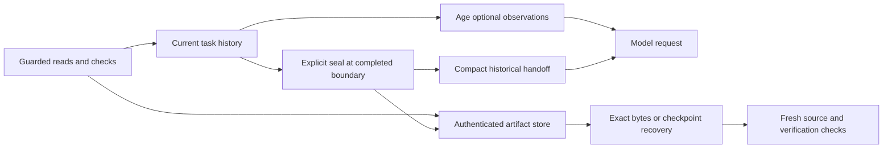

# Batch inspection, authenticated receipts and task handoffs

These features reduce repeated input and unnecessary model round trips while
retaining explicit recovery paths. They are provider-independent implementations,
not HELIX/Antigravity protocol compatibility. No third-party savings percentage
is assumed. Default archives are temporary memory; encrypted disk storage is an
explicit opt-in.

## 1. Inspect related ranges together

The model tool `batch_inspect` accepts one to ten ranges:

```json
{
  "requests": [
    {"path": "src/service.py", "start_line": 40, "end_line": 80},
    {"path": "src/policy.py", "start_line": 1, "end_line": 45}
  ]
}
```

Each range has a relative path of at most 1,024 characters and inclusive positive
line numbers, with at most 200 lines and 12,000 content characters. The response
has a shared 24,000-character budget, including space reserved for per-file
errors and an archive receipt. A result exceeding that budget is replaced with
an explicit error, not silently cut source. Mixed successes/failures retain
their request order. Top-level tool success means the batch completed; inspect
each result's `ok` before using it.

Successful entries contain `path`, `content`, line metadata and a full-file
`sha256`. Editor entries also contain the observed `documentVersion` and read
dirty buffers without saving. Duplicate paths reuse one initial observation.
Eligible files are re-read at the end: changes to content, path eligibility or
editor versions set `stable: false`. `atomic` is always false. Revalidation
detects changes; it cannot establish a simultaneous cross-file snapshot or
prevent changes after return. Edit tools still recheck current hashes and paths.

Credential-path guards, `.agentignore` denial, UTF-8/text limits and cancellation
apply independently. The Python/editor bridge filters denied paths before the
callback, and the editor rechecks its own policy. A denied file is not made
accessible by placing it beside an allowed file in a batch.

Grouping known ranges avoids the intermediate model requests of serial reads.
It does not discover unknown dependencies or guarantee lower tokens: schemas,
metadata and overbroad requested ranges also cost input. Search first, batch
related known ranges, then expand only when necessary.

## 2. Receipts and exact recovery

Snapshot/range/batch reads and configured check captures can return a compact
`receipt`: version, authenticated handle, artifact kind, captured byte count,
SHA-256 and whether storage is persistent. Full authenticated metadata is
recoverable with the handle. The legacy `read_file` response stays plain text;
complete history can still be archived when sealing.

`archive_read(handle, offset, length)` returns a receipt, base64 bytes,
`next_offset` and `eof`. Offsets are bytes; length is 1–4,096 bytes. This recovers
the original archived observation rather than rereading a changed file or
rerunning a command. File-read artifacts contain the original UTF-8 JSON
observation. Command artifacts contain the exact captured bytes, including
invalid UTF-8, NULs and original line endings.

```text
/raw HANDLE
/raw HANDLE 4096:4096
```

Check receipts record host-observed profile, command-argument digest, exit code,
elapsed time, timeout, cancellation, capture completeness and capture truncation.
Fix-and-lint workflows retain separate original captures and command digests.
Test counts are not guessed from arbitrary stdout. Exit zero is command status,
not proof of coding correctness or OWASP compliance. Current verification still
comes from the independent fingerprint/evidence ledger.

Existing success excerpts and failure head/tail excerpts remain available, as
does `read_check_output` for decoded lines. Security and dependency-audit output
is not shortened. Raw receipt retrieval can recover traceback details omitted
from an excerpt, up to the original capture limit. The default process capture
limit remains 65,536 bytes: the process continues draining beyond it, but those
discarded bytes cannot be recovered. `output_truncated` states this separately
from excerpt omission. This is not an unlimited or “100% stdout” retention claim.

When archiving fails, check execution status and inline output remain available
with `archive_error`; no successful storage receipt is fabricated. A failed
archive must not turn a failed test into a pass or trigger a second execution.

## 3. Storage, integrity and access

Memory archives require no extra dependency, disk access or vault. They share a
store across submitted tasks in one frontend process, with at most 128 entries
and 64 MiB of payloads. Eviction/exit can invalidate old handles; retrieval
reports that explicitly. Memory data is not encrypted and cannot be recovered
after process exit.

```bash
pip install -e '.[terminal,archives]'
coding-agent --profile work --persist-artifacts --context-mode compact
```

Disk archives use AES-256-GCM. The payload and private metadata, including source
paths, are encrypted. A minimal authenticated header exposes artifact identity,
kind, size/digest, creation time and hashes of workspace/policy identity; it is
not a source-content log. HMAC-SHA-256 authenticates the complete receipt under
a separately derived authentication key. A plain content hash alone would not
establish receipt authenticity.

Keys come from a supported OS vault, scoped to the canonical workspace. There is
no plaintext key-file fallback. Headless integrations may explicitly inject
`AGENT_ARCHIVE_KEY`, containing base64 for 32 random bytes, through their secret
manager. Do not put that value in a repository, AGENTS.md or plugin manifest.
Losing/rotating the key makes existing ciphertext unreadable; it is not silently
replaced on decryption failure.

Files live under the execution host's user state directory,
`artifacts/<workspace-hash>/`, outside the workspace. Symlinked storage roots and
files are rejected; creation uses private permissions and atomic replacement.
Per-workspace locks serialize key initialization and disk quota checks. Locks
fail explicitly rather than waiting indefinitely; after a crash, remove stale
locks only after stopping other writers.

Each payload is at most 8 MiB. Disk storage is capped at 64 MiB of encoded data
and 1,024 entries. A receipt expires 30 days after creation. Writes prune only
authenticated, decryptable expired artifacts; corrupt/unknown files are
preserved. Storage-full errors leave original task history intact. The directory
and minimum header metadata are not confidential against the authorized OS user.

Handles are bound to workspace and denial-policy state. Changing `.agentignore`
revokes previous handles conservatively; successful source paths are checked
again before archiving and before retrieval. Historical recovery does not
bypass current access denial. Historical content is not current source, and its
hash does not authorize an edit against a changed file.

Existing `--persist-session` recovery remains a separate, unencrypted opt-in
format. Enabling artifact encryption does not encrypt those snapshots. Sealing
with saved-session recovery requires persistent artifacts so the saved handoff
does not knowingly reference an archive that vanishes on exit.

## 4. Two levels of context control

**Within a task:** `compact` mode replaces older large successful file reads
with historical references, preserving their archive handles when available.
Batch results age per range. The newest two rounds, failed observations and
verification results are not rewritten. Active provider continuation chains
remain complete, even if that requires a budget stop.

Pin files whose observations must remain intact:

```bash
coding-agent --context-mode compact --context-pin src/policy.py
```

At most 16 exact relative paths can be pinned. Matching read rounds and their
user request become mandatory context. Pins are not read permissions, do not
imply freshness, and can cause an explicit context-budget stop. Pinned provider
continuation turns remain whole. No model guesses which old decision is safe
to remove.

**Between tasks:** retire completed history explicitly:

```text
/seal Decision: preserve the public API. Open: inspect dependency behavior and rerun checks.
/restore-task HANDLE
```

`seal` requires nonempty handoff notes, up to 6,000 characters. It validates that
the checkpoint ends with a completed assistant turn; pending tool chains and
busy workers cannot be sealed. The exact checkpoint and handoff notes are
archived first. Only after successful archival does the frontend replace its
history with a completed `agent.handoff.v1` user/assistant pair containing the
receipt, request/answer excerpts, user notes, bounded historical file references
and the old workspace fingerprint. Original state remains unchanged on failure.

The handoff is historical data, not new system instructions. It does not certify
assistant claims. Both seal and restore return the frontend to Plan, clear plan
acceptance and verification, and clear pending attachments/approvals. Restore
validates and loads the archived checkpoint; it does not replay tools, change
files or roll back accepted edits. Usage accounting continues in the same usage
session. The referenced workspace fingerprint is historical, not a current pass.
Provider-specific continuation items remain opaque; restoring does not make
them portable to a different provider or model.



This bounds repeated task context, not all future costs. Recovery calls, schema
overhead, extra reads and changed provider prompt-cache prefixes can offset
savings. Evaluate actual input/output/cached tokens, latency, independent task
pass rate and recovery overhead on the same workloads.

## 5. Editor and optional MCP integration

VS Code exposes **Seal Completed Task**, **Restore Archived Task** and **Read
Archived Bytes** in the command palette. The read command opens the first 4,096
bytes as a JSON/base64 result; `next_offset` supports subsequent tool/RPC reads.
Set `genericAgent.contextPins` for mandatory observations. The machine-scoped
`genericAgent.persistArtifacts` setting opts into encryption. Run backend setup
after enabling it: setup validates and installs the existing hash-pinned CLI
runtime profile, including cryptography/keyring. Completions do not initialize
the archive vault. No model is asked to summarize or seal automatically.

```bash
pip install -e '.[mcp]'
coding-agent-mcp --workspace /absolute/path/to/project
```

The optional stdio MCP adapter exposes only `batch_inspect` and `archive_read`.
It grants no writes, shell execution, task retirement or model requests. Add
`--persist-artifacts` and the archives extra if persistent recovery is wanted.
A host may register this executable as an MCP server; no Antigravity-specific
installation, global execution rules or home-directory symlinks are created.

The SDK is an optional adapter dependency; the engine and both regular
frontends work without it. The MCP extra requires SDK 1.30+ and security-patched
AnyIO 4.14.2+; it does not change regular runtime locks. The real stdio test
requires local IPC/event-loop wakeups in restricted execution environments,
although it makes no external model request. Initialization has a test timeout
so a blocked transport cannot hang the suite indefinitely.
See [ADR-0025](adr/0025-context-artifacts-and-task-sealing.md).
