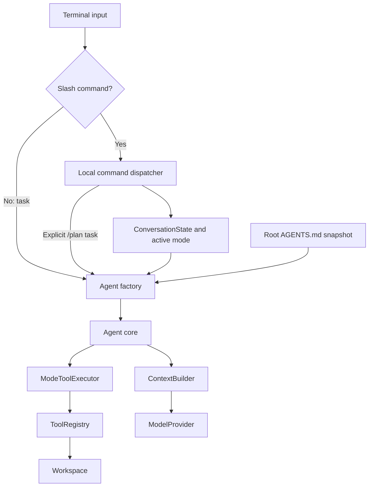
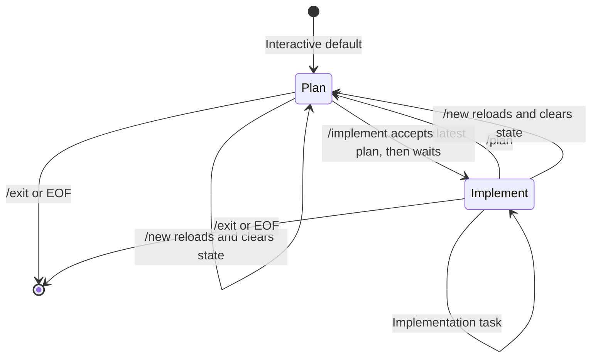

# Interactive terminal, modes, and project instructions

Since version 0.4 the agent supports a shared in-memory conversation, Tab-completed commands, enforced
planning permissions, and automatic workspace-root `AGENTS.md` loading. The same
agent core and provider adapters serve both interactive and single-task usage.

## Installation and start

```bash
pip install -e '.[terminal]'
python -m agent.cli --provider demo --allow-write
```

The demo is deterministic, not a planning model. For real tasks choose an installed
Ollama model or install `.[openai,terminal]` and configure `OPENAI_API_KEY`.
The optional terminal uses `prompt-toolkit`; the core and single-task CLI do not
require that package. A missing terminal dependency produces installation guidance.

Without a positional task the CLI starts the terminal in `plan` mode. With a task
it performs one run, defaulting to `implement` for compatibility:

```bash
python -m agent.cli "Explain this project" --provider demo --mode plan
```

`--mode plan|implement` overrides either default. `--allow-write` is a startup
capability: it permits edits only while the active mode is `implement`.
The prompt displays the mode and effective write permission.

## Commands and completion

| Command | Behavior |
| --- | --- |
| `/plan` | Switch to read-only planning without a model call |
| `/plan <task>` | Switch to planning and submit the explicit task |
| `/implement` | Accept the latest successful planning response, switch to implementation, and wait |
| `/instructions` | Display the actual loaded root instruction snapshot and path |
| `/help` | List commands and effective permissions |
| `/new` | Reload root instructions, clear history and plans, return to planning |
| `/exit` | Exit |

Tab completes slash-command names. `/pl` followed by Tab becomes `/plan`;
ambiguous prefixes display completion choices and further Tabs cycle them.
No model call is needed for completion or command handling. `/plan <task>` is the
explicit exception that also submits work. Other commands reject arguments.
Unknown slash commands offer nearby names without forwarding the text to a model.
Single-task CLI arguments are ordinary tasks, not slash-command input.

Example session:

```text
[plan | read-only | tests:off] > /plan Add a configuration loader and propose tests
...reviewable plan...
[plan | read-only | tests:off] > /implement
Implementation mode. Waiting for your next task.
[implement | write | tests:off] > Implement the plan, keeping the public API stable
...changes and outstanding verification...
[implement | write | tests:off] > /instructions
...loaded AGENTS.md snapshot...
[implement | write | tests:off] > /new
New conversation. Instructions reloaded; mode is plan.
```

`/implement` does not start execution. Without a proposed plan it simply switches
mode. Without `--allow-write`, it warns that edits are disabled. `/plan` does not
clear an already accepted plan; it remains a reference until replaced by accepting
a newer planning response or cleared by `/new`. The latest successful response
produced in planning mode is treated as the proposed plan; there is no separate
machine-readable plan approval schema. Newer user instructions may revise it.

## Architecture and permission enforcement



`agent/terminal.py` owns input, completion, command parsing, the mode, and session
lifetime. It imports `prompt-toolkit` only when creating a prompt session. The CLI
provides a factory that creates an Agent with the current mode and loaded rules.

`agent/core/policy.py` wraps the tool executor. In `plan` it exposes and executes
only tools explicitly marked `ToolSpec.read_only=True`. Other tools are rejected
even if the model invents a call to their name. Custom tools default to not being
read-only and must opt in deliberately. This flag is trusted adapter metadata,
not an operating-system sandbox.

In `implement`, the wrapper permits the tools registered by the frontend. The
workspace registry still omits `write_file` when `--allow-write` is absent, and
the Workspace checks its write flag independently. Mode instructions describe
the expected output but do not grant capabilities.



## Conversation, context, and accepted plans

`ConversationState` contains completed conversation messages, `latest_plan`, and
`accepted_plan`. It is passed explicitly to `Agent.run(task, state)`. Omitting the
state preserves independent-run behavior. State does not contain runtime system
messages; the Agent constructs those separately using its current mode, project
rules, and accepted plan. Switching modes therefore replaces mode instructions
rather than retaining stale ones from prior turns.

```mermaid
sequenceDiagram
    participant Shell
    participant Agent
    participant State as ConversationState
    participant Model
    Shell->>Agent: run(task, state)
    Agent->>State: Read completed history and accepted plan
    Agent->>Agent: Build local turn and fixed instructions
    loop Model/tool rounds
        Agent->>Model: Budgeted context
        Model-->>Agent: Response or tool calls
        Agent->>Agent: Execute allowed tools and append results locally
    end
    alt Successful final response
        Agent->>State: Commit complete turn; update latest_plan in plan mode
        Agent-->>Shell: RunResult
    else Failure or interruption
        Agent-->>Shell: Error; shared conversation unchanged
    end
```

The `recent` context strategy pins all leading system messages, the original
user task, and the latest user request. Fixed system messages include loaded
project rules and the accepted plan. They count toward the existing approximate
character budget and are never silently truncated.

The newest active-turn tool round must fit completely. Earlier active-turn rounds
are added newest first; if they all fit, older completed user turns are added as
whole units, including their user message and all responses. Selection stops at
the first older unit that does not fit. The resulting projection preserves source
order and complete tool/result groups. The original user task remains even if
its old responses no longer fit. `full` keeps the entire conversation or fails.

Older information can be absent from `recent`; no summaries are generated.
`RunResult.messages` contains the full successful history plus current system
messages; `ConversationState.messages` contains only the conversation messages.
Usage and selection metrics remain available per run.

## AGENTS.md behavior

Only `<workspace>/AGENTS.md` is loaded automatically; nested files are not merged.
The file is read through existing workspace checks with the 100,000-character
UTF-8 limit. Missing files are allowed. Invalid UTF-8, unreadable or oversized
files, directories in place of files, and symlinks outside the workspace fail
before a task reaches the model. The file is a project guideline source, not a
mechanism to override mode restrictions or explicit user requests.

The session keeps a snapshot rather than rereading on every turn. Editing the
file during a session does not silently change its rules. `/instructions` displays
the snapshot, while `/new` reloads it and clears both conversation and plans.
If reloading fails, the current session and mode remain unchanged.
Single-task CLI runs load a fresh snapshot before execution. Direct Python callers
supply `project_instructions` to Agent themselves; the core performs no file I/O.

The repository's existing root `AGENTS.md` is an example. A minimal project file:

```markdown
# Project instructions

- Use Python 3.11 or newer.
- Keep changes limited to the requested task.
- Validate with `python -m unittest discover -s tests -v` when execution is available.
- Never report tests as passing unless they were actually run.
```

## Errors, interruption, and persistence limits

Empty input makes no request. Ctrl+C at the prompt clears the current draft;
Ctrl+C during execution returns to the prompt and reports interruption. EOF exits.
The terminal catches ordinary task errors and remains usable.

Only successful turns enter shared history. A failed or interrupted turn can
already have changed files, and those changes are not rolled back. The terminal
warns about this and does not automatically retry actions. A subsequent task
should inspect the actual workspace before deciding what to repeat. Hard process
termination or a model request continuing on a remote server is not a resumable
session checkpoint.

History, proposed plans, accepted plans, and prompt input history live only in
memory. There is no SQLite store, disk prompt history, restart resume, automatic
plan execution, or automatic execution of arbitrary commands. Version 0.5 adds the explicitly configured
`run_tests` tool; see the [coding workflow guide](coding-workflow.md). Shell redirection or
external terminal recording may still retain output.

## Tests

The suite covers mode permission enforcement, successful multi-turn state,
accepted-plan pinning under context pressure, complete tool groups, root-file
loading failures, command parsing, unknown commands, reset/reload behavior,
interruption recovery, and CLI defaults. A real `prompt-toolkit` prompt is fed
`/pl`, Tab, and Enter to verify completion. That one test skips if the optional
terminal dependency is missing; GitHub Actions installs the terminal extra so it
runs there. No live model credentials are needed.

## Version 0.5: verification capability

`--allow-exec` and `--test-command` enable the local test tool together. The prompt
shows `tests:on/off` separately from file-edit permission. Planning always has
tests off. Process execution has host access and can modify files even when
file-write tools are disabled. `/implement` still switches and waits; it never
starts tests automatically.
