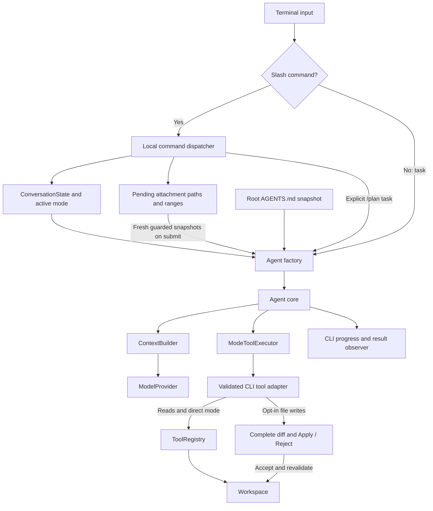
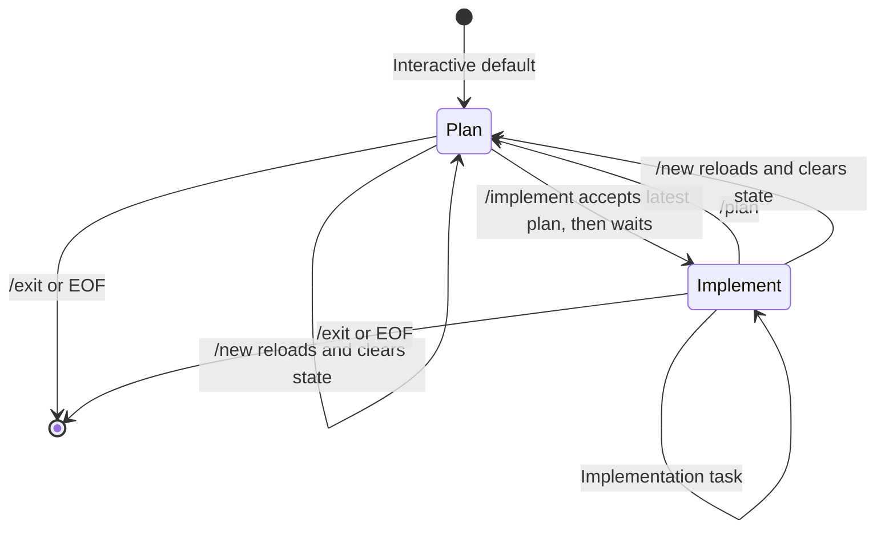
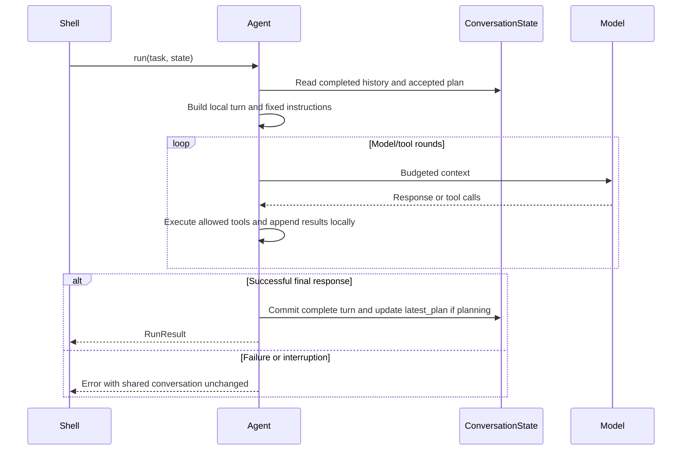

# Interactive terminal, modes, and project instructions

Since version 0.4 the agent supports a shared in-memory conversation, Tab-completed commands, enforced
planning permissions, and automatic workspace-root `AGENTS.md` loading. The same
agent core and provider adapters serve both interactive and single-task usage.
Version 0.10 adds multiline composition, explicit file attachments, readable
progress and summaries, and opt-in per-edit terminal review.

## Installation and start

```bash
pip install -e '.[terminal]'
python -m agent.cli --provider demo --allow-write
```

The demo is deterministic, not a planning model. For real tasks choose an installed
Ollama model or install `.[openai,terminal]` and configure `OPENAI_API_KEY`.
The optional terminal uses `prompt-toolkit`; the core and single-task CLI do not
require that package. A missing terminal dependency produces installation guidance.

Without a positional task the CLI starts the terminal in `plan` mode. With a task
it performs one run, defaulting to `implement` for compatibility:

```bash
python -m agent.cli "Explain this project" --provider demo --mode plan
```

`--mode plan|implement` overrides either default. `--allow-write` is a startup
capability: it permits edits only while the active mode is `implement`.
The prompt displays the mode and effective write permission.

## Commands and completion

| Command | Behavior |
| --- | --- |
| `/plan` | Switch to read-only planning without a model call |
| `/plan <task>` | Switch to planning and submit the explicit task |
| `/implement` | Accept the latest successful planning response, switch to implementation, and wait |
| `/instructions` | Display the actual loaded root instruction snapshot and path |
| `/status` | Display workspace, provider/model, mode/permissions, character budget, review setting and attachment count |
| `/attach "path" [start:end]` | Queue a guarded file or inclusive line range for the next successful task |
| `/attachments` | List pending attachment IDs and ranges locally |
| `/detach <id\|all>` | Remove a queued attachment, or all of them |
| `/help` | List commands and effective permissions |
| `/new` | Reload root instructions, clear history and plans, return to planning |
| `/exit` | Exit |

Tab completes slash-command names. `/pl` followed by Tab becomes `/plan`;
ambiguous prefixes display completion choices and further Tabs cycle them.
No model call is needed for completion or command handling. `/plan <task>` is the
explicit exception that also submits work. Attach/detach accept the arguments
shown above; other commands reject arguments.
Unknown slash commands offer nearby names without forwarding the text to a model.
Single-task CLI arguments are ordinary tasks, not slash-command input.

Enter submits the current task. **Alt+Enter** inserts a newline; bracketed
multiline paste stays editable until Enter. Tab also completes workspace paths
after `/attach`, including quoted names containing spaces. Use `/` separators
for cross-platform completion and quote names containing backslashes or spaces.
Completion excludes protected paths, outside-workspace symlinks and names with
terminal control characters. It is local filesystem work, not an AI request.

### Explicit file attachments

```text
/attach "src/my file.py" 10:35
/attachments
1: src/my file.py [10:35]
Explain this function and the surrounding assumptions
```

Queue at most five attachments totaling 40,000 content characters. Each follows
the [range contract](token-efficiency.md#tool-contract-and-data-flow): at most
200 logical lines and 12,000 content code points, preserving original endings.
Without bounds, the entire file must fit both limits; no excerpt is silently
substituted. Protected, binary, invalid UTF-8, NUL and oversized files are denied.

Queue entries retain paths and ranges, not persisted source content. Every
submission reads fresh snapshots, checks canonical targets and bounds again,
and places path/line/hash metadata and contents in the user request as project
data, not system instructions. File attachments are sent to the selected model
only when you submit a task. A validation failure makes no model call and leaves
the task editable. Successful runs consume the pending queue; failures and
interruptions keep it. `/new` clears pending attachments and the recovery draft.
Attachments from completed turns remain in ordinary in-memory conversation
history and may be selected again by the context builder.

### Progress, summaries and output channels

Interactive TTY runs show plain progress lines for model requests and tool
start/completion. `--no-progress` hides those lines, while final summaries remain.
There is no spinner, color requirement or token streaming. Redirected output
receives no animated UI, and `NO_COLOR` needs no special renderer behavior.

Run summaries show elapsed time, attempted/completed model calls, tool counts,
applied/rejected file-tool changes, and individual check outcomes. Repeated
checks retain each outcome rather than hiding an earlier failure behind a pass.
Unattempted test/lint/security/dependency-audit checks are labeled not run.
Configured fix processes are not counted as individual file-tool edits. Check
results describe their execution, not a guarantee of freshness after later edits.

Provider input, output and cached-input token sums include response coverage;
unknown usage remains unknown and zero is retained. Cached input is a subset of
input, not an additional total or a free-token assumption. Cumulative context
characters are labeled separately and are not a token estimate.

Human output stays on stdout. `--verbose` keeps JSONL metadata on stderr; Unicode
is escaped in JSON without changing decoded event values. Redirect stderr to
capture machine-readable traces independently. Plain model/file text escapes
terminal controls; the trusted input widget still uses normal terminal cursor
controls. Existing single-task invocations without review retain final-answer
output without progress or summaries.
With verbose mode, runtime failures/interruption produce structured `cli_error`
or `cli_interrupted` metadata instead of appending plain error text to the trace.
Argument-parsing/configuration errors before runtime still use argparse's normal
stderr diagnostics and exit code 2.

### Opt-in terminal edit review

```bash
coding-agent --provider ollama --model YOUR_MODEL --allow-write --review-edits
```

`--review-edits` defaults to off and works for interactive and single-task usage.
It requires `--allow-write`, real stdin/stdout terminals and `.[terminal]`.
These requirements are checked before provider clients are created. It cannot
be combined with `--lint-fix-command`. Without the flag, existing direct-edit
behavior remains available.

Each `write_file` or `apply_edit` displays its complete unified diff and waits
for **a/apply** or **r/reject**. Empty input, unrecognized answers and EOF reject;
Ctrl+C rejects the pending change and interrupts the run. No Apply-all option is
added. A `preview_edit` call itself never prompts. Model/file text is rendered
literally, so embedded control sequences cannot turn the diff into terminal commands.

Acceptance rechecks the canonical target, existence and complete original bytes.
Changes outside a previously read excerpt also make an edit stale. Existing
files use same-directory staged atomic replacement and retain permission bits.
New files use atomic no-overwrite hard-link creation; unsupported filesystems
report a tool failure instead of falling back to overwriting a target. New
staged files retain private temporary-file permissions. Rejected/invalid changes
do not create parent directories; accepted changes can leave created directories
if a later filesystem operation fails. Temporary files are cleaned up.

These are optimistic checks, not filesystem locking or OS isolation. A concurrent
change in the interval after final checking can still race a replacement. The
gate covers dedicated file tools, not arbitrary configured verification code,
which continues to run with host permissions and can write files. Planning
continues to reject both write and process tools. Review decisions and source
diffs are not added to verbose metadata logs.

Example session:

```text
[plan | read-only | tests:off] > /plan Add a configuration loader and propose tests
...reviewable plan...
[plan | read-only | tests:off] > /implement
Implementation mode. Waiting for your next task.
[implement | write | tests:off] > Implement the plan, keeping the public API stable
...changes and outstanding verification...
[implement | write | tests:off] > /instructions
...loaded AGENTS.md snapshot...
[implement | write | tests:off] > /new
New conversation. Instructions reloaded; mode is plan.
```

`/implement` does not start execution. Without a proposed plan it simply switches
mode. Without `--allow-write`, it warns that edits are disabled. `/plan` does not
clear an already accepted plan; it remains a reference until replaced by accepting
a newer planning response or cleared by `/new`. The latest successful response
produced in planning mode is treated as the proposed plan; there is no separate
machine-readable plan approval schema. Newer user instructions may revise it.

## Architecture and permission enforcement



`agent/terminal.py` owns input, completion, command parsing, the mode, and session
lifetime. It imports `prompt-toolkit` only when creating a prompt session. The CLI
provides a factory that creates an Agent with the current mode and loaded rules.
The [attachment queue](../agent/adapters/attachments.py),
[presentation observer](../agent/adapters/console.py) and
[review adapter](../agent/adapters/review.py) keep terminal policy and file effects
outside the core. Core `tool_started`/`tool_completed` events provide metadata;
the CLI adapter observes actual results for check and edit summaries. The outer
mode policy blocks disallowed calls before any review or process callback.

`agent/core/policy.py` wraps the tool executor. In `plan` it exposes and executes
only tools explicitly marked `ToolSpec.read_only=True`. Other tools are rejected
even if the model invents a call to their name. Custom tools default to not being
read-only and must opt in deliberately. This flag is trusted adapter metadata,
not an operating-system sandbox.

In `implement`, the wrapper permits the tools registered by the frontend. The
workspace registry still omits `write_file` when `--allow-write` is absent, and
the Workspace checks its write flag independently. Mode instructions describe
the expected output but do not grant capabilities.



## Conversation, context, and accepted plans

`ConversationState` contains completed conversation messages, `latest_plan`, and
`accepted_plan`. It is passed explicitly to `Agent.run(task, state)`. Omitting the
state preserves independent-run behavior. State does not contain runtime system
messages; the Agent constructs those separately using its current mode, project
rules, and accepted plan. Switching modes therefore replaces mode instructions
rather than retaining stale ones from prior turns.



The `recent` context strategy pins all leading system messages, the original
user task, and the latest user request. Fixed system messages include loaded
project rules and the accepted plan. They count toward the existing approximate
character budget and are never silently truncated.

The newest active-turn tool round must fit completely. Earlier active-turn rounds
are added newest first; if they all fit, older completed user turns are added as
whole units, including their user message and all responses. Selection stops at
the first older unit that does not fit. The resulting projection preserves source
order and complete tool/result groups. The original user task remains even if
its old responses no longer fit. `full` keeps the entire conversation or fails.

Older information can be absent from `recent`; no summaries are generated.
`RunResult.messages` contains the full successful history plus current system
messages; `ConversationState.messages` contains only the conversation messages.
Usage and selection metrics remain available per run.

## AGENTS.md behavior

Only `<workspace>/AGENTS.md` is loaded automatically; nested files are not merged.
The file is read through existing workspace checks with the 100,000-character
UTF-8 limit. Missing files are allowed. Invalid UTF-8, unreadable or oversized
files, directories in place of files, and symlinks outside the workspace fail
before a task reaches the model. The file is a project guideline source, not a
mechanism to override mode restrictions or explicit user requests.

The session keeps a snapshot rather than rereading on every turn. Editing the
file during a session does not silently change its rules. `/instructions` displays
the snapshot, while `/new` reloads it and clears both conversation and plans.
If reloading fails, the current session and mode remain unchanged.
Single-task CLI runs load a fresh snapshot before execution. Direct Python callers
supply `project_instructions` to Agent themselves; the core performs no file I/O.

The repository's existing root `AGENTS.md` is an example. A minimal project file:

```markdown
# Project instructions

- Use Python 3.11 or newer.
- Keep changes limited to the requested task.
- Validate with `python -m unittest discover -s tests -v` when execution is available.
- Never report tests as passing unless they were actually run.
```

## Errors, interruption, and persistence limits

Empty input makes no request. Ctrl+C at the prompt clears the current draft;
Ctrl+C during execution returns to the prompt and reports interruption. EOF exits.
The terminal catches ordinary task errors and remains usable.
After task failure/interruption, the original task is restored as an editable
draft, and pending attachments remain. No automatic retry is performed. Provider
errors use controlled guidance rather than printing raw SDK exceptions or request
bodies. Attachment validation errors identify the local correction needed.

Only successful turns enter shared history. A failed or interrupted turn can
already have changed files, and those changes are not rolled back. The terminal
warns about this and does not automatically retry actions. A subsequent task
should inspect the actual workspace before deciding what to repeat. Hard process
termination or a model request continuing on a remote server is not a resumable
session checkpoint.

History, proposed plans, accepted plans, and prompt input history live only in
memory. Usage metadata alone is stored in SQLite; see [profiles and reports](providers-and-usage.md). There is no disk prompt history, restart resume, automatic
plan execution, or automatic execution of arbitrary commands. Version 0.5 adds the explicitly configured
`run_tests` tool; see the [coding workflow guide](coding-workflow.md). Shell redirection or
external terminal recording may still retain output.

## Tests

The suite covers mode permission enforcement, successful multi-turn state,
accepted-plan pinning under context pressure, complete tool groups, root-file
loading failures, command parsing, unknown commands, reset/reload behavior,
interruption recovery, and CLI defaults. A real `prompt-toolkit` prompt is fed
`/pl`, Tab, and Enter to verify completion. That one test skips if the optional
terminal dependency is missing; GitHub Actions installs the terminal extra so it
runs there. Additional real-input tests cover Alt+Enter, bracketed paste and
quoted path completion. Attachment limits/freshness/recovery, complete diff
approval/rejection, concurrent changes, no-overwrite creation, output channel
separation and token coverage have regression tests. These new prompt tests
require the terminal extra. No live model credentials are needed.
The extension CI matrix also runs the CLI workflow regression file on Linux,
Windows and macOS with the terminal extra installed.

A real PTY smoke used a scripted provider, an attached file, an accepted edit and
an actual configured check. It verified the changed disk contents, queue
consumption and a separately captured valid JSONL trace. This validates the CLI
workflow, not live-provider quality or every terminal emulator.

## Version 0.5: verification capability

`--allow-exec` and `--test-command` enable the local test tool together. The prompt
shows `tests:on/off` separately from file-edit permission. Planning always has
tests off. Process execution has host access and can modify files even when
file-write tools are disabled. `/implement` still switches and waits; it never
starts tests automatically.

## Version 0.6: separate lint status

The prompt also shows `lint:on/off` and `fixes:on/off`. Execution can be configured
for tests, lint, or both. Planning mode blocks every verification process.
See [Tests and linting](testing-and-linting.md) for independent command setup and
opt-in fixes. Slash commands and explicit plan acceptance are unchanged.


## Security profiles (v0.7)

Separate `run_security` and `run_dependency_audit` tools reuse the bounded command
runner and require explicit commands plus `--allow-exec`. Planning blocks both.
The prompt adds effective `security:on/off` and `audit:on/off` indicators.
See [Security checks](security-checks.md) for setup, CI, results and limitations.

## Connecting and usage reports (0.11)

`/connect` manages named profiles for existing providers, with hidden keys in the
OS keychain. `/connect NAME` selects one and starts a fresh Plan conversation;
`/providers` lists metadata only. Failed/cancelled setup keeps the current state.
`/stats` reports the conversation; `/stats today|week|month|7d|30d|all` and custom
`--from DATE --to DATE` support provider/profile/model/interface/category filters.
`/new` changes the usage conversation UUID without deleting historical records.
Standalone `--connect`, `--profile NAME` and `--stats [period]` are also available.
Read [the full contract, storage locations and diagrams](providers-and-usage.md).
