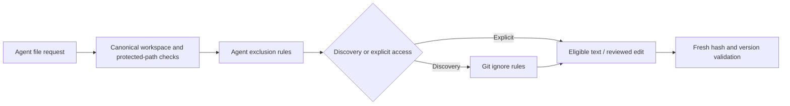
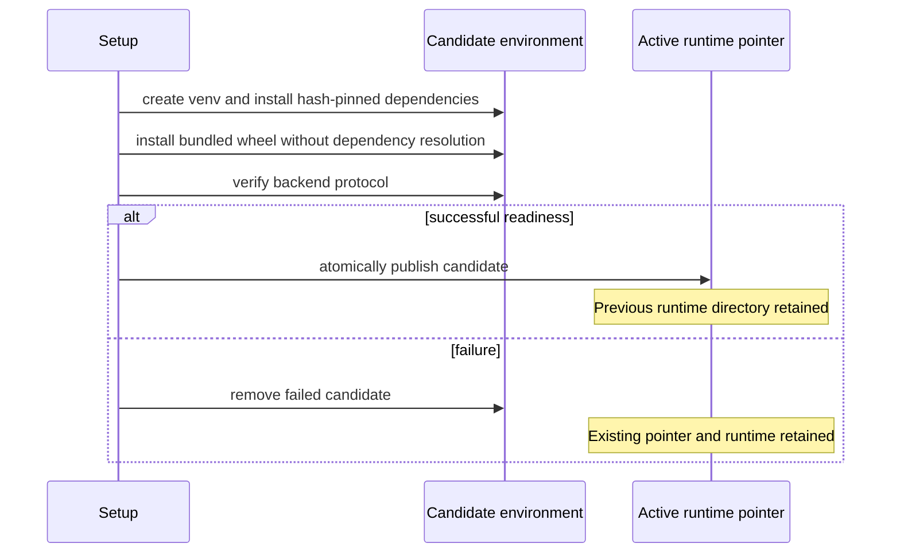

# Production baseline and internal release procedure

Backend **0.12.0**, extension **0.4.0**, protocol **2**, Python **3.11–3.14**.
This is an **internal release candidate** for a supervised team working on trusted
projects. Automated checks establish specific implementation properties; they
do not establish live-model coding accuracy, universal vault compatibility, or
safe execution of untrusted projects. [The release checklist](../release/checklist.json)
records the remaining manual gates explicitly.

## What to keep, simplify and defer

| Capability | Production role |
| --- | --- |
| Plan/Implement and individual edit review | Core workflow and permission boundary |
| Focused reads, hashes and provider-neutral adapters | Keep; useful for retrieval cost and edit correctness |
| Tests, lint and security tools | Keep separate, with host-owned freshness evidence |
| Provider profiles and usage reports | Keep; configuration and operational visibility |
| Demo | Setup diagnostic; no evidence about model quality |
| Inline completions | Optional; remain off by default |
| Lint fixer | Explicit opt-in; configured host commands can bypass individual file review |
| Multi-agent orchestration, vector retrieval and response caches | Defer until controlled measurements justify their complexity |

## Safe defaults and exclusions

`--allow-write` now enables terminal diff review by default. Entering Plan still
blocks writes and configured processes independently. An explicit one-shot Plan
request does not require a review terminal. Noninteractive automation must pass
`--allow-write --no-review-edits`; absence of a TTY never silently enables direct
writes. `--review-edits` remains supported. The dedicated lint fixer requires
the explicit review opt-out because host processes do not use the file review gate.

Both reviewed and direct file replacements stage bytes and use atomic replacement
with optimistic checks on path and previous content. New files use no-overwrite
creation. Review is not a filesystem lock: another process can still race the
final checks. Configured commands retain the OS user's permissions and can write
outside the project. This release adds no container sandbox.

`.gitignore` rules, including nested rules, affect list/search discovery. An
explicit file read can access a Git-ignored file. Root `.agentignore` uses the
same Git-style patterns but denies reads, attachments, snapshots and edits as
well. Pattern matching is case-sensitive consistently across hosts; protected
credential names are case-insensitive. A denied parent cannot be reopened by directly naming a child. The policy
is reloaded as files change; malformed, oversized or symlinked policy files fail
closed. Protected credential paths apply before configurable rules, including
`.env*`, `.git`, `.ssh`, `.aws`, `.azure`, `.config`, private-key names and common
certificate/key extensions. `.agentignore` itself is protected from agent edits.
Users can edit it manually. These rules are shared through Python/editor golden
tests and apply to dirty editor buffers and inline/selection context guards too.



## Verification evidence and its limits

`CheckEvidence` records a check profile, status, input fingerprint and configuration
fingerprint. `VerifiedTools` surrounds actual configured check execution; the
model cannot create a passing record by saying tests passed. `RunResult` and
structured events expose the resulting evidence. CLI summaries and the sidebar
display it separately from assistant text.

| Status | Meaning |
| --- | --- |
| passed | Check succeeded and observed input/configuration fingerprints agree |
| failed | Check execution returned failure |
| stale | Inputs/configuration changed, or a known later edit invalidated the result |
| not run | No check ran, or permission/save was declined |
| unknown | The fingerprint could not be established reliably |

Fingerprints cover nonexcluded workspace files, contents, modes and ignore policy
contents. Reads are bounded to 10,000 entries and 64 MiB; uncertainty, symlinks,
unsupported files or observation errors produce unknown. Generated/build/virtual
environment directories are excluded. A check that changes observed inputs is
stale even if it exits successfully. Editor document/filesystem events and
configuration changes conservatively invalidate visible evidence; unsaved buffer
changes cannot preserve a passing badge. New conversations, resume and worker
initialization reset evidence. Failed tasks also emit available evidence.

This is an observed-input contract, not proof that the whole system is correct.
Excluded files, external services, installed tools, environment variables and
unobserved concurrent changes can affect checks. A clean security scan does not
prove OWASP compliance. Evidence is never restored as fresh from a snapshot.

## Requests, cancellation and bounded usage storage

Normal providers default to 120-second I/O timeouts and 4,096 output tokens.
Configure CLI `--request-timeout` / `--max-output-tokens`, or editor
`genericAgent.requestTimeout` / `genericAgent.maxOutputTokens`. Provider SDK
retries are disabled. Completion defaults remain five seconds and 256 tokens.
Providers identify output truncation; incomplete responses cannot execute tools
or commit a completed turn. Reported usage is still recorded before rejection.
Ollama responses are capped at 4 MiB.

RPC defaults are 15 seconds for metadata/initialization, seven seconds for a
completion request, and 30 minutes for an agent run including human review time.
Editor callbacks have a ten-minute deadline. An expired frontend request closes
its backend worker. Network I/O timeouts are not an exact wall-clock/billing cap
on remote work, and cancellation cannot retract a provider request. Accepted
edits remain after cancellation. No failed task, check or edit is automatically
replayed; inspect the workspace before retrying.

Durable finalized usage rows are released from worker memory. Up to 5,000 active
or failed-write records remain per journal. Overflow warns and marks history
incomplete; the reporting worker also limits merged volatile snapshots. This
bounds the memory used by usage accounting, not all conversation history.
Counts remain provider-reported, nullable and distinct from billing estimates.

Usage is never automatically pruned. Explicit examples:

```bash
coding-agent --stats all --stats-export usage.json
coding-agent --stats all --stats-prune-before 2026-01-01
```

Export refuses overwriting an existing file. Pruning removes finalized rows
whose start precedes the chosen host-local calendar date; pending attempts are
preserved. CLI/editor workers sharing the state directory see the same history.

## Opt-in recovery

```bash
coding-agent --provider ollama --model MODEL --persist-session
```

Enable editor user setting `genericAgent.persistSession` for the same behavior.
It is a machine-scoped setting, default off; project settings cannot silently
opt users into storing source. The setting/flag explicitly describes retention
of completed prompts and source excerpts. Snapshots do not save API-key
configuration, but conversation text itself may contain sensitive material.
Filesystem permissions do not encrypt these files or protect them from another
process running as the same user.

Snapshots live in `sessions/` under the existing host-local state directory,
separately from metadata-only `usage.sqlite3`. Each versioned JSON file includes
conversation UUID, workspace identity, provider/profile/model references, last
successful completed history, plan references, update time and input fingerprint.
Temporary-file replacement preserves the previous snapshot on failed writes;
failure warns without undoing accepted edits. Snapshots have an 8 MiB limit.
Concurrent saves of the same resumed conversation use last-writer-wins replacement;
use separate conversations for concurrent work.

Use `/sessions`, `/resume ID`, `/session-delete ID`, or editor **Resume Saved
Conversation** / **Delete Saved Conversation**. The list contains metadata only.
Resume validates completed history and workspace identity, reloads instructions,
clears plan acceptance, attachments, permissions and verification, and starts in
Plan. It reports changed/unknown workspace fingerprints. It retains the current
provider configuration and warns when saved references differ; no keys are read
from the snapshot. No tool call is replayed and no editor buffer is overwritten.

Snapshots inactive for 30 days expire when saved-session management is used.
Unknown schemas and corrupt files are preserved with a warning. Wrong-workspace
snapshots cannot be resumed/deleted through that workspace. Deleting the active
CLI snapshot disables its autosave until New or another resume; in the editor a
fresh conversation UUID prevents recreating the deleted record. Usage is retained.
Disabling recovery stops new saves but does not silently delete earlier files.

## Diagnostics

```bash
coding-agent doctor
coding-agent doctor --test-command 'python -m unittest'
coding-agent doctor --export diagnostics.json
coding-agent doctor --test-connection PROFILE
```

**Diagnose Setup** and **Export Redacted Diagnostics** provide editor equivalents.
Reports allowlist version/platform/protocol, profile-schema validity, storage
probe results, keychain-backend availability and check-executable availability.
They omit source, prompts, keys, endpoints, argv and raw exception bodies. A
backend being detected does not prove that its vault is unlocked for access.

Ordinary diagnosis performs no model/endpoint request. Explicit CLI connection
testing makes an authenticated GET to the provider's model-list endpoint with a
ten-second timeout, no redirect and no inference. A successful model listing does
not prove tool-calling support or coding accuracy. Export uses no-overwrite private
file creation; users choose where to share it.

## Repeatable setup and internal artifacts

Runtime locks pin versions and allowed wheel SHA-256 hashes. Base/OpenAI profiles
are bundled with the VSIX; the CLI profile includes terminal/keychain dependencies.
The inventory records versions, upstream sources, licenses as reported by PyPI,
and allowed wheel hashes. Cross-platform dependency unions can install libraries
unused on a particular host; the chosen backend still follows OS selection.
Maintainers refresh locks explicitly with `tools/lock_runtime.py`, review the
diff, run advisory audits and test the OS/interpreter matrix. Do not refresh them
implicitly during a user installation. The build uses a prepared setuptools
environment with build isolation disabled; release CI installs the reviewed lock.
Source builds must first install `vscode/backend/runtime-base.txt` with
`pip install --require-hashes --only-binary=:all: -r`; extension CI does the same.

The editor verifies the wheel and lock manifests, creates a separate candidate
environment, installs locked binary dependencies with `--require-hashes`, installs
the local wheel without dependency resolution, and verifies protocol readiness.
It atomically publishes a versioned runtime pointer only afterward. Failed setup
removes the candidate and preserves the working runtime and marker. A setup lock
prevents overlapping installs; after a crash remove a stale `backend-setup.lock`
only when other setup processes have stopped. Older runtime directories are kept
for rollback and can be removed manually once no worker uses them.



Install a matching wheel/VSIX, then run **Set Up / Update Backend**. Usage schema 1
and provider configuration schema 1 remain compatible with 0.11.0; neither is
rewritten on upgrade. Protocol 1 workers are rejected explicitly. For rollback,
reinstall the previous VSIX and select its previously prepared backend. Keep
snapshots/data backups on the same host; stop workers before copying SQLite and
its WAL/SHM files. Recovery is off by default after upgrade.

`python tools/release_manifest.py` assembles VSIX, wheel, dependency inventory,
locks, changelog, this guide and the manual checklist under `release/artifacts/`.
`manifest.json` and `SHA256SUMS` make integrity review possible. The manually
triggered **Internal release candidate** workflow uploads these artifacts without
publishing a GitHub Release, Marketplace extension or PyPI package. Access follows
repository/Actions permissions; this public repository is not a confidential
internal distribution service. No new open-source license is granted.

## Release gates and evidence

CI exercises core tests, lint/security/dependency audits, native editor scenarios,
and hash-locked installs on Linux/Windows/macOS at Python 3.11 and 3.14. Golden
exclusion tests establish shared behavior; fault tests cover stale evidence,
partial output, failed replacement, corrupt/expired recovery, RPC deadlines,
interrupted setup and bounded persistence failure. These establish the tested
properties, not blanket correctness.

Before changing classification from release-candidate, record real smoke-test
results for native OpenAI, installed Ollama and an actual compatible endpoint,
plus each supported OS's unlocked keychain. Record exact model/runtime versions,
tool-calling success, timeout/failure behavior and usage coverage. Test representative
bug-fix, cross-file and test-repair tasks with independent assertions and publish
the pass rate; do not substitute scripted demo results for live accuracy.

Those manual gates remain **pending** in this environment. Artifact assembly
preserves their status and never claims production readiness automatically.
Relevant decisions: [ADR-0021](adr/0021-production-evidence-and-safety.md),
[ADR-0022](adr/0022-opt-in-recovery.md), and [ADR-0023](adr/0023-locked-internal-releases.md).
