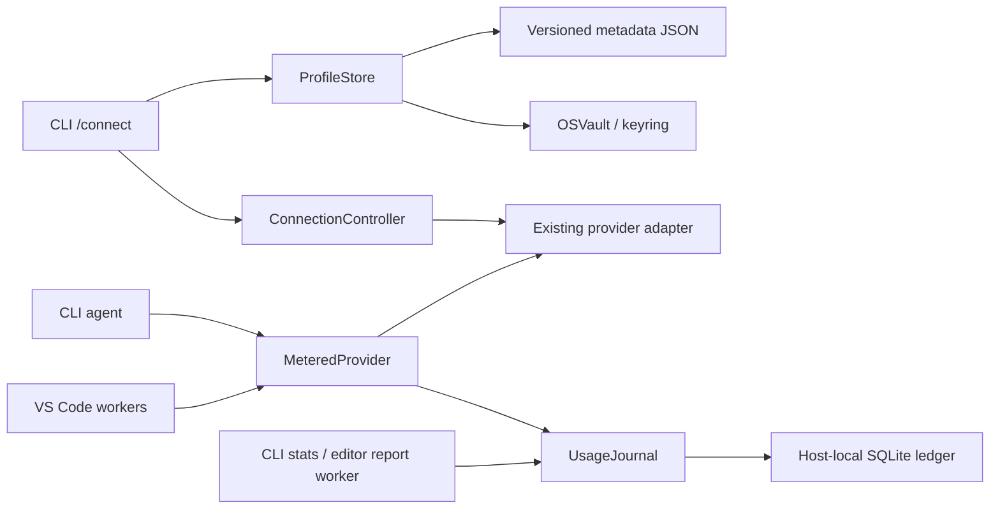
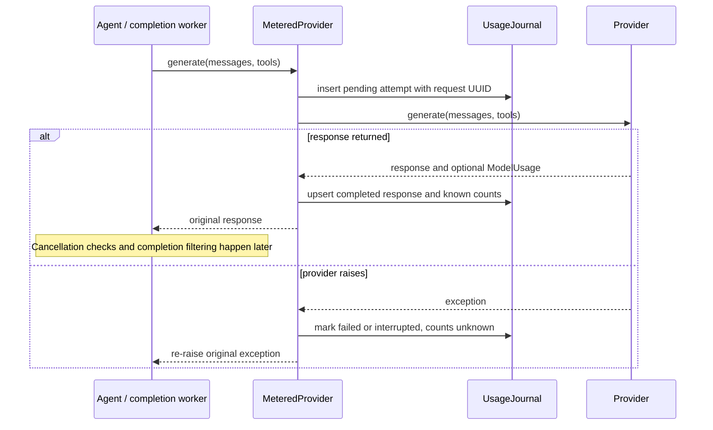

# Provider profiles and recorded token usage

Introduced in backend **0.11.0** and extension **0.3.0**; current **0.12.0 / 0.4.0** adds [hardening and recovery](production-readiness.md). Provider configuration
and usage reports are local operations: neither implicitly sends a model request.
The agent remains independent of ChatGPT and supports the existing OpenAI,
Ollama and OpenAI-compatible adapters.

## CLI quick start

```bash
pip install -e '.[terminal,connections,openai]'
coding-agent --connect
coding-agent --profile work
```

The wizard offers **select**, **add**, **edit**, and **remove**. Add asks for a
profile name, provider, model, optional endpoint, hidden API key and whether to
use this profile by default. Use `ollama` for a local server with no API key;
install/start Ollama and download the model separately. OpenAI and compatible
profiles require their existing optional SDK dependency, installed above.
Client construction checks local configuration; it does not verify credentials
against a remote server. Setup can succeed while the endpoint is unavailable.

Inside the terminal:

```text
/connect
/connect work
/providers
/stats
/stats today
/stats week --interface vscode
/stats month --provider openai --model gpt-4.1
/stats 7d --kind completion
/stats --from 2026-10-01 --to 2026-10-21
/stats all --profile work
```

Tab completes the command names. `/providers` lists names, providers, models and
the default marker without reading keys. `/connect NAME` selects a saved profile
and asks whether to make it the default. A successful selection starts a fresh
conversation in Plan, clears queued attachments and the draft, and reloads root
instructions. Existing usage remains in history. Failed or cancelled setup
keeps the active connection and conversation. Removing the currently active
profile is rejected; select another profile first.

`--connect` configures and exits, with no inference. `--profile NAME` selects one
complete profile: it cannot be combined with explicit provider/model/endpoint/
key-environment overrides. Without explicit provider flags or `AGENT_PROVIDER` /
`AGENT_MODEL`, the saved default applies. Existing environment-variable and
provider flags still work without a keychain. An unconfigured interactive shell
can open so that `/connect`, `/providers`, `/stats` and `/exit` are available.

Historical reports work without a valid workspace, API key, optional SDK or
initialized provider:

```bash
coding-agent --stats                 # today
coding-agent --stats 30d
coding-agent --stats all --interface cli --provider ollama
coding-agent --stats custom --from 2026-10-01 --to 2026-10-21
```

Standalone `--stats session` cannot infer a previous conversation. Use `/stats`
inside that conversation, or choose a historical period. Filters are exact
matches and combine with AND. Provider/profile/model flags filter reports only
when explicitly supplied. The `ad-hoc` profile labels legacy CLI configuration;
`editor` labels VS Code configuration. Demo calls can appear with unknown usage;
they perform no paid inference. The demo completion path makes no model call.

## Credentials and profile storage

`ProfileStore` stores versioned metadata in `providers.json`: profile name,
provider, model, endpoint, opaque credential reference, default name and revision.
API keys use the `ai-coding-agent` service in the operating system keychain.
`OSVault` accepts the supported Windows Credential Manager, macOS Keychain,
Secret Service and KWallet backend classes supplied by `keyring`; generic
plaintext backends and missing/locked vaults produce a controlled error. There
is no plaintext fallback. Headless Linux may require a running, unlocked desktop
secret service. Ollama profiles do not require keyring.

Hidden prompts use a separate `DummyHistory` and no key default. Keys are passed
directly into the provider adapter, without rewriting global environment
variables. Endpoints reject userinfo, query strings and fragments; metadata
files are still private configuration, since they contain profile/model names
and endpoint addresses. No claim is made that a malicious process running as the
same OS user cannot access that user's credentials.

Writes use an exclusive lock, revision check and temporary-file replacement.
A conflicting process must retry. Keys rotate on edits. If metadata saving
fails, the newly created key is removed; old-key cleanup failure is reported.
The file and keychain are separate resources, so process death between their
updates can leave an orphaned key. Use OS vault tools to remove old entries.
Remove a stale `providers.lock` only after other agent processes have stopped.

## Storage locations and execution hosts

| Host | Configuration directory | Usage directory |
| --- | --- | --- |
| Linux | `$XDG_CONFIG_HOME/ai-coding-agent` or `~/.config/ai-coding-agent` | `$XDG_STATE_HOME/ai-coding-agent` or `~/.local/state/ai-coding-agent` |
| macOS | `~/Library/Application Support/ai-coding-agent` | same directory |
| Windows | `%APPDATA%/ai-coding-agent` | `%LOCALAPPDATA%/ai-coding-agent` |

`AGENT_CONFIG_DIR` and `AGENT_STATE_DIR` accept absolute directory overrides;
each override is used directly. Usage is stored in `usage.sqlite3`. CLI processes
and VS Code backend workers with the same host/user/state directory share it.
SSH, WSL and containers have their own execution-host storage. This is not
cross-device synchronization. Windows uses the user's inherited ACLs; POSIX
directories/files are created with private permissions where supported.

## Component responsibilities and call lifecycle



`ConnectionController` owns an active immutable configuration and lazily creates
its provider. The wizard constructs a candidate before saving and activating it;
no existing session is discarded on ordinary validation/SDK failure.
`MeteredProvider` implements the model port by composition. The core remains
unaware of profiles, keychains, SQLite and frontends. `UsageJournal` owns
parameterized persistence, filtering, grouped aggregation and volatile snapshots.
`UsageSession` represents a conversation, independent of worker lifetime or run.



Each row contains a request UUID (primary key), conversation UUID, run UUID,
UTC start/finish timestamps, status, response flag, provider/profile/model,
interface (`cli`/`vscode`), category (`agent`/`completion`) and nullable input,
output and cached-input counts. Indexes cover start time and conversation.
An upsert updates the same request, so repeated finalization does not insert
another attempt. WAL and short transactions allow independent workers; a
250 ms busy timeout bounds each storage operation. Schema version 1 uses
`PRAGMA user_version`; unknown versions are preserved and reported as unavailable.
Read-only reports neither create a database nor migrate one.

Only metadata is stored. Prompts, messages, source, tool arguments, exception
bodies, keys and raw endpoints never enter the ledger. Labels are supplied by
the host, not inferred from messages. This is durable usage accounting, not
conversation persistence, a response cache, or a verification ledger.
Legacy model labels longer than 256 characters are shortened with a stable hash
suffix so accounting does not prevent inference; saved profiles reject such names.

## Interpreting totals and time windows

For a token field with known values on K of R returned responses, the report
shows `reported_sum = sum(known values)` and coverage `K/R`. If K is zero the sum
is `unknown`; a reported zero stays zero. Missing output does not invalidate a
known input count. Cached input is a separate provider field and may already be
included in input tokens; it must not be added again. Different model tokenizers
make cross-model sums an operational overview rather than an equivalent-work
measure. No currency estimate or tokenizer-based estimate is generated.

Attempts, returned responses, unfinished, failed and interrupted calls appear
separately. A process killed after inserting an attempt leaves an unfinished
row. A timed-out provider may still bill work without returning usage. SDK
internal HTTP retries are inside one `generate` attempt; their hidden usage
cannot be reconstructed. This ledger therefore does not replace provider billing.

`session` means one conversation. CLI `/new`, editor **New**, and successful
profile/provider changes allocate a new UUID; worker replacement keeps the UUID.
One-shot CLI tasks allocate a fresh UUID. CLI and editor conversations remain
distinct even when they share historical storage. Reports assign each call to
the time of its start, including requests that finish across a date boundary.

Calendar boundaries use the **execution host's local timezone**: today starts at
midnight, week on Monday, month on its first day. `7d` and `30d` are rolling 168 /
720 hour windows. Custom `YYYY-MM-DD` dates include both chosen calendar dates,
implemented as start-inclusive / next-midnight-exclusive. DST days can contain
23 or 25 hours. Presets end at query time; custom end dates can be in the future.
Reports show the host timezone and UTC boundaries. Changing the host timezone
changes calendar grouping without changing stored UTC timestamps.

## VS Code and recovery

Use **Coding Agent: Show Token Usage**, or Refresh usage in the sidebar. Choose
a period, custom dates, provider/profile/model, interface and category. Refresh
applies filters. The independent report worker uses read-only `usage/query`
before model initialization; reports remain available while an agent is busy
and require no model credentials. A configured backend and trusted filesystem
workspace are required. Both agent and completion workers receive the same
conversation UUID; completion-specific model labels are retained.

The editor keeps **Configure Provider** and VS Code SecretStorage. CLI keychain
profiles are not silently imported into editor settings or vice versa. Changing
provider/model/endpoint starts a new Plan conversation; ordinary budget changes
retain the conversation identity.

Storage errors warn once per journal and retain process-local call metadata.
Coding continues. Queries merge failed writes with disk rows by request UUID,
replacing stale pending rows rather than counting them twice. The editor asks
live workers for `usage/pending` metadata and overlays those snapshots in its
read-only report worker; overlays are validated and never written to SQLite.
Report requests have deadlines and generation checks reject stale UI results.
If a worker is unavailable, the report is marked incomplete. Memory-only records
are lost when their worker exits; there is no silent claim of a complete history.

There is no automatic retention cleanup or cloud upload. To reset history, stop
all CLI/editor workers and remove `usage.sqlite3` and its `-wal`/`-shm` companions
from the state directory. This does not remove profiles or OS-keychain entries.
Stop workers before copying these files for backup as well.

## Evidence and limits

[Python regressions](../tests/test_connections_usage.py) exercise profile
validation/rotation/rollback, fake supported and plaintext keychains, session
boundaries, incomplete usage, duplicate updates, concurrent journals, read-only
queries, unknown schemas, failed writes, volatile deduplication and DST windows.
The [real stdio test](../vscode/test/rpc.test.cjs) exercises queries before
initialization and while busy. Editor/webview tests cover stale results,
filters, text-only rendering and worker snapshots; native tests exercise command
registration and credential-free reporting in VS Code.

Actual unlocked OS vaults and live provider endpoints require host-specific
smoke tests. Their availability and billing reconciliation are not established
by mocks. The ledger itself adds no model calls and does not reduce prompt size.
Use it to measure token consumption, then evaluate context changes with controlled
tasks as described in [token efficiency](token-efficiency.md).

Decisions: [ADR-0019](adr/0019-provider-profiles-and-keychains.md) and
[ADR-0020](adr/0020-host-local-usage-ledger.md).

Since 0.12, durable finalized rows leave memory and failed-write buffering is capped.
Use explicit `--stats-export` and `--stats-prune-before` for storage management;
usage history has no automatic expiry. Recovery snapshots remain separate from
this metadata-only ledger. See [production storage behavior](production-readiness.md).
