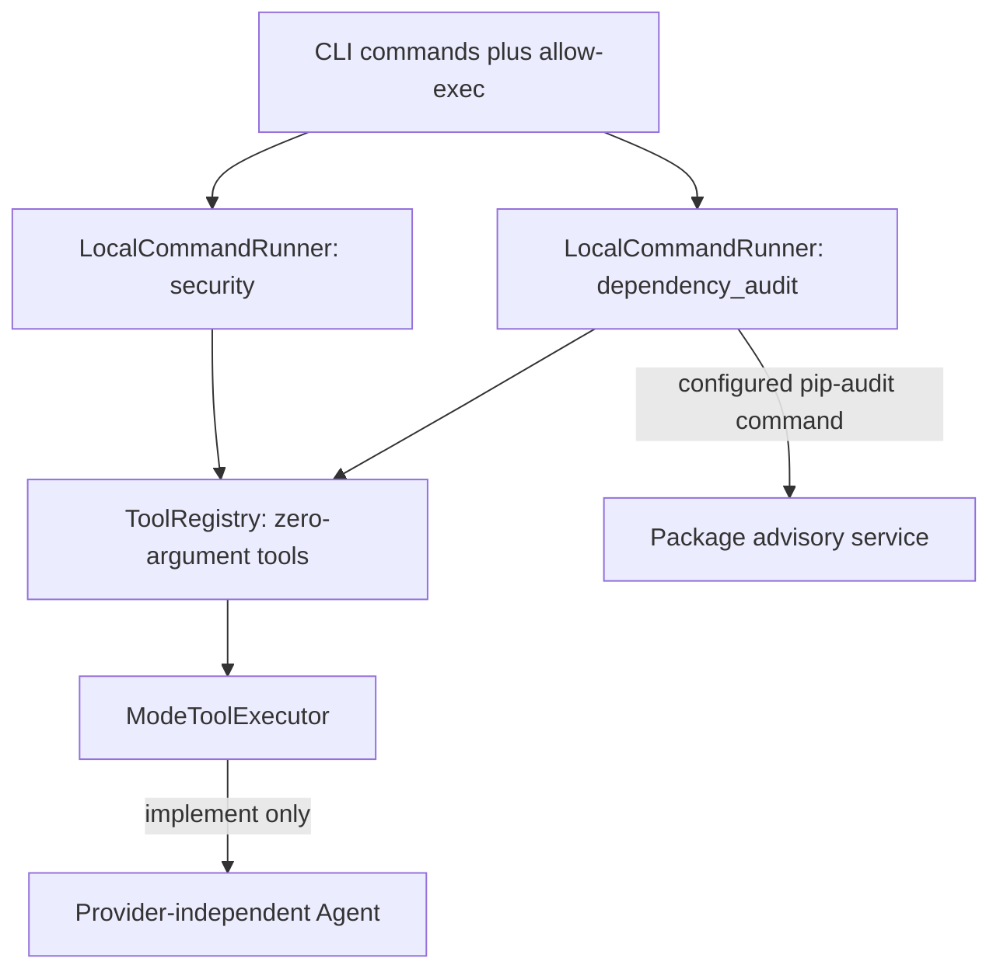

# Security checks (v0.7)

Static analysis and dependency auditing complement tests and linting. Bandit finds
suspicious Python patterns; pip-audit compares installed package versions with
published vulnerability advisories. Neither proves that an application is secure.
OWASP Top 10 is a risk framework, not a scanner or certification provided here.

## Installation and use

Use a dedicated virtual environment for each project, then install the checks:

```bash
python -m pip install --upgrade pip setuptools
python -m pip install -e '.[openai,terminal,dev,security]'
python -m bandit -r agent
python -m pip_audit --skip-editable
```

Enable either profile independently, or both alongside tests and lint:

```bash
coding-agent --provider ollama --model MODEL --allow-exec \
  --security-command 'python -m bandit -r agent' \
  --dependency-audit-command 'python -m pip_audit --skip-editable' \
  --security-timeout 60 --dependency-audit-timeout 120
```

The terminal starts in `plan`. Use `/implement`, then submit a task requesting
checks. `security:on` and `audit:on` indicate the effective capabilities. For a
single task, implementation mode is the default. The demo provider only lists
files and does not run these checks automatically.

The model receives `run_security {}` and `run_dependency_audit {}` only when the
corresponding command was configured. Both require `--allow-exec`; configuring a
command without permission, or permission without any command, fails at startup.
They do not require `--allow-write`. Neither is available in planning mode, and
invented tool calls are denied by the same policy. Root AGENTS.md instructions
cannot override these restrictions. Tool arguments cannot replace commands,
paths, scanner settings or advisory sources.

## Components and execution flow



`agent/cli.py` validates permission and builds separate runners. The registry
registers each configured capability with `read_only=False`, so planning policy
blocks process execution even though the default scanners normally only read
source files or package metadata. No provider adapter or model protocol change is
needed. `LocalCommandRunner` provides the same workspace directory, argument-list
execution (`shell=False`), process cleanup and capture limits as tests and lint.
There is no implicit scan on every edit; the agent can call a configured tool
when the task warrants it. CI runs checks independently of model decisions.

| CLI setting | Default | Purpose |
| --- | --- | --- |
| `--security-timeout` | 60 seconds | Static scanner process deadline |
| `--dependency-audit-timeout` | 120 seconds | Audit process deadline, including network time |
| `--security-output-bytes` | 65,536 bytes | Static scanner output retained |
| `--dependency-audit-output-bytes` | 65,536 bytes | Audit output retained |

Each result contains `check` (`security` or `dependency_audit`), `passed`,
`exit_code`, combined stdout/stderr, elapsed time, `timed_out`,
`output_truncated`, `capture_complete`, and `capture_error` (null on successful
capture). A pass requires exit zero, no timeout, and successful output capture.
A reader failure stops a running command and returns `passed=False` even if
the process has already exited zero; partial output remains available. Registry-level startup failures, including a missing executable,
return `ToolResult(ok=False)` with the error, rather than a successful scan.
A nonzero exit can mean findings, configuration problems, or network failure;
inspect output before interpreting it. This adapter does not normalize
scanner-specific findings into a common vulnerability schema. Truncated output
may require a direct scanner run for investigation.

Report tests, lint, security and dependency results separately. Missing scans are
not run. A successful scan applies to the scanned code and installed versions at
that moment; edits or dependency changes require another check. The prompt
requests this behavior; no persistent verification ledger enforces freshness.
There is no security-fix tool, automatic dependency upgrade, or automatic advisory
suppression. Correct a finding deliberately, review the diff, then rerun relevant
scans and tests.

## CI and audit coverage

The workflow has separate test/lint, Bandit, and dependency-audit jobs, using
Python 3.11 and read-only repository permissions. An audit service outage fails
the audit job without preventing the other jobs from reporting their outcomes.
Bandit scans `agent/` at all default severity levels; tests containing intentional
attack examples are outside its target. CI audits a fresh environment with the
OpenAI, terminal, development and security extras installed, including transitive
and tooling packages. pip and setuptools are updated before this audit. The editable local
project is skipped because it is not a published distribution; its installed
dependencies are still audited. No vulnerability identifiers are ignored.

pip-audit normally accesses PyPI's advisory service and sends package names and
versions. It does not upload source code as part of that lookup. Advisory service
availability and newly published findings can change results. For a restricted
host, configure its approved network access and a writable cache, for example
`python -m pip_audit --skip-editable --cache-dir /tmp/project-audit-cache`.
The configured Python interpreter must be the project's environment: running an
audit from another environment audits that environment, not the target project.
No lockfile is generated; CI audits the versions resolved at install time, not
all versions permitted by the dependency ranges.

## Findings addressed and reviewed exceptions

The first Bandit run found an unrestricted Ollama URL scheme. Ollama now validates
HTTP(S) URLs without credentials, query or fragment, and rejects redirects before
a follow-up request. Local and private endpoints remain supported because users
explicitly select their model server. This is not an SSRF boundary for untrusted
endpoint configuration; the endpoint and host remain trusted inputs.

Three narrowly scoped inline exceptions remain in `agent/adapters/execution.py`:

| Rule | Location | Reason and compensating control |
| --- | --- | --- |
| B404 | subprocess import | This adapter intentionally runs explicitly configured host commands. |
| B603 | subprocess.Popen | Fixed configured argv, `shell=False`, no model-supplied arguments, explicit execution permission and planning denial. |
| B603 | Windows taskkill | Fixed OS utility path under trusted SystemRoot, numeric child PID, fixed flags, bounded cleanup time. |

The Windows cleanup utility no longer resolves through workspace/PATH. There are
no repository-wide Bandit rule exclusions. Review each exception when changing
command construction. Tests cover argument replacement attempts, instruction
attempts to bypass planning, absent profiles, independent failures, missing
executables, timeout/capture limits, URL validation and redirect rejection.

## Limits and next steps

These checks help address insecure coding patterns and vulnerable dependencies.
They do not cover every OWASP risk: authorization, business logic, runtime
configuration and model/tool behavior still need design review and targeted tests.
Secrets scanning, container/image scanning, web DAST, a dependency lockfile and
incremental type checking are separate future additions.

Configured commands run with host permissions and inherited environment; they
are not sandboxed. `--allow-write` gates dedicated edit tools, but cannot prevent
a user-configured scanner command from writing files. Only configure trusted
non-fixing commands. Tools may import project modules or load plugins; use an
isolated host/container when executing untrusted repositories. OS isolation is
not implemented by this change.
