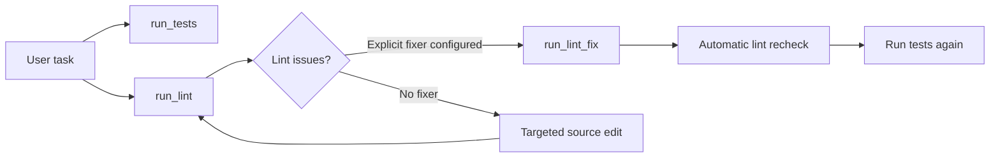
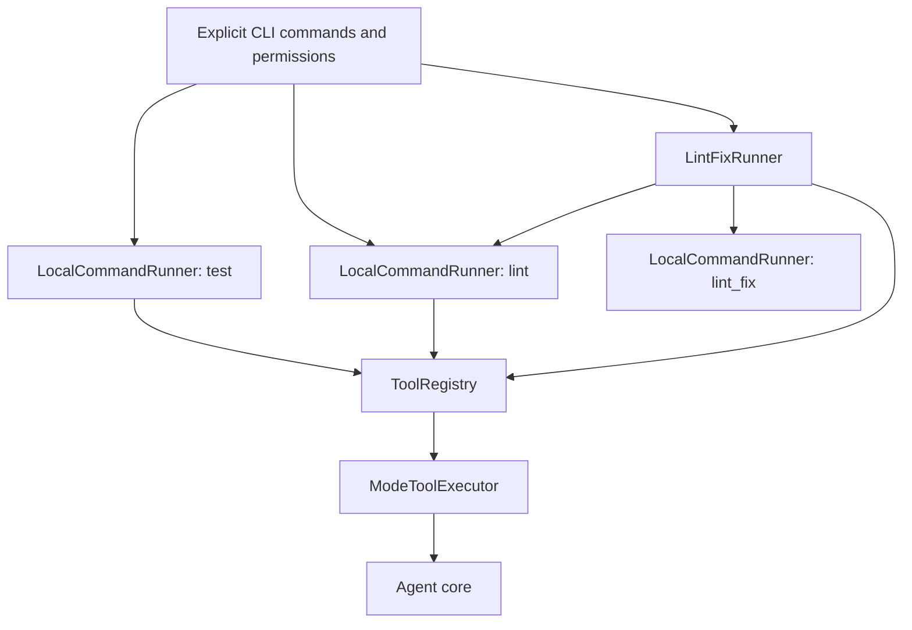

# Separate tests, lint checks, and opt-in fixes

Version 0.6 supports separate verification commands in the same session. Tests
and lint checks report independent results. Optional lint fixes run only when
explicitly configured and file-write permission is enabled.

## Install project development tools

```bash
pip install -e '.[dev,terminal]'
python -m ruff check .
python -m unittest discover -s tests -v
```

The optional `dev` extra supplies Ruff for this repository. The core still needs
no mandatory third-party packages. `pyproject.toml` configures Ruff for Python
3.11 and the E4/E7/E9/F rules. GitHub Actions installs the extras and runs lint
and tests as separate checks. This feature does not automatically install tools
inside another project or expose a package-installation command to the model.

## Configure both checks

```bash
coding-agent --provider ollama --model YOUR_MODEL --allow-write --allow-exec \
  --test-command 'python -m unittest discover -s tests -v' \
  --lint-command 'python -m ruff check .'
```

Native OpenAI and compatible providers use the same verification configuration.
Configure either command alone or both. `--allow-exec` requires at least one
command; commands without execution permission are rejected. Tool arguments
cannot change the configured commands. Commands use shell-like quoting for
argument splitting and execute with `shell=False` from the workspace root.

| Startup configuration | Tool exposed in implementation mode |
| --- | --- |
| `--allow-exec --test-command ...` | `run_tests()` |
| `--allow-exec --lint-command ...` | `run_lint()` |
| Both configurations | Both independent tools |
| Optional fix configuration below | `run_lint_fix()` as well |

Planning mode exposes none of these tools and rejects invented calls to them.
Switch with `/implement`, then ask the agent to run the configured checks.
The prompt shows `tests:on/off`, `lint:on/off`, and `fixes:on/off` separately.
No check starts merely because a mode is switched.

## Optional automatic fixes

```bash
coding-agent --provider ollama --model YOUR_MODEL --allow-write --allow-exec \
  --test-command 'python -m unittest discover -s tests -v' \
  --lint-command 'python -m ruff check .' \
  --lint-fix-command 'python -m ruff check --fix .'
```

A fix command requires `--allow-exec`, `--allow-write`, and a separate
`--lint-command`. `run_lint_fix()` executes the fixer once and then runs the
configured lint check again. It is not triggered automatically by an ordinary
lint failure. The agent can choose it because the user explicitly enabled it.



A nonzero fixer exit remains a failure even if the following lint check passes.
A fixer timeout skips the follow-up lint command. Ctrl+C interrupts the sequence
through the existing process-cleanup path. No fixer retry happens implicitly.
Fixes are not rolled back if either process fails.

The fix result always sets `requires_test_rerun: true`: a lint fix can change
behavior. The model is instructed to rerun available tests afterward or report
them as not run. A passing lint result never substitutes for passing tests.
This is a conservative signal and model instruction, not a persisted workspace-
version verification ledger or a guarantee that every model follows the instruction.

## Results and limits

Ordinary commands return the existing process result plus a `check` label:
`test`, `lint`, or `lint_fix`. Nonzero exits and timeouts are failed `ToolResult`s.
The registry also rejects any attempt to pass model-supplied command arguments.

```json
{
  "check": "lint",
  "passed": false,
  "exit_code": 1,
  "output": "...diagnostics...",
  "elapsed_seconds": 0.05,
  "timed_out": false,
  "output_truncated": false,
  "capture_complete": true
}
```

A fix sequence returns `check`, aggregate `passed`, nested `fix` and `lint`
results, and `requires_test_rerun`. `lint` is null when the fixer times out.
A command-start error, such as a missing executable, becomes a normal tool error;
tools are not installed or substituted automatically.

| Option | Default | Applies to |
| --- | --- | --- |
| `--test-timeout` | 60 seconds | Test command |
| `--test-output-bytes` | 65,536 raw bytes | Test capture |
| `--lint-timeout` | 60 seconds | Each lint or fixer process |
| `--lint-output-bytes` | 65,536 raw bytes | Each lint or fixer capture |

Limits apply separately to each process. A fix-plus-recheck sequence can therefore
use two timeout periods and retain two bounded outputs. Extra output is drained
without retaining it. Process-group cleanup on POSIX and best-effort tree cleanup
on Windows are inherited from the shared runner.

Execution remains local, with the host permissions and environment of the agent.
This is not a sandbox. `--allow-write` gates the dedicated fixer and file-edit
tools, but cannot prevent an arbitrary user-configured test/lint command from
writing files. Configure `--lint-command` as a non-fixing check and reserve the
fixing invocation for `--lint-fix-command`.

## Architecture and compatibility

`LocalCommandRunner` generalizes the existing subprocess implementation.
`LocalTestRunner` remains an alias, preserving earlier integrations and the
evaluation harness. `LintFixRunner` composes two explicitly configured runners.
The registry independently registers test, lint, and fixer tools. The existing
`ModeToolExecutor` rejects all three in planning mode because none are read-only.



No model-port change is required. The evaluator still measures the configured
fixture tests; it does not silently enable repository-specific linting or
compare lint quality across live models.

The automated suite checks independent test/lint outcomes, missing capabilities,
planning denial, fix permission requirements, automatic lint recheck, fixer
failure/timeout, command-argument rejection, CLI setup, and prompt indicators.
A manual smoke check with the installed Ruff additionally verifies an actual
unused-import failure, fix, and clean recheck.


## Security profiles (v0.7)

Separate `run_security` and `run_dependency_audit` tools reuse the bounded command
runner and require explicit commands plus `--allow-exec`. Planning blocks both.
The prompt adds effective `security:on/off` and `audit:on/off` indicators.
See [Security checks](security-checks.md) for setup, CI, results and limitations.
