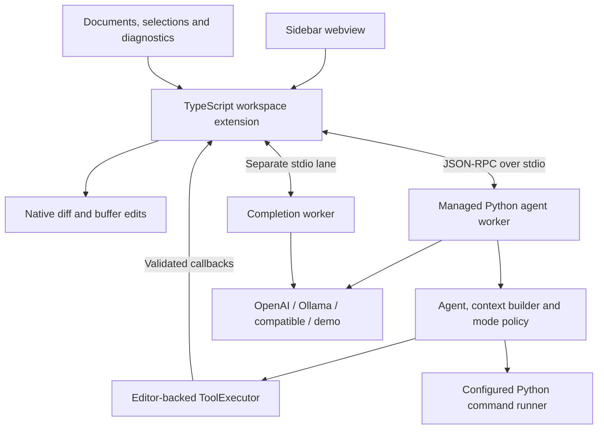
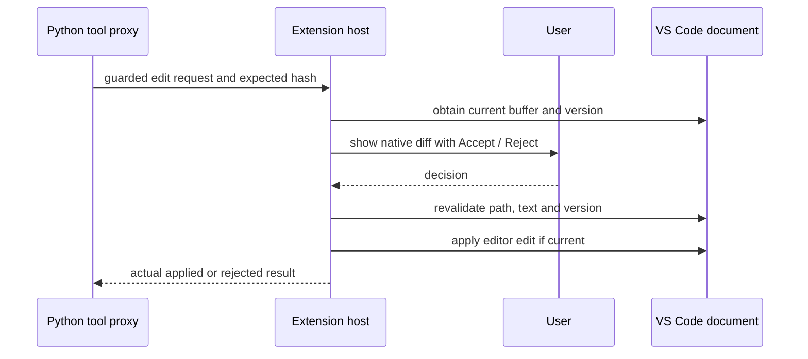

# VS Code extension architecture (v0.1 / backend v0.8)

The extension adds an editor adapter to the generic agent. It preserves the
Python CLI and its file-based behavior. Read the [extension user guide](../vscode/README.md)
for setup, commands and settings. The [component reference](components.md)
describes the existing core; this document specifies the editor-specific changes.

## Components and execution location

`extensionKind: workspace` places the extension host and managed Python environment
beside the workspace: local on desktop, remote for SSH/WSL/containers. There is no
HTTP listener or browser-only backend. VS Code's webview provides presentation;
it does not receive API keys or execute project commands. Runtime configuration
and effects are owned by the extension host, not webview/model-supplied paths.

The managed environment is created only by the setup/update command, using a
selected Python 3.11+ interpreter. The VSIX bundles a wheel and SHA-256 manifest;
the environment marker records that exact wheel and whether provider SDKs were
installed. Setup invalidates the readiness marker before installation. A failed
setup must be corrected before that environment is used. The checksum detects
inconsistent packaged files; it is not a publisher signature or a defense against
an attacker replacing both the wheel and manifest. Install VSIX files from a
trusted source.

## Protocol and session ownership

`python -I -m agent.server` isolates module discovery from the workspace directory.
JSON-RPC 2.0 messages use UTF-8 newline framing, request IDs and a protocol-version
handshake. Frames are bounded to 16 MiB. stdout carries only protocol data. The
server returns controlled error messages rather than raw provider exceptions.
The transport rejects oversized/malformed frames and outstanding requests fail
on disconnection.

| Operation | Purpose |
| --- | --- |
| `initialize` | Protocol 1, workspace, provider settings, budgets, explicit check profiles and optional completed checkpoint |
| `session/run` | Submit task and `plan`/`implement` mode; return text, request metrics and completed checkpoint |
| `session/acceptPlan` | Accept latest successful plan without starting an implementation |
| `session/reset` | Clear the worker's in-memory state |
| `completion/generate` | Bounded prefix/suffix/language request without tools or session history |
| `cancel` | Cancel the token and pending editor requests; report command-cleanup status |
| `editor/tool` | Worker asks extension for a guarded file/search/review operation |
| `editor/instructions` | Retrieve the loaded root instruction snapshot |
| `editor/beforeCheck` | Ask for execution permission and saving dirty buffers |
| `editor/checkResult` | Display the actual individual check result, including not-run outcomes |
| `agent/event` | Progress metadata notifications |

These are internal interfaces, not a network API or an extension API for arbitrary
webviews. Settings/checkpoint objects and protocol messages are validated. API
keys pass only through the trusted extension-to-worker channel and provider
client, never through the sidebar. The extension stores keys in VS Code
SecretStorage, separated by provider and normalized endpoint.

A session belongs to one workspace folder. The sidebar can select among folders,
but a run cannot access another folder. It starts in Plan. `/implement` in the
CLI corresponds to **Accept plan** in the sidebar; both wait for another task.
Root `AGENTS.md` is a validated snapshot, refreshed on New conversation. Reload
validation precedes discarding old state. Nested instructions are not discovered.

The worker and extension keep the last successful checkpoint in memory. Only
completed turns enter it. Cancelling or crashing a worker does not promote its
partial history. A replacement worker can restore that checkpoint while VS Code
remains open. Extension/window restart loses conversations and plans. This is not
SQLite persistence or an event-sourced recovery system.

## Buffer ownership and reviewed edits

The editor ToolExecutor advertises the existing file-tool contracts but does not
invoke the CLI's direct filesystem write handlers. The Python and TypeScript
sides validate workspace containment and protected paths independently. Reads
validate eligible UTF-8 files and return current editor text, including unsaved
changes; snapshots hash that text and include document version metadata.

Every `write_file` or `apply_edit` opens a native before/after diff and creates an
approval request in the sidebar. Reject/cancel returns a tool failure. Accept
revalidates the canonical target, document version and snapshot text before using
VS Code edits. Existing files stay unsaved; native Undo is available. New files
are created through a WorkspaceEdit after review. Preview text is bounded, and
there is no general patch executor.

Planning rejects write/process tools even if the model invents a call. The host
also rejects edit callbacks in Plan. A custom handler must still be classified
correctly. Workspace Trust gates setup, model requests and effects. Application
path checks are not an OS sandbox or a complete secrets detector.

## Verification and cancellation

Checks are executable/argument arrays configured by the user. Only test, lint,
security and dependency-audit profiles are supported in the extension. A
profile/configuration fingerprint receives session permission; changing critical
settings stops workers and invalidates permissions. The backend asks the host
before each check. Dirty workspace documents require an explicit save action;
declining or failing to save yields a not-run report.

The command then uses `LocalCommandRunner`, inheriting the host's working
permissions/environment in the selected workspace. Output/deadline limits and
capture-error semantics match the CLI. Results are separate and include their
actual output. A successful check is evidence for the scanned disk state, not a
freshness guarantee if files change later. An unrestricted lint-fix command is
not exposed: model fixes follow individual review instead.

A cancellation token is checked around model/tool work and before conversation
commit. Command spawn/registration is synchronized with cancellation. The
runner polls the token, terminates its process group/tree and releases its
tracked-process record after termination. The server releases outstanding editor
callbacks and reports whether cleanup completed before the extension replaces a
worker. Late model results do not update the checkpoint. A timed-out/incomplete
cleanup is surfaced rather than authorizing another run silently.

Cancellation is cooperative for active commands and cannot retract a provider
request already received or guarantee termination of deliberately escaped
processes. Already accepted buffer edits remain. The shell/CLI remains compatible:
its new cancellation argument is optional and defaults to an uncancelled token.

## Completions and diagnostics

Completions use a separate worker, no tools and no conversation state. Automatic
requests require workspace opt-in, not merely a repository setting. Manual
requests are available separately. A 500 ms debounce, one in-flight request,
6,000-character prefix/2,000-character suffix limit, 256-output-token setting and
five-second deadline bound ordinary request volume. A changed URI/version/cursor
or cancelled request suppresses stale output. Invalid/fenced/tool-call output is
not presented as a suggestion. Actual completion quality and latency depend on
the configured model; these limits do not establish benchmark performance.

Existing VS Code language extensions remain responsible for diagnostics. Changes
update the sidebar without an AI call. Explain and Propose fix are explicit user
actions. Propose fix selects implementation mode but retains diff review. There
is no extra automatic scanner, replacement language server or background AI audit.

## Packaging, validation and platform limits

The build bundles TypeScript, builds the backend wheel, and creates a VSIX from an
explicit asset allowlist using Python's zip/XML standard libraries. Dependencies,
keys, source trees and test fixtures are excluded. The package is a private local
artifact; no Marketplace publication or license grant is implied. CI produces
installable artifacts after source checks, dependency auditing and native tests.

Automated Python tests cover checkpoint validation, protocol behavior, editor
callbacks, permission denial, sanitized errors, cancellation and output settings.
Node tests cover guarded editing, dirty buffers, review rejection/staleness,
command save/permission gates, bounded completion context and webview HTML
injection. Native Extension Host tests install the VSIX and exercise activation,
editor snapshots, reviewed application, Undo and existing diagnostics. CI runs
current stable VS Code on Linux/Windows/macOS and the 1.95 release family on Linux.
Live model quality is not established by demo tests.

Remote smoke checklist for a real SSH, WSL or Dev Container session:

1. Install the VSIX into that workspace host and verify the extension runs there.
2. Select a Python interpreter on that host and complete managed setup.
3. Run Demo, then configure a reachable real provider and request an explanation.
4. Accept/reject an edit of an unsaved file; verify Undo and disk state.
5. Run a permitted host check, decline saving once, then save and run it.
6. Cancel a long check and inspect the host for surviving tracked descendants.
7. Enable a completion, change document/cursor during a request, and verify stale
   suggestions are discarded.

Desktop native CI is not evidence that every remote configuration, proxy, model
endpoint or container image has passed this checklist. Remote isolation and live
provider smoke tests require those actual environments.

Related records: [ADR-0013](adr/0013-vscode-workspace-extension.md),
[ADR-0014](adr/0014-editor-buffer-ownership.md),
[ADR-0015](adr/0015-cancellable-editor-workers.md),
[ADR-0016](adr/0016-managed-runtime-and-vsix.md).
